# Development log

[Project overview](README.md) · [Simulator](docs/simulator.md) · [Data acquisition](docs/data-acquisition.md) · [Bluetooth brakes](docs/bluetooth-brakes.md)

This log records completed project milestones, their evidence and their limitations. It replaces the development history previously embedded in the README. Entries are newest first; interface screenshots have been refreshed on 22 November 2026 to show the English application. Dated verification reports remain unchanged. Planning work is identified explicitly when it has not been implemented or tested.

## 28 November 2026 · First live brake-lever readings and simpler calibration

**Both assembled Maneta v01 levers are sending real Bluetooth readings to the bench tester.** The original Chrome capture shows the two encoder channels connected, with **MD=1, ML=1, MH=0 and AGC=128** on both. The builder reports that pulling each lever changes its raw angle. The weak-field warning is real: this establishes acquisition and transport, but does not validate magnetic accuracy, full-stroke repeatability or the final mechanical assembly.

| Original live Bluetooth connection | Updated interface in demo mode |
| --- | --- |
| [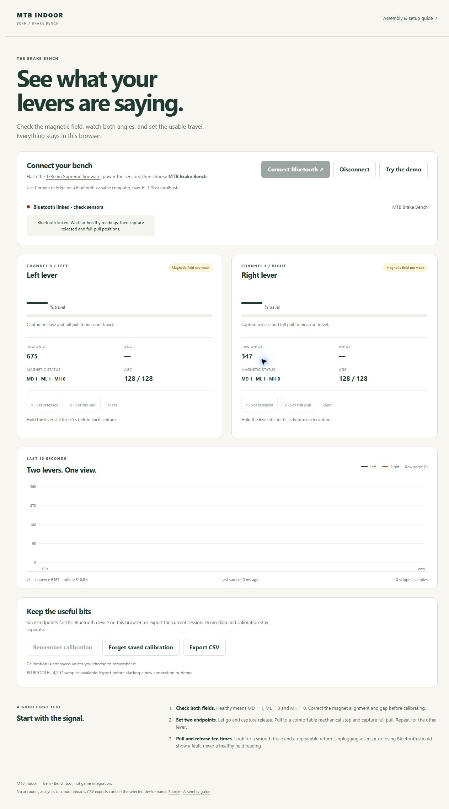](docs/images/brake-bench-first-live.jpg) | [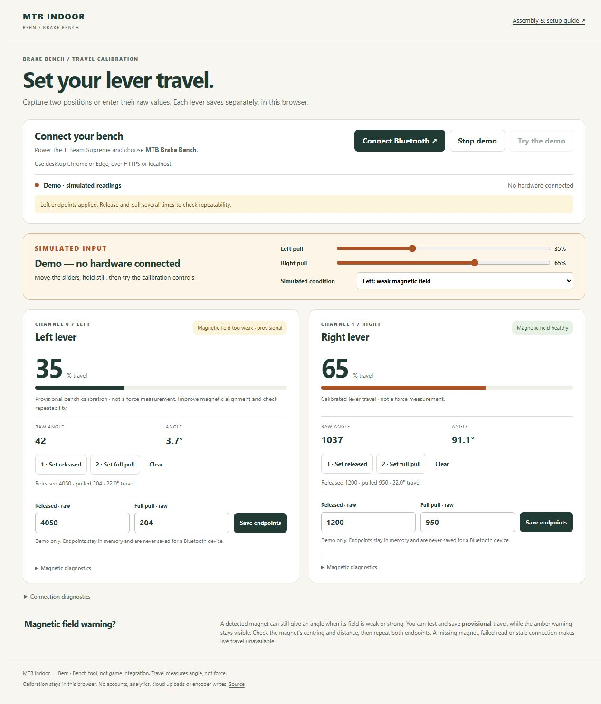](docs/images/brake-bench-calibration.jpg) |

*The left image records real hardware before the interface update. The right image demonstrates the revised software with explicitly simulated data; it is not proof of calibrated physical levers.*

**Calibration no longer disappears behind a weak-field warning.** A detected, readable magnet can show its angle and provisional travel while keeping an amber warning. Stable release/full-pull captures require at least half a second at rest; measured raw endpoints can also be entered manually. Completed endpoints save automatically for the selected Bluetooth device and protocol, and each lever's **Clear** removes its saved configuration. Demo calibration stays in memory. Missing magnets, failed reads, invalid status and stale telemetry still make live values unavailable. Saving endpoints changes travel mapping, not magnetic health.

**The bench now focuses on the two lever cards.** The shared history plot and the “Keep the useful bits” session/CSV section have been removed. Assembly, firmware and protocol guides explain the revised flow, centring the magnet over the chip and adjusting the gap from live diagnostics. The firmware protocol is unchanged; this update does not require reflashing.

**Verified:** all 26 software tests passed. Browser checks exercised weak-field stable capture across the raw-angle wrap (4050 → 204, reaching 100%), opposite-direction manual endpoints (1200 → 950, displaying 50% at the midpoint), stale telemetry blanking both levers, and a missing left magnet leaving the healthy right channel available. The 490 px and 1280 px layouts showed no horizontal overflow, and the inspected browser console had no errors. These interface checks used demo data. A complete physical repeatability test and integration of proportional lever input into the riding simulator remain outstanding.

[Open the bench](https://mfarre.github.io/mtb-indoor-bern/workshop/tester/) · [Calibration guide](docs/workshop/tester/README.md) · [Assembly and hardware](docs/bluetooth-brakes.md#maneta-v01) · [Verification record](docs/verification-brake-bench-2026-11-28.json).

## 28 November 2026 · Estimated calories, saved rides and confirmed shift feedback

**The gear-change click is back when a button actually changes gear.** Audio version 3 keeps seven continuous tyre, wind and braking/scrub sources, plus one short click for a host-confirmed successful shift. Continuous chain/freehub buzz remains absent. Cassette-limit presses, restored gear settings, seeking, resume and repeated snapshots do not replay shift clicks. Historical El Tony and Dentenberg comparison videos retain their original version 1 and version 2 soundtracks.

**EST. KCAL now estimates exercise energy from measured trainer power.** The app integrates mechanical work and divides by 4184 J/kcal and an assumed 24% cycling efficiency. For example, 200 W over 30 minutes is about 359 kcal. This is not a measurement of individual metabolism: pauses, rejected/missing-power intervals and resting energy are not included. Demo and practice watts do not add workout calories or generate activity records.

**Real rides are saved locally and can be exported for Strava.** The Activities panel shows duration, virtual distance, measured work, average power and estimated calories. Periodic checkpoints and lifecycle saves retain real power and available cadence/heart rate, with separate tracks across pauses and data gaps. Local files use atomic replacement and previous-checkpoint backups. Personal recordings remain outside the public repository.

*This screenshot uses synthetic test values to demonstrate the interface. It is not a measured training session and does not show a successful Strava publication.*

Choose **1 · Save TCX**, then **2 · Open Strava ↗**. On Strava, select the file, mark the ride as indoor, review its details and visibility, and save it there. The app opens the fixed upload page without sending the file or requesting account credentials. Automatic OAuth publishing is not implemented. TCX includes UTC timestamps and virtual distance but no invented GPS position or outdoor elevation; the exporter checks Strava's documented 25 MB file limit before replacing a chosen destination.

**Offline verification:** recorder/export tests cover measured-work integration, pauses and gaps, demo exclusion, partial-course starts, timestamp ordering, missing sensor values, atomic checkpoints, recovery from damaged files and rejection of truncated or invalid exports. A failed local save keeps its snapshot available for export even after a course change or ride reset; tests cover retrying storage and older write completions without losing newer data. Synthetic TCX fixtures passed the official Garmin Training Center Database v2 and ActivityExtension v2 schemas.

**Native UI verification:** demo calories remain blank, successful shifts update the gear, and opening Activities pauses the demo. A synthetic 20-minute recording was displayed and exported through the Windows save dialog; cancel leaves the Strava button disabled, successful export enables it, and closing/reopening the panel requires another export. The 1134 px layout and explicit demo resume were checked. No personal workout was uploaded to Strava, and neither successful Strava ingestion nor a new physical-sensor recording is claimed by these tests.

[Calories, recordings and Strava workflow](docs/activities-strava.md) · [Current audio behaviour and checks](tools/ride-audio/README.md) · [Simulator controls](docs/simulator.md).

## 28 November 2026 · Dentenberg autumn woodland and quieter rides

**Dentenberg now has a more detailed autumn forest across its annotated woodland sections.** The existing DJI recording guided pale retained leaves, exposed branches, darker conifer saplings and a narrow worn trail through fallen leaves. Nearby three-dimensional trees use fixed spatial budgets; distant trees remain lightweight. Softer ground margins and less repetitive materials improve the transition into the surrounding imagery. The route, elevation, surface annotations, gearing and KICKR load are unchanged.

[Before still](docs/images/dentenberg-woodland-before.png) · [After still](docs/images/dentenberg-woodland-after.png) · [30-second comparison video](docs/images/dentenberg-woodland-comparison.mp4) · [English in-app demo](docs/images/dentenberg-woodland-in-app.png).

**The chain/freehub buzz and gear-shift clacks have been removed at rider request.** Tyres, wind, braking and corner scrub remain at their previous levels. Repeated gear changes and coasting cannot create drivetrain sound sources. Earlier El Tony media retains its historical soundtrack; the new Dentenberg video uses the quieter current graph.

**Measured and verified:** approximately 30 fps before and after in the 45-second GTX 660 renderer benchmark at 1280×720, with no frames above 66.7 ms. CPU submission p95 changed from 3.7 to 4.9 ms. Public/personal Release builds and self-tests, geometry and forest-boundary invariants, spatial limits, fallback handling, other-course isolation and audio/input regressions passed. Native offline demo renders the new scene without errors. The first short startup check contained a long stalled frame while export was finishing; the separate sustained measurement does not promise hitch-free startup or connected-session performance.

The personal installation is updated with calibration, saved devices, records and private course assets preserved. Raw footage, extracted reference photographs and personal route data remain local; public CC0 material files have source/checksum records. No new physical hardware test was performed.

[Visual changes, references and measurements](docs/dentenberg-visuals.md) · [Verification record](docs/verification-dentenberg-2026-11-28.json) · [Development checks](tools/dentenberg/README.md).

## 28 November 2026 · El Tony woodland, ride sound and focus view

**A 340 m visual pilot now surrounds the El Tony jump on Gurtentrail.** The same route gains compacted-earth materials with separate colour, normal and roughness maps, irregular shoulders, broadleaf crowns, saplings, ferns and dappled shade. Trailnet and TRIEBHAUS photographs guided the appearance; generic Poly Haven materials are CC0. This is a recreation rather than photogrammetry. The existing logo, route elevations, jump shapes, gearing and trainer-load model are retained.

[Watch the 45-second comparison with ride sound](docs/images/el-tony-pilot-comparison.mp4) · [Before still](docs/images/el-tony-pilot-before.png) · [After still](docs/images/el-tony-pilot-after.png).

The comparison follows identical positions and camera timing. It is exported at 12 fps and is separate from the real-time benchmark. Its soundtrack uses the same Web Audio graph as the application, rendered offline against a coasting trajectory and the actual surface metadata. The GIF is silent.

**Ride sound and presentation:** original synthesized tyre textures, wind, coasting freehub, confirmed gear clicks and restrained braking/scrub respond to host snapshots. Sound starts after a user gesture, fades on pause or stale data and cannot pause the ride if audio initialization fails. Focus view keeps watts, speed, heart rate, gear and gradient while folding away larger panels. Volume, stable camera and the 30/60 fps target persist separately from bike calibration. Interpolation resets on seeking and never extrapolates stale motion. Dialogs retain their keyboard controls; brake release remains reliable when focus changes.

| Focus view in demo | Saved preferences |
| --- | --- |
|  |  |

**Measured on this PC:** the GTX 660 delivered approximately 30 fps before and after at 1280×720. The release pilot's frame-interval p95 was 33.4 ms and CPU submission p95 6.2 ms, compared with 33.5 ms and 4.6 ms before. One approximately 150 ms hitch remains in the 45-second pilot run; shader prewarming did not eliminate it. The Eiger control stayed at 30 fps. These are renderer-only measurements, not a connected training-session or 60 fps claim.

**Verified:** public and personal Windows Release builds and full self-tests, including Dentenberg in the private installation; audio, interpolation, settings, mouse and brake-key regressions; local geometry/grade invariants; optional missing-texture and shader-prewarm failure fallbacks; English native UI, gesture sound activation, demo pause/resume and preferences retained across restart. The installed app retains settings, calibration, records and private course assets, with rollback copies. No new physical Bluetooth or trainer test was performed.

[Pilot, sources and detailed performance](docs/el-tony-pilot.md) · [Verification record](docs/verification-el-tony-pilot-2026-11-28.json) · [Reusable capture, audio and benchmark tool](tools/render-comparison/README.md).

## 28 November 2026 · Continuous rides, two Clicks and smoother trainer load

**A lost Zwift Click no longer pauses the ride.** Left and right Clicks now have separate pairing, status and input state, preserving the existing right-side pairing. Right `+` shifts up, left `−` shifts down, and right `B` remains a downshift fallback. Mirrored right-button packets on the left stream are ignored to avoid duplicate actions. Right `A` still controls virtual braking; losing its connection releases its held brake input while keyboard and on-screen braking remain available. Reconnection runs independently of the ride. Loss of trainer telemetry or an interrupted 3D view still pauses and releases load.

**Mouse backup:** a left click on the 3D trail shifts up; a right click shifts down. This works during riding and moving demos. Controls, dialogs, the map, elevation-profile seeking, dragging and modified clicks keep their own behavior. The main screen has a compact four-device status display and a mouse-control hint.

Bluetooth connection and usable input are now distinguished. A Click waits for its first valid button packet; an idle confirmed Click stays confirmed. The controller handshake/keepalive and failed-connection cleanup have been updated. Heart-rate freshness is based on valid pulse measurements, rather than battery or unrelated notifications: missing/stale readings are blank, waiting is explicit, and a stalled stream is retried. A Click reporting a Zwift activation challenge is labelled accordingly; activation through Zwift is not implemented here.

**Gurten load response:** the course is reconstructed from public map and terrain data, not a personal GPX. The trainer now averages elevation rise across 40 m of the actual road path and eases ordinary terrain-driven torque reductions at twice the saved increase rate. Easier shifts, low-cadence assistance and zero targets still reduce load promptly. The rendered route, displayed local slope and avatar physics are unchanged, and existing profiles/calibration results are retained. On adjacent 5 m samples of the Gurten climb, the 95th-percentile grade change drops from **2.00 to 1.25 percentage points**, with the maximum falling from **4.21 to 1.86**. This is load filtering, not a new terrain survey; it can anticipate or delay short slope details by up to 20 m.

**Verified:** public and personal Windows Release builds and full self-tests passed, covering independent Click persistence, subscription recovery state, packet parsing, pulse freshness, calibration, all available routes and the new trainer-load regressions. Mouse-input regression tests and JavaScript syntax checks passed. Native UI checks in an isolated offline copy confirmed the four device cards, left/right mouse shifts, no shifting from paused scene clicks or profile seeking, and demo pause/resume. The local installation was updated after closing the paused session, with settings, calibration, records and private course assets preserved.

*Native screenshot with no sensors connected; it demonstrates the new layout, not hardware connectivity.*

**Still pending:** a physical ride with both Clicks, repeated connection loss/recovery, live heart-rate recovery and a KICKR comparison on Gurten. Previous right-Click and trainer tests do not establish that these new recovery paths work on hardware.

[Connection and controls](docs/simulator.md#first-connection) · [Gurten trainer response](docs/GURTEN.md#trainer-response) · [Load and calibration model](docs/bike-calibration.md) · [Verification results](docs/verification-ride-reliability-2026-11-28.json) · [Mouse regression suite](tools/ride-input/test.mjs).

## 24 November 2026 · Maneta v01 assembly guide and Bluetooth bench

**The brake project now has an [illustrated assembly guide inside its GitHub Markdown document](docs/bluetooth-brakes.md#maneta-v01) and a [browser tester](https://mfarre.github.io/mtb-indoor-bern/workshop/tester/).** The general English guide covers the original Maneta v01 assembly, sensor mounting, return spring, bill of materials and manufacturer references. Mirrored STL files and editable OpenSCAD are available in the repository and as a download. The instructions describe the design independently of any individual build or private assembly discussion. The full instructions sit directly below **Maneta v01**, with native STL/CAD views replacing the conceptual hero in the project overview and brake document. The separate guide website has been retired; its old address redirects to the Markdown document. Only the interactive Bluetooth tester needs a hosted page.

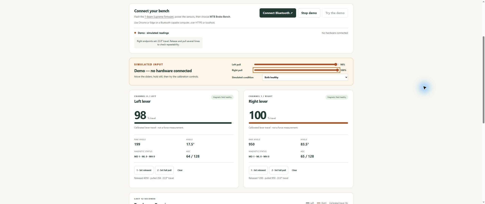

The wiring guide connects two **AS5600 encoders** through separate **TCA9548A channels** to a **LilyGO T-Beam Supreme**. Its V3.1 CNC1 mapping uses regulated 3.3 V, ground, GPIO43 as SDA and GPIO44 as SCL. Connector numbering follows the schematic; cable colours are not a pinout. The guide explains pull-ups, mux addressing, magnetic alignment and diagnostic checks.

The included firmware has pinned PlatformIO dependencies, USB build/upload/boot instructions and a documented 20-byte BLE telemetry format. It advertises **MTB Brake Bench** automatically and sends both raw angles, magnetic status and AGC. The tester supports stable endpoint calibration in either direction, angle wraparound, fault/stale detection, optional per-device local calibration and CSV export. Its clearly labelled demo works without hardware and stays separate from real-device profiles. No encoder OTP settings are programmed.

**Verified:** ESP32-S3 firmware compilation (44,508 bytes RAM; 908,481 bytes flash), native acquisition/protocol failure tests, 13 tester core tests, and desktop browser demo checks covering both calibrations, weak-field and stale faults, recovery and CSV export. A downloaded CSV was checked for 12,000 simulated records and 30 columns. CAD meshes are unchanged from the supplied source; source archives and local documentation links were checked. Browser control ended before compact-layout checks, so those are not claimed.

**Still pending:** physical fit and sensor/Bluetooth measurements on an assembled controller, battery operation, and proportional-brake integration with the simulator. Compilation and demo readings are not hardware validation. Existing Click button braking is unchanged.

[Assembly guide](docs/bluetooth-brakes.md#maneta-v01) · [Printable hardware](hardware/maneta-v01/) · [Firmware](firmware/brake-bench/) · [BLE protocol](docs/brake-protocol.md) · [Verification](docs/verification-brake-workshop-2026-11-24.json).

## 22 November 2026 · Eiger Bike Challenge 20 km, summer and three starts

**A new course around Grindelwald is included in the simulator and public repository.** The organisers' published 20 km GPX measures **19.48 km**, with approximately **874 m of climbing** after smoothing. Its June 2026 route was cross-checked against the official profile map. SWISSIMAGE, mapped woodland/buildings and swisstopo terrain provide the geographic setting, including the actual distant Alpine silhouettes.

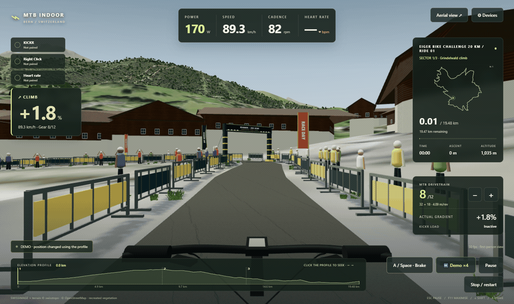

Choose **Whole course** or one of three training starts before riding or entering demo: **Grindelwald climb at km 0**, **Upper traverse & descent at km 8.25**, or **Mühlebach & finish at km 13.03**. Each continues to the finish. The profile marks the boundaries and the route panel shows the current sector. Stop/restart returns to the selected entry point; a running or paused ride cannot teleport between starts. Partial descent starts are timed without record eligibility, and an already-passed stage is hidden.

| Starting-sector selection | Summer Alpine panorama |
| --- | --- |
|  | 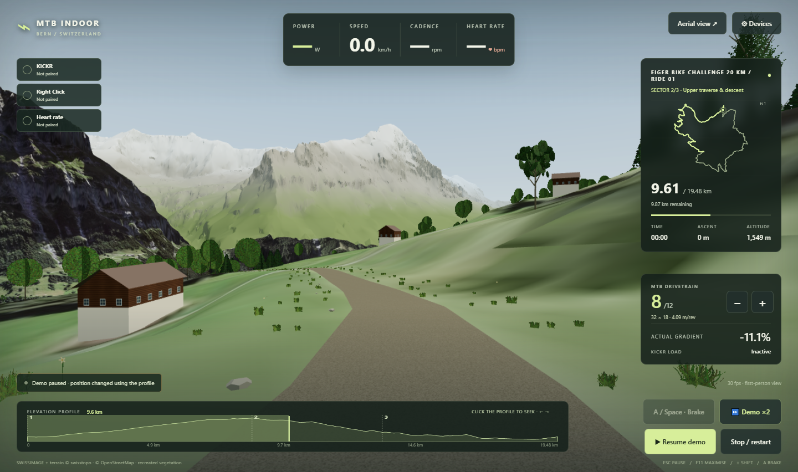 |

Summer scenery adds green meadows, conifers, timber-style chalets, race arches, flags, barriers, spectators and feed tents. Race installations are visual interpretations; source photos are not distributed, and no organiser or sponsor affiliation is claimed. The original road/elevation profile remains the source of graphics, physics and trainer gradient. A hairpin resampling correction removes artificial gradient spikes; clipping the near/far terrain boundary removes visible triangular gaps without moving the course.

**Verified:** public and personal builds/self-tests; 28 native UI checks covering all three starts, fresh counters, stop/reset, pause/resume, profile seeking and teleport guards; partial-timer record protection; six screenshots and a nine-second GIF; normal and compact layouts. Captures reported approximately 30 fps on this PC. The installed app was updated while preserving device/settings files and local Dentenberg assets. No new physical trainer test was performed.

[Course, sectors and sources](docs/EIGER.md) · [Verification](docs/verification-eiger-2026-11-22.json) · [Reusable geographic importer](tools/eiger-import/README.md).

## 22 November 2026 · Gurten in motion and animated brake design

The repository landing page now opens with the existing **Gurtentrail riding GIF**, featuring the El Tony jump and signage, instead of a still screenshot.

The [Bluetooth brake guide](docs/bluetooth-brakes.md) and landing page also show a new **Maneta v01 pull-and-release animation** beneath the earlier concept image. It is rendered directly from the editable STL assembly in Blender: the orange lever rotates around its pivot and the return spring follows its anchors. The rider-side view keeps the trigger pointing outward toward the right grip. The original realistic still and CAD reference remain linked in the [render provenance](docs/brake-v01-render.md).

This is an illustration of the proposed mechanism, not footage of a built brake or a force simulation. The [animation tool and reproduction commands](tools/brake-render/README.md) are included. No simulator behavior, hardware connection or saved setting changed in this milestone.

**Verified:** the 800×512 GIF has 63 frames over 3.15 seconds, with matching first and last resting poses. Visual review checked the resting, intermediate and full-pull positions, including the spring and attached fasteners. All 224 local documentation links resolve.

## 22 November 2026 · English apps and refreshed screenshots

**The simulator and Track Lab now use English throughout their interfaces.** Course selection, ride data, gearing, device pairing, brake and corner warnings, bike setup, guided calibration, video alignment, observations and import/export messages have been translated. Number and date formatting uses English conventions. The guides now use the actual English control names.

| Choose a course | Configure the bike |
| --- | --- |
| 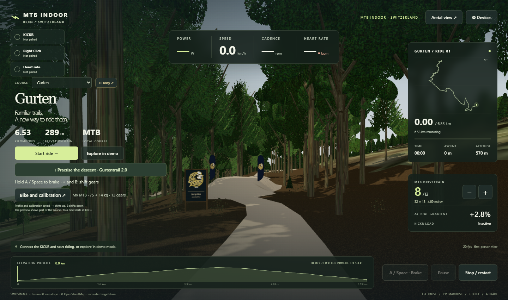 |  |

| Connect devices | Align outdoor recordings |
| --- | --- |
| 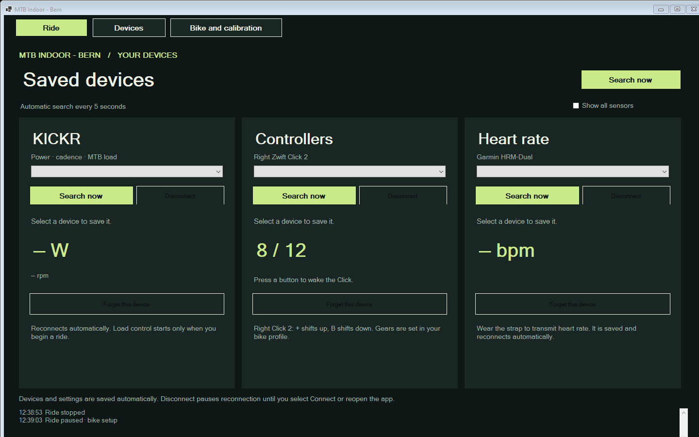 |  |

**Seventeen interface screenshots and three GIFs have been refreshed.** The moving Gurten and Dentenberg captures use the running English application. The before/after renderer comparison keeps its original paired frames and now has English captions; its historical geometry is preserved. Other interface screenshots illustrate the current English app, including those linked from earlier milestones.

Existing settings, device identities, calibration results, course IDs, personal records and annotation schemas remain compatible. Legacy descent names are translated only when displayed, keeping record keys unchanged. User-entered names and recording notes remain as saved; the Track Lab screenshot uses a separate copy with an English session title and timing note.

**Verified:** public and personal simulator builds and self-tests, production Track Lab build and video playback, all **27 calibration UI checks**, normal-size screenshots and compact 1100×772 calibration dialogs. The welcome controls also fit both 1440×852 and 1100×772 views without overlapping the elevation profile. Captures used demo/practice or disconnected hardware; no new physical trainer test is claimed. The local simulator and Track Lab were updated while preserving their settings and records.

[English UI verification](docs/verification-english-ui-2026-11-22.json) · [Simulator controls](docs/simulator.md) · [Track Lab guide](docs/track-lab.md).

## 22 November 2026 · Maneta v01: from mechanical design to realistic render

The [Bluetooth brakes guide](docs/bluetooth-brakes.md) now shows the **actual Maneta v01 design beneath the earlier concept study**. The supplied ZIP contains mirrored STL parts, the OpenSCAD assembly, a two-page PDF and assembly notes. The right-hand meshes were assembled at their original scale and orientation in Blender; ImageGen then added realistic PETG, rubber and metal surfaces using that render as its geometry reference.

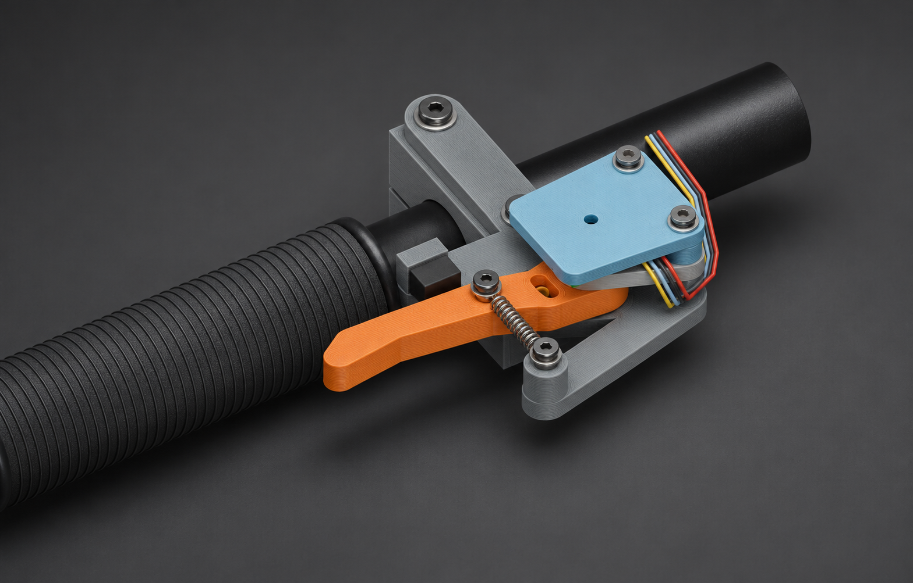

The exposed return spring, rubber stop, sensor cover and two-piece clamp follow the design package. The six printed parts retain their source geometry in the [direct CAD reference](docs/images/bluetooth-brake-v01-cad.png). The rider-side view shows the trigger pointing outward toward the right grip/bar end, with the pivot inboard and a contextual stem on the left. Colours, spring-coil details, fasteners, wire routing and the handlebar/grip/stem are visualization choices. This image documents a proposed prototype, not a completed physical build.

The hardware list now records the proposed **two AS5600 sensors, TCA9548A multiplexer and external LilyGO T-Beam Supreme**, with supplier and technical links. Each sensor measures lever angle. Custom BLE firmware, proportional simulator input and physical validation remain pending; existing Click A-button braking is unchanged.

The [render provenance](docs/brake-v01-render.md) records the source hashes and generation prompt. A [reusable Blender renderer](tools/brake-render/README.md) reproduces the CAD reference from the supplied package. Visual review checked the main shapes, spring, rubber stop, cover hole, clamp and four sensor wires against the source render.

**Verified:** 19 Markdown pages and 209 local file/heading links; published image hashes; concept-before-render order in both pages; and the documented Blender command producing both reference views and its scene file. This milestone changes documentation and adds an offline rendering tool; simulator behavior is unchanged.

## 22 November 2026 · English documentation and three project sections

The repository now has a visual landing page and separate guides for the **[simulator](docs/simulator.md)**, **[data acquisition](docs/data-acquisition.md)** and **[Bluetooth brakes](docs/bluetooth-brakes.md)**. The full milestone history has moved from the README into this development log. User guides, tool READMEs and third-party notices are now in English; the application interface was translated in the English UI milestone above; dated verification reports retain their original recorded values.

The acquisition guide documents the working camera/FIT alignment workflow and links the hardware and manuals. The recording metadata identifies the camera as a **DJI Osmo Action 5 Pro**. The **Wahoo ELEMNT ROAM** is documented without assuming its generation. Additional sensor streams are described as future work, separate from the fields the current decoder imports.

Dedicated Bluetooth brake hardware is being explored in the [shared planning discussion](https://chatgpt.com/share/6b02a20d-5db8-83eb-93a7-cbb479549aaa). The new brake section distinguishes the tested right Click 2 button input from an unimplemented custom lever. Manufacturer references are linked and their status is explicit; the exact prototype bill of materials has not yet been transcribed into the repository.

This image was generated with ImageGen as a **concept study**, not as a photograph or proof of a built device. [Asset and generation prompt](docs/brake-concept-render.md).

This is a documentation milestone. It adds no custom brake firmware, changes no simulator behavior and claims no new hardware tests. Existing captures, verification evidence and their limitations remain linked from the [documentation index](docs/README.md). The older downhill capture harness is now documented as needing a timer-integration update before its deterministic recording procedure is reused.

**Documentation checks:** 17 Markdown pages and 185 local file/heading links checked; all 17 historical screenshot/GIF references retained. Application source and the recorded verification reports are unchanged by this milestone.

## 19 November 2026 · Gurten: from Il Brunello to the Gurtentrail

**New selectable course: Gurten.** The route starts beside Il Brunello in Kehrsatz, climbs via Zimmerwaldstrasse, Talstrasse, Gurtenstrasse and Grünenbodenweg, then descends the Gurtentrail to Wabern. The prepared profile measures **6.53 km with 289 m of ascent**. It is an open route ending at the trail finish; no return leg to the restaurant has been invented.

The route combines the OpenStreetMap road network with the current geometry of Gurtentrail 2.0, rebuilt in 2025. The mapped descent is **2.373 km**, consistent with the operators' description of **2.4 km and roughly 240 m of descent**. A **15 m walking connector** before the entrance is documented as such, without asserting permission to cycle there. The public version includes the route, terrain and **4352×4096 SWISSIMAGE orthophoto**.

| Climbing the Gurten | Route over aerial imagery |
| --- | --- |
|  |  |

Official photographs guided the pale compacted earth, summer woodland and **40 raised trail features and 14 berms**. The **El Tony Jump Line** sign recreates the design documented by TRIEBHAUS; the two flags beside the jump appear in photographs of the July 2025 opening. The **El Tony ↗** button opens a demo directly before this section, without controlling the KICKR.

**Real references, approximate obstacles:** the trail surface and camera share the raised features' elevation, but there is no airborne physics. The position and dimensions of each jump, berm and sign have not been surveyed. The KICKR follows the smoothed geographical gradient, without resistance pulses from artificial jump lips. Reference photographs are retained for research; the trail textures are generated in code.

**Verified:** personal and public builds; physics and demo behavior on all three courses; 28,040 feature samples and 267,117 road samples without overlapping terrain. The aerial view no longer has gaps along the trail edges. Native 1440×852 captures show 30 FPS and the loaded logo; the GIF covers nine seconds of demo travel over the jump. The El Tony button was checked through the interface, without trainer control. [Verification results](docs/verification-gurten-2026-11-19.json).

[Gurten guide, sources and limitations](docs/GURTEN.md) · [Geographical provenance](src/MTBIndoorBern/Scene/courses/gurten/provenance.json) · [Visual feature references](src/MTBIndoorBern/Scene/courses/gurten/features.json).

## 19 November 2026 · MTB profile and guided calibration

**New Bike and calibration section**, accessible from the top navigation and welcome screen. It saves rider and bike weight, wheel circumference, chainring, virtual cassette, gradient scaling and low-cadence assistance. Presets include 10–51, 10–52 and 11–46, with custom sprockets supported; the game and Click respect the selected number of gears.

| Bike profile | Guided response test |
| --- | --- |
|  | 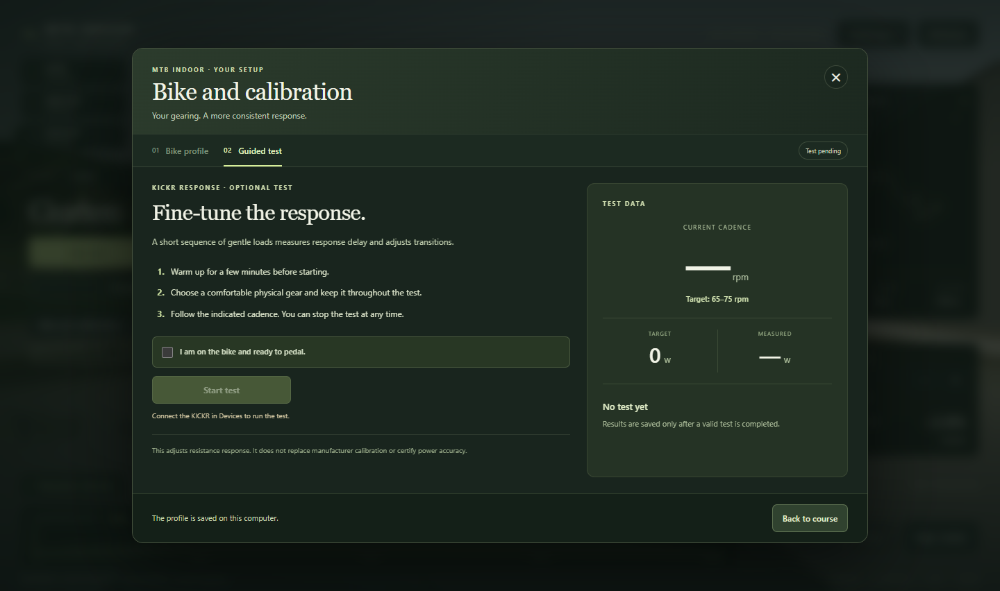 |

Resistance and movement now share the gravity, rolling resistance and aerodynamic model, using total weight and trail surface. Load increases follow a **torque-per-second ramp**, while reductions apply immediately. Measured watts continue to move the rider.

The **optional test, lasting about two minutes**, guides a 70–110 W sequence at two cadences. It only starts applying load after the rider confirms readiness and steady pedaling is detected. It measures response, adjusts transitions and saves the result against the profile and KICKR. It does not correct measured watts or certify power-meter accuracy. The test can be canceled at any time; incomplete tests or tests without valid data are not marked as calibrated.

**Verified:** personal and public builds; tests on the two courses available at this milestone; preservation of old profiles; custom gearing; torque ramp; and the complete protocol with a simulated trainer, including cancellation, stale data, disconnection and control failures. Native 1440×852 screenshots and the compact interface were checked. **The guided test with the physical KICKR still required a pedaling session.** Previous records are retained; the updated physics starts a new version of downhill records.

[Bike, model and calibration guide](docs/bike-calibration.md) · [Milestone verification](docs/verification-calibration-2026-11-19.json).

## 19 November 2026 · Uetliberg course and profile seeking

**Uetliberg and Dentenberg became selectable at startup.** The new GPX route passes through Zurich, Triemli, Uto Kulm and Ringlikon: **25.75 km with 581 m of ascent** after profile smoothing. The selected course is remembered when reopening the app. Dentenberg retains the Al Dente course, settings and previous records.

Uetliberg includes a **4352×5120 SWISSIMAGE © swisstopo orthophoto**, real elevation data, and building footprints and estimated surfaces from OpenStreetMap. Vegetation is recreated. The GPX is a planned route, without a reconnaissance video; map data guides the paths' appearance. The smoothed profile supplies exactly the same elevations to the 3D road and physics. The original GPX has approximately 614 m of ascent before smoothing.

| Demo paused in the forest | Aerial imagery around Uto Kulm |
| --- | --- |
|  |  |

**Explore in demo → Pause → Resume demo** continues from the same point and preserves the ×1–×8 multiplier. Click anywhere on the elevation profile to seek: a paused demo stays paused, and a moving demo keeps moving. With the profile focused, arrow keys move 100 m, Shift + arrow moves 1 km, and Home/End move to the endpoints. Seeking backward also works after reaching the finish. Seeking is demo-only and neither creates records nor activates the KICKR.

The course also includes **Practice the descent · Uetliberg · Ringlikon** (**Practica la baixada · Uetliberg · Ringlikon**), covering **km 11.355–14.565**, with the same braking and line-control rules as Dentenberg.

**Verified:** local and public builds; physics and demo tests on both courses; 140 Uetliberg points without terrain above the rider; and gradient error below 0.00005 percentage points. Checked captures maintain **30 FPS at 1440×852**, with adaptive resolution. The public build works with the included Uetliberg assets and does not require private Dentenberg data.

[Reusable GPX import tools](tools/course-import/README.md) · [Data provenance](src/MTBIndoorBern/Scene/courses/uetliberg/provenance.json) · [Milestone verification](docs/verification-uetliberg-2026-11-19.json).

## 19 November 2026 · Braking and the Dentenberg downhill challenge

**Braking now affects downhill times.** Hold **A on the right Click**, **Space**, or the on-screen brake button to reduce virtual speed. Press and release events for A were validated with the real controller. `+` and `B` retain their MTB shifting functions.

Corner guidance shows direction, distance and a target game speed based on geometry, surface and estimated width. Excess speed causes a skid; sustained excess leads to a runout that stops the virtual bike for **3 seconds** while the timer continues. Braking early avoids this penalty. Braking does not increase the physical KICKR load.

**Braking on the singletrack:** eight seconds of practice mode, captured with the game's actual physics and an automated brake input to make the demonstration reproducible. Trainer control is inactive.

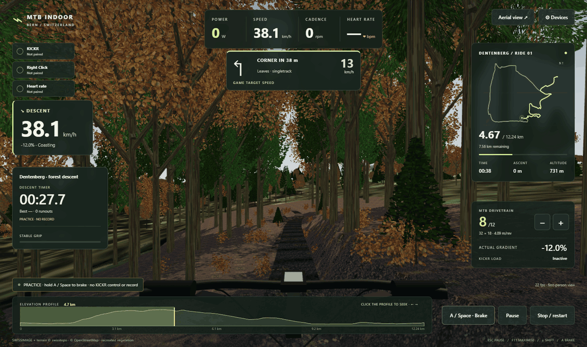

**More visible ride data:** a large gradient indicator when climbing; speed, gradient, braking and grip when descending.

| Climbing gradient | Runout caused by excess speed |
| --- | --- |
| 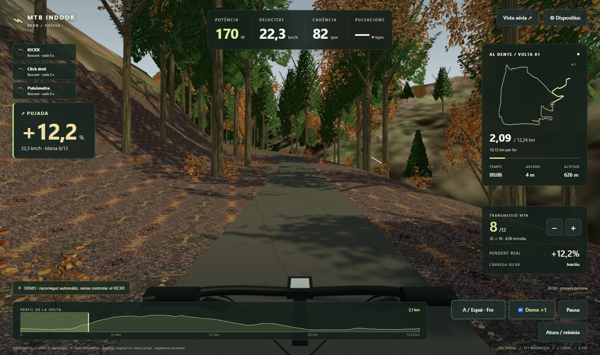 | 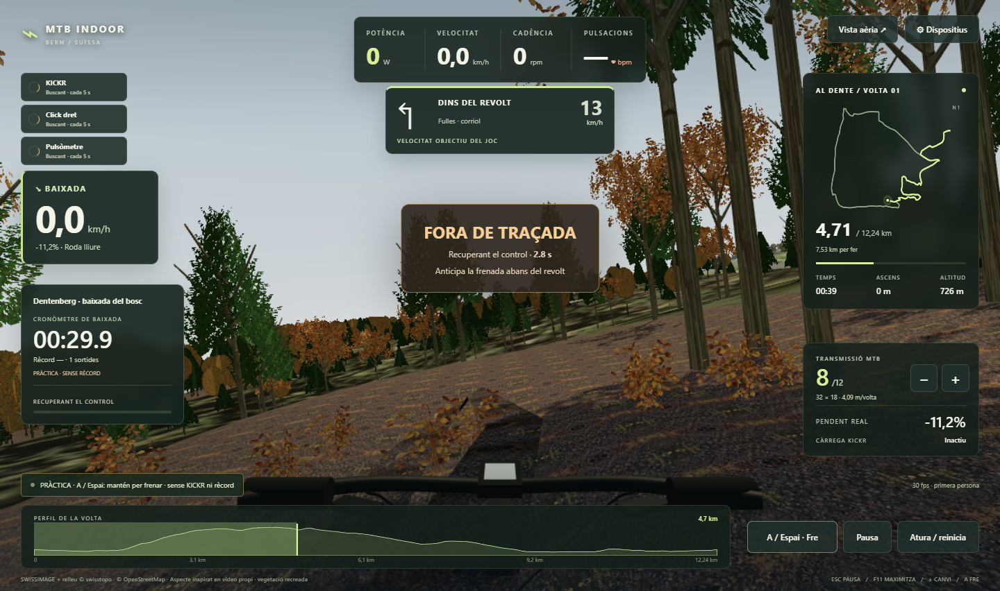 |

**Practice the descent · Dentenberg** starts before the timed section without sensors. The challenge covers **km 4.480–6.980 of Al Dente**, with a start, finish and local personal record. Practice provides automatic propulsion on flatter sections; records are only saved for real sessions that complete the section without pauses. The separate ×1–×8 sightseeing demo remains available.

In the automated descent test including the approach, no braking produces **4 runouts and 384.3 s**; anticipating corners finishes with **0 runouts and 365.1 s**. Braking on a −20% slope, coasting at 0 W, record persistence, and exclusion of paused sessions and demos were also checked. Climb and descent captures maintain **30 FPS at 1440×852** with adaptive resolution.

Overlapping terrain was removed at corners where the recorded track revisits the same path. Original elevations and consistency between displayed gradient and physics are preserved.

[Braking, practice and records guide](docs/downhill.md) · [Reproducible capture tools](tools/downhill/README.md) · [Verification results](docs/verification-downhill-2026-11-19.json).

## 15 November 2026 · Autumn Al Dente and Track Lab

A recording of a real ride was used to revise the course's appearance: asphalt, gravel, narrow leaf-covered singletrack, autumn trees, undergrowth and verges. The local installation uses a ground sample extracted from the video; that asset remains private and the engine has a code-generated fallback texture. Vegetation is recreated with geometry and textures, rather than photogrammetry. The following captures show the local installation.

**Moving comparison · forest singletrack, km 4.30–4.35.** Eight seconds of both versions side by side, with identical position, camera and speed. The GIF compares the previous engine with the new local rendering style.

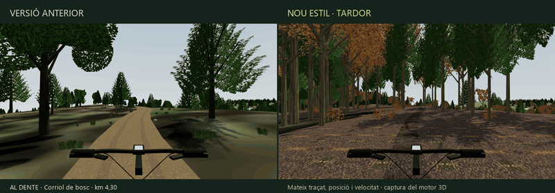

**Accelerated demo:** the **⏩ Demo ×1** button beside Pause cycles **×1 → ×2 → ×4 → ×8 → ×1**. Speed is retained when pausing and resuming; Stop / restart returns to ×1. It changes demo movement only: the timer shows real seconds and trainer control stays inactive. At ×8, the entire circuit can be reviewed in approximately four minutes. All four speeds, pause, resume, finishing and the build with all visual assets were checked.

The [capture and comparison tools](tools/render-comparison/README.md) allow the comparison to be repeated for other versions or sections. [Demo and GIF verification](docs/verification-demo-2026-11-15.json).

**Before and after**, at the same forest section around km 4.37:

| Previous version | New autumn style |
| --- | --- |
| 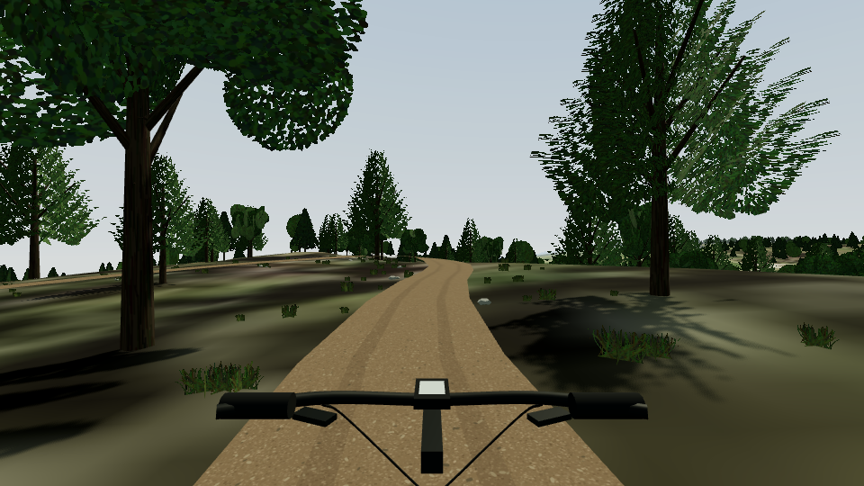 | 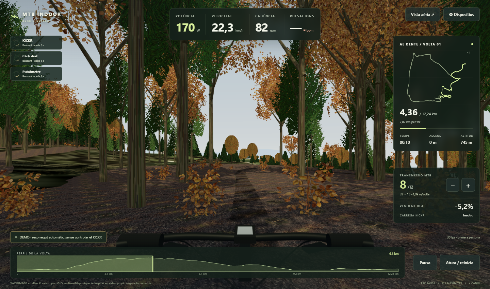 |

Terrain near the road now uses a finer mesh so the verges do not cover the asphalt on steep slopes. The route elevations used by the physics are preserved. Surface, estimated width, forest sections and confidence are defined in `appearance.json`.

**Track Lab** is a new standalone viewer for preparing future courses. It copies and verifies originals with SHA-256, decodes FIT, displays video rotated 180°, supports clock alignment and map position, extracts full-resolution MP4 frames, and saves or exports section observations.

The working session contains 28.5 GB of originals, 64 minutes of video and 65 initial frames. An offset of −226 s between camera and FIT was estimated; it is adjustable, with approximately 10 s of uncertainty. The middle of the video follows a different variant of the previous route. It is marked as a variant, and its visual appearance is extrapolated without placing obstacles as though their locations had been surveyed.

**Verified:** checked copies; viewer build; corrected H.264 playback; detail extraction at **2688×1512**; saved captures; test import with a FIT and short video; and physics/FTMS tests. Checked forest and asphalt scenes maintain **30 FPS at 1440×852** with adaptive resolution. Maximum error between visual and physical gradient is below **0.00005 percentage points** across 2,448 segments. Visual checks used demo mode without controlling the KICKR.

[Track Lab usage and build guide](docs/track-lab.md) · [Textures and provenance](docs/render-assets.md) · [Verification results](docs/verification-2026-11-15.json).

## 12 November 2026 · First working version

A 3D course with aerial imagery, direct KICKR CORE, right Click 2 and HRM-Dual connections, MTB 1×12 gearing, persistent settings and device reconnection. The reduction in load when shifting from gear 3 to gear 1 was checked while pedaling.

### First-person view

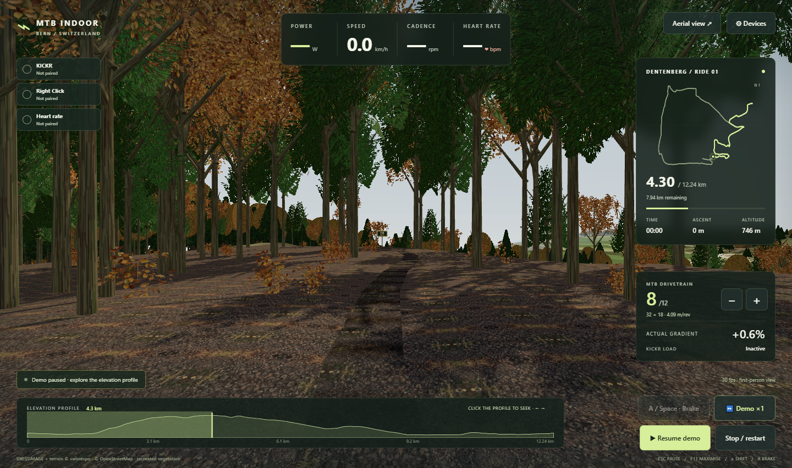

### Aerial view

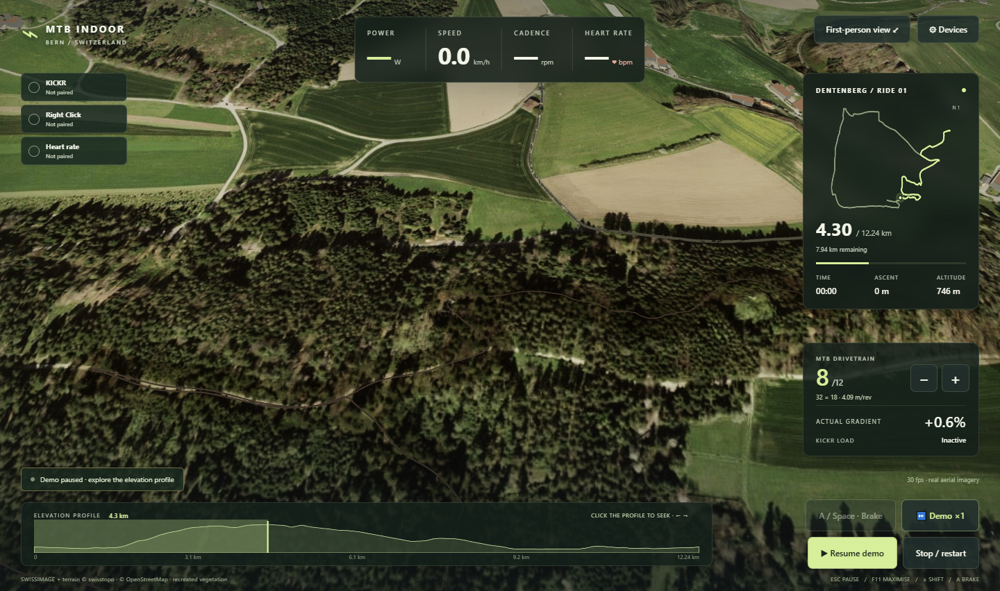

These views have been refreshed with the current English interface in demo mode. The terrain imagery is real; trees and first-person details are recreated. The original milestone and its hardware checks remain historical.
