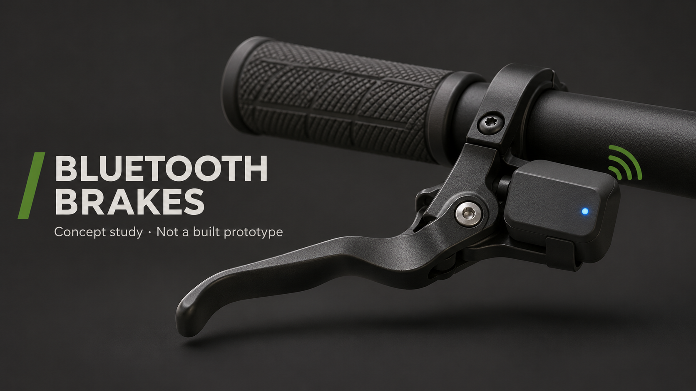
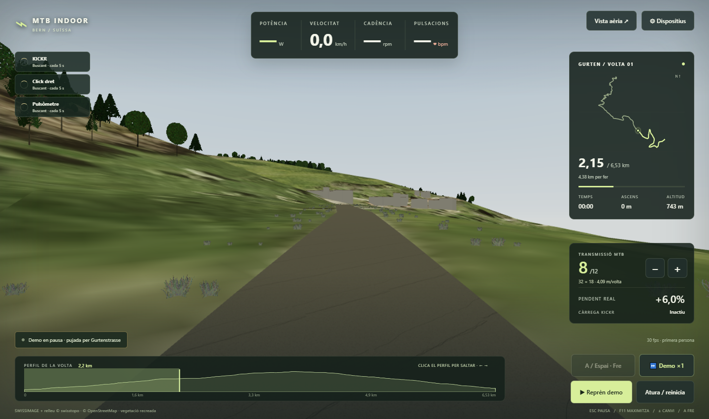
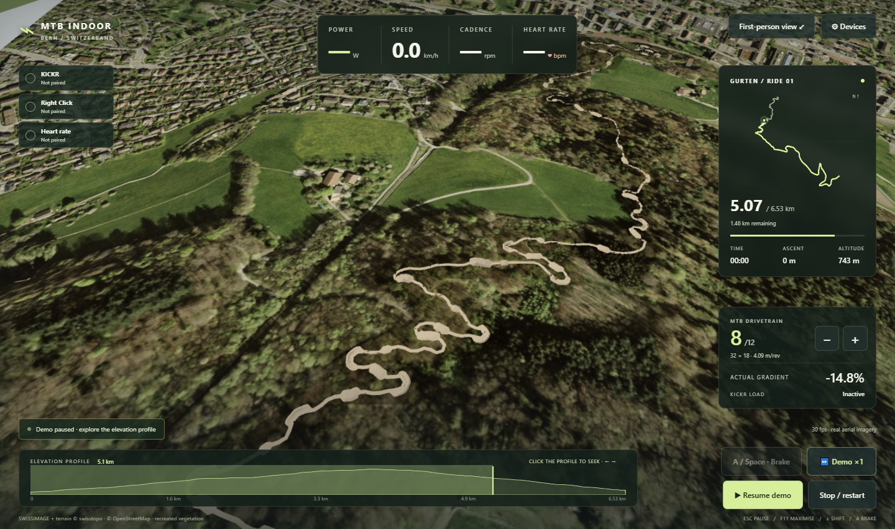
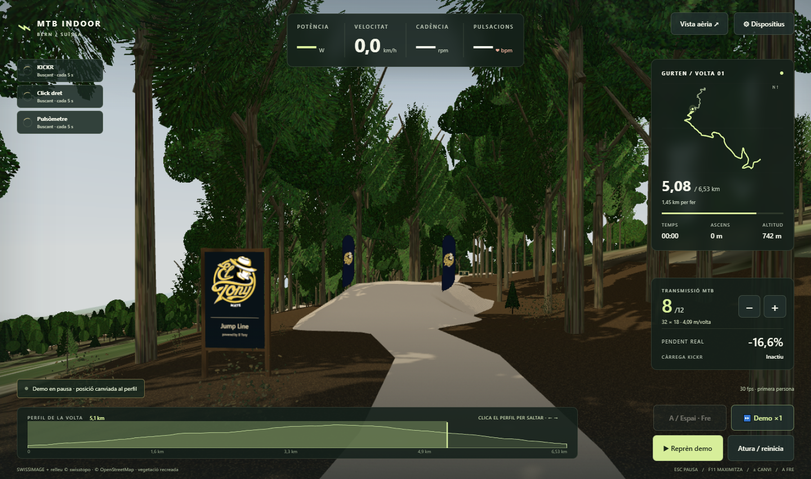
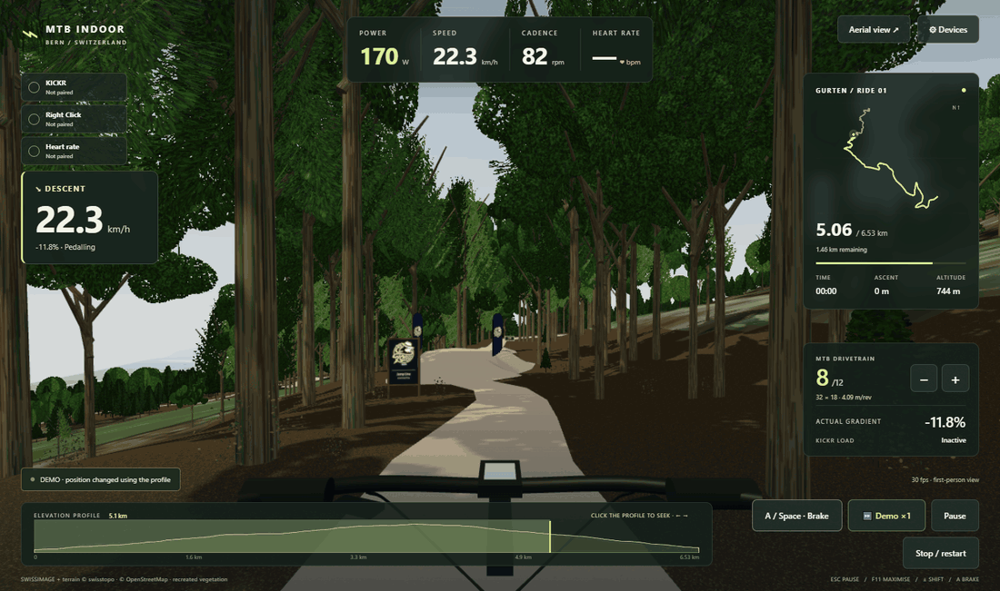
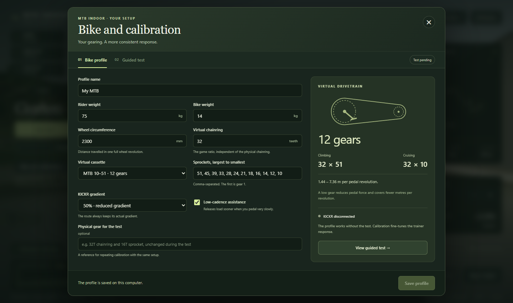
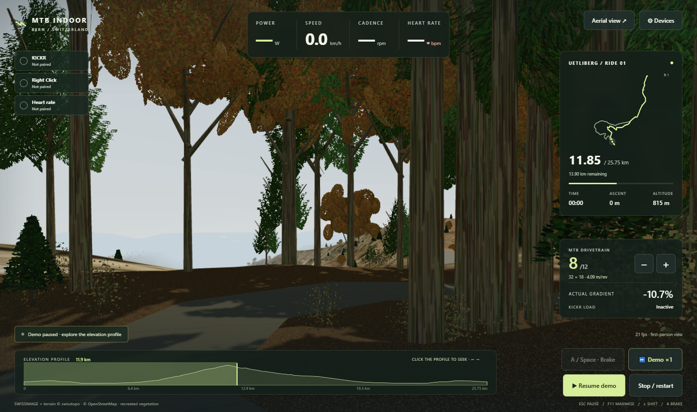
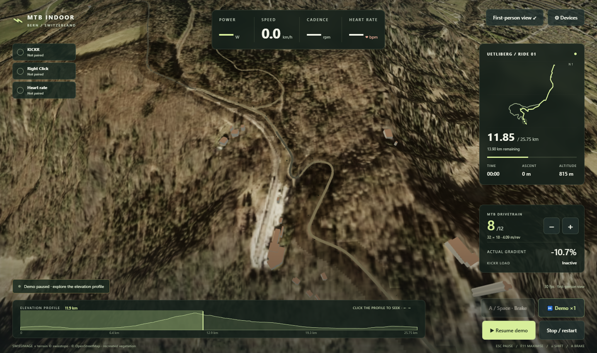
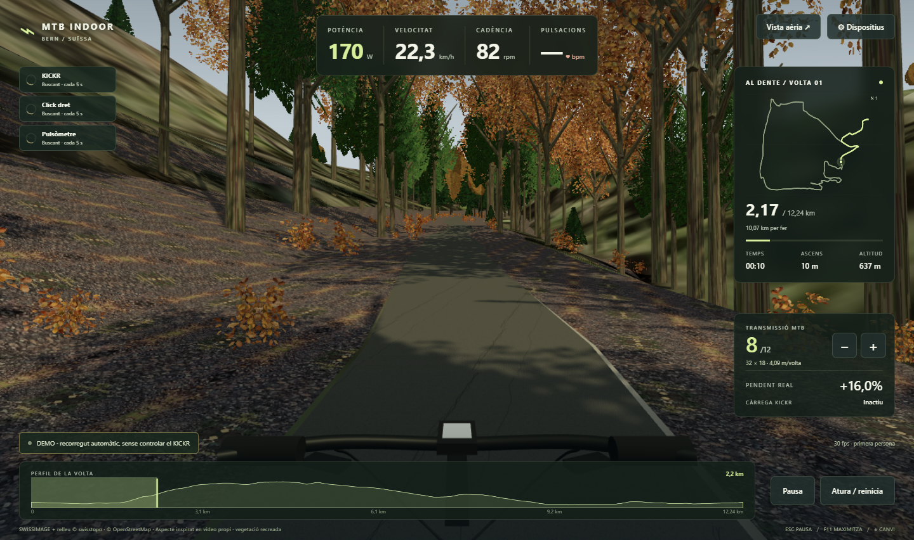
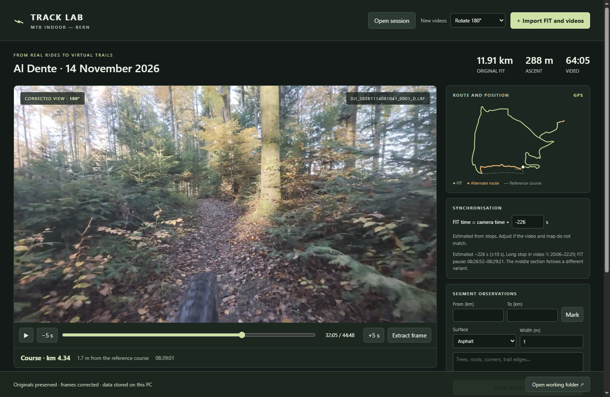

# Development log

[Project overview](README.md) · [Simulator](docs/simulator.md) · [Data acquisition](docs/data-acquisition.md) · [Bluetooth brakes](docs/bluetooth-brakes.md)

This log records completed project milestones, their evidence and their limitations. It replaces the development history previously embedded in the README. Entries are newest first; the screenshots are historical captures and retain the app's Catalan interface. Planning work is identified explicitly when it has not been implemented or tested.

## 22 November 2026 · Maneta v01: from mechanical design to realistic render

The [Bluetooth brakes guide](docs/bluetooth-brakes.md) now shows the **actual Maneta v01 design beneath the earlier concept study**. The supplied ZIP contains mirrored STL parts, the OpenSCAD assembly, a two-page PDF and assembly notes. The right-hand meshes were assembled at their original scale and orientation in Blender; ImageGen then added realistic PETG, rubber and metal surfaces using that render as its geometry reference.

The exposed return spring, rubber stop, sensor cover and two-piece clamp follow the design package. The six printed parts retain their source geometry in the [direct CAD reference](docs/images/bluetooth-brake-v01-cad.png). Colours, spring-coil details, fasteners, wire routing and the handlebar/grip are visualization choices. This image documents a proposed prototype, not a completed physical build.

The hardware list now records the proposed **two AS5600 sensors, TCA9548A multiplexer and external LilyGO T-Beam Supreme**, with supplier and technical links. Each sensor measures lever angle. Custom BLE firmware, proportional simulator input and physical validation remain pending; existing Click A-button braking is unchanged.

The [render provenance](docs/brake-v01-render.md) records the source hashes and generation prompt. A [reusable Blender renderer](tools/brake-render/README.md) reproduces the CAD reference from the supplied package. Visual review checked the main shapes, spring, rubber stop, cover hole, clamp and four sensor wires against the source render.

**Verified:** 19 Markdown pages and 209 local file/heading links; published image hashes; concept-before-render order in both pages; and the documented Blender command producing both reference views and its scene file. This milestone changes documentation and adds an offline rendering tool; simulator behavior is unchanged.

## 22 November 2026 · English documentation and three project sections

The repository now has a visual landing page and separate guides for the **[simulator](docs/simulator.md)**, **[data acquisition](docs/data-acquisition.md)** and **[Bluetooth brakes](docs/bluetooth-brakes.md)**. The full milestone history has moved from the README into this development log. User guides, tool READMEs and third-party notices are now in English; historical screenshots and recorded UI strings retain their original language.

The acquisition guide documents the working camera/FIT alignment workflow and links the hardware and manuals. The recording metadata identifies the camera as a **DJI Osmo Action 5 Pro**. The **Wahoo ELEMNT ROAM** is documented without assuming its generation. Additional sensor streams are described as future work, separate from the fields the current decoder imports.

Dedicated Bluetooth brake hardware is being explored in the [shared planning discussion](https://chatgpt.com/share/6b02a20d-5db8-83eb-93a7-cbb479549aaa). The new brake section distinguishes the tested right Click 2 button input from an unimplemented custom lever. Manufacturer references are linked and their status is explicit; the exact prototype bill of materials has not yet been transcribed into the repository.

This image was generated with ImageGen as a **concept study**, not as a photograph or proof of a built device. [Asset and generation prompt](docs/brake-concept-render.md).

This is a documentation milestone. It adds no custom brake firmware, changes no simulator behavior and claims no new hardware tests. Existing captures, verification evidence and their limitations remain linked from the [documentation index](docs/README.md). The older downhill capture harness is now documented as needing a timer-integration update before its deterministic recording procedure is reused.

**Documentation checks:** 17 Markdown pages and 185 local file/heading links checked; all 17 historical screenshot/GIF references retained. Application source and the recorded verification reports are unchanged by this milestone.

## 19 November 2026 · Gurten: from Il Brunello to the Gurtentrail

**New selectable course: Gurten.** The route starts beside Il Brunello in Kehrsatz, climbs via Zimmerwaldstrasse, Talstrasse, Gurtenstrasse and Grünenbodenweg, then descends the Gurtentrail to Wabern. The prepared profile measures **6.53 km with 289 m of ascent**. It is an open route ending at the trail finish; no return leg to the restaurant has been invented.

The route combines the OpenStreetMap road network with the current geometry of Gurtentrail 2.0, rebuilt in 2025. The mapped descent is **2.373 km**, consistent with the operators' description of **2.4 km and roughly 240 m of descent**. A **15 m walking connector** before the entrance is documented as such, without asserting permission to cycle there. The public version includes the route, terrain and **4352×4096 SWISSIMAGE orthophoto**.

| Climbing the Gurten | Route over aerial imagery |
| --- | --- |
|  |  |

Official photographs guided the pale compacted earth, summer woodland and **40 raised trail features and 14 berms**. The **El Tony Jump Line** sign recreates the design documented by TRIEBHAUS; the two flags beside the jump appear in photographs of the July 2025 opening. The **El Tony ↗** button opens a demo directly before this section, without controlling the KICKR.

**Real references, approximate obstacles:** the trail surface and camera share the raised features' elevation, but there is no airborne physics. The position and dimensions of each jump, berm and sign have not been surveyed. The KICKR follows the smoothed geographical gradient, without resistance pulses from artificial jump lips. Reference photographs are retained for research; the trail textures are generated in code.

**Verified:** personal and public builds; physics and demo behavior on all three courses; 28,040 feature samples and 267,117 road samples without overlapping terrain. The aerial view no longer has gaps along the trail edges. Native 1440×852 captures show 30 FPS and the loaded logo; the GIF covers nine seconds of demo travel over the jump. The El Tony button was checked through the interface, without trainer control. [Verification results](docs/verification-gurten-2026-11-19.json).

[Gurten guide, sources and limitations](docs/GURTEN.md) · [Geographical provenance](src/MTBIndoorBern/Scene/courses/gurten/provenance.json) · [Visual feature references](src/MTBIndoorBern/Scene/courses/gurten/features.json).

## 19 November 2026 · MTB profile and guided calibration

**New Bicycle and calibration section** (**Bicicleta i calibratge**), accessible from the top navigation and welcome screen. It saves rider and bike weight, wheel circumference, chainring, virtual cassette, gradient scaling and low-cadence assistance. Presets include 10–51, 10–52 and 11–46, with custom sprockets supported; the game and Click respect the selected number of gears.

| Bike profile | Guided response test |
| --- | --- |
|  |  |

Resistance and movement now share the gravity, rolling resistance and aerodynamic model, using total weight and trail surface. Load increases follow a **torque-per-second ramp**, while reductions apply immediately. Measured watts continue to move the rider.

The **optional test, lasting about two minutes**, guides a 70–110 W sequence at two cadences. It only starts applying load after the rider confirms readiness and steady pedaling is detected. It measures response, adjusts transitions and saves the result against the profile and KICKR. It does not correct measured watts or certify power-meter accuracy. The test can be canceled at any time; incomplete tests or tests without valid data are not marked as calibrated.

**Verified:** personal and public builds; tests on the two courses available at this milestone; preservation of old profiles; custom gearing; torque ramp; and the complete protocol with a simulated trainer, including cancellation, stale data, disconnection and control failures. Native 1440×852 screenshots and the compact interface were checked. **The guided test with the physical KICKR still required a pedaling session.** Previous records are retained; the updated physics starts a new version of downhill records.

[Bike, model and calibration guide](docs/bike-calibration.md) · [Milestone verification](docs/verification-calibration-2026-11-19.json).

## 19 November 2026 · Uetliberg course and profile seeking

**Uetliberg and Dentenberg became selectable at startup.** The new GPX route passes through Zurich, Triemli, Uto Kulm and Ringlikon: **25.75 km with 581 m of ascent** after profile smoothing. The selected course is remembered when reopening the app. Dentenberg retains the Al Dente course, settings and previous records.

Uetliberg includes a **4352×5120 SWISSIMAGE © swisstopo orthophoto**, real elevation data, and building footprints and estimated surfaces from OpenStreetMap. Vegetation is recreated. The GPX is a planned route, without a reconnaissance video; map data guides the paths' appearance. The smoothed profile supplies exactly the same elevations to the 3D road and physics. The original GPX has approximately 614 m of ascent before smoothing.

| Demo paused in the forest | Aerial imagery around Uto Kulm |
| --- | --- |
|  |  |

**Explore in demo → Pause → Resume demo** (**Explora en demo → Pausa → Reprèn demo**) continues from the same point and preserves the ×1–×8 multiplier. Click anywhere on the elevation profile to seek: a paused demo stays paused, and a moving demo keeps moving. With the profile focused, arrow keys move 100 m, Shift + arrow moves 1 km, and Home/End move to the endpoints. Seeking backward also works after reaching the finish. Seeking is demo-only and neither creates records nor activates the KICKR.

The course also includes **Practice the descent · Uetliberg · Ringlikon** (**Practica la baixada · Uetliberg · Ringlikon**), covering **km 11.355–14.565**, with the same braking and line-control rules as Dentenberg.

**Verified:** local and public builds; physics and demo tests on both courses; 140 Uetliberg points without terrain above the rider; and gradient error below 0.00005 percentage points. Checked captures maintain **30 FPS at 1440×852**, with adaptive resolution. The public build works with the included Uetliberg assets and does not require private Dentenberg data.

[Reusable GPX import tools](tools/course-import/README.md) · [Data provenance](src/MTBIndoorBern/Scene/courses/uetliberg/provenance.json) · [Milestone verification](docs/verification-uetliberg-2026-11-19.json).

## 19 November 2026 · Braking and the Dentenberg downhill challenge

**Braking now affects downhill times.** Hold **A on the right Click**, **Space**, or the on-screen brake button to reduce virtual speed. Press and release events for A were validated with the real controller. `+` and `B` retain their MTB shifting functions.

Corner guidance shows direction, distance and a target game speed based on geometry, surface and estimated width. Excess speed causes a skid; sustained excess leads to a runout that stops the virtual bike for **3 seconds** while the timer continues. Braking early avoids this penalty. Braking does not increase the physical KICKR load.

**Braking on the singletrack:** eight seconds of practice mode, captured with the game's actual physics and an automated brake input to make the demonstration reproducible. Trainer control is inactive.

**More visible ride data:** a large gradient indicator when climbing; speed, gradient, braking and grip when descending.

| Climbing gradient | Runout caused by excess speed |
| --- | --- |
|  |  |

**Practice the descent · Dentenberg** (**Practica la baixada · Dentenberg**) starts before the timed section without sensors. The challenge covers **km 4.480–6.980 of Al Dente**, with a start, finish and local personal record. Practice provides automatic propulsion on flatter sections; records are only saved for real sessions that complete the section without pauses. The separate ×1–×8 sightseeing demo remains available.

In the automated descent test including the approach, no braking produces **4 runouts and 384.3 s**; anticipating corners finishes with **0 runouts and 365.1 s**. Braking on a −20% slope, coasting at 0 W, record persistence, and exclusion of paused sessions and demos were also checked. Climb and descent captures maintain **30 FPS at 1440×852** with adaptive resolution.

Overlapping terrain was removed at corners where the recorded track revisits the same path. Original elevations and consistency between displayed gradient and physics are preserved.

[Braking, practice and records guide](docs/downhill.md) · [Reproducible capture tools](tools/downhill/README.md) · [Verification results](docs/verification-downhill-2026-11-19.json).

## 15 November 2026 · Autumn Al Dente and Track Lab

A recording of a real ride was used to revise the course's appearance: asphalt, gravel, narrow leaf-covered singletrack, autumn trees, undergrowth and verges. The local installation uses a ground sample extracted from the video; that asset remains private and the engine has a code-generated fallback texture. Vegetation is recreated with geometry and textures, rather than photogrammetry. The following captures show the local installation.

**Moving comparison · forest singletrack, km 4.30–4.35.** Eight seconds of both versions side by side, with identical position, camera and speed. The GIF compares the previous engine with the new local rendering style.

**Accelerated demo:** the **⏩ Demo ×1** button beside Pause cycles **×1 → ×2 → ×4 → ×8 → ×1**. Speed is retained when pausing and resuming; Stop / restart (**Atura / reinicia**) returns to ×1. It changes demo movement only: the timer shows real seconds and trainer control stays inactive. At ×8, the entire circuit can be reviewed in approximately four minutes. All four speeds, pause, resume, finishing and the build with all visual assets were checked.

The [capture and comparison tools](tools/render-comparison/README.md) allow the comparison to be repeated for other versions or sections. [Demo and GIF verification](docs/verification-demo-2026-11-15.json).

**Before and after**, at the same forest section around km 4.37:

| Previous version | New autumn style |
| --- | --- |
|  |  |

Terrain near the road now uses a finer mesh so the verges do not cover the asphalt on steep slopes. The route elevations used by the physics are preserved. Surface, estimated width, forest sections and confidence are defined in `appearance.json`.

**Track Lab** is a new standalone viewer for preparing future courses. It copies and verifies originals with SHA-256, decodes FIT, displays video rotated 180°, supports clock alignment and map position, extracts full-resolution MP4 frames, and saves or exports section observations.

The working session contains 28.5 GB of originals, 64 minutes of video and 65 initial frames. An offset of −226 s between camera and FIT was estimated; it is adjustable, with approximately 10 s of uncertainty. The middle of the video follows a different variant of the previous route. It is marked as a variant, and its visual appearance is extrapolated without placing obstacles as though their locations had been surveyed.

**Verified:** checked copies; viewer build; corrected H.264 playback; detail extraction at **2688×1512**; saved captures; test import with a FIT and short video; and physics/FTMS tests. Checked forest and asphalt scenes maintain **30 FPS at 1440×852** with adaptive resolution. Maximum error between visual and physical gradient is below **0.00005 percentage points** across 2,448 segments. Visual checks used demo mode without controlling the KICKR.

[Track Lab usage and build guide](docs/track-lab.md) · [Textures and provenance](docs/render-assets.md) · [Verification results](docs/verification-2026-11-15.json).

## 12 November 2026 · First working version

A 3D course with aerial imagery, direct KICKR CORE, right Click 2 and HRM-Dual connections, MTB 1×12 gearing, persistent settings and device reconnection. The reduction in load when shifting from gear 3 to gear 1 was checked while pedaling.

### First-person view

### Aerial view

These captures use demo mode. The terrain imagery is real; trees and first-person details are recreated.
