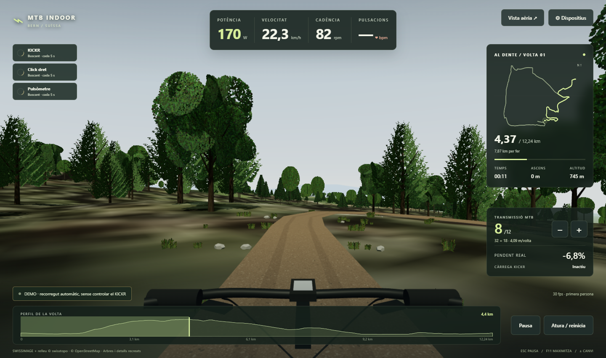
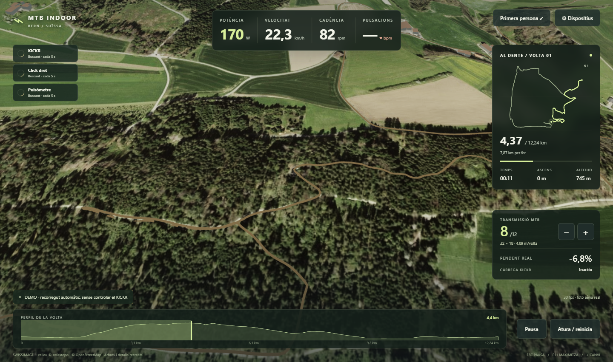

# MTB Indoor - Bern

Simulador de MTB indoor per a Windows, amb circuits 3D de Berna, connexió Bluetooth al Wahoo KICKR, canvi virtual MTB i pulsòmetre. **Al Dente** és el primer circuit inclòs: 12,24 km sobre fotografia aèria i relleu reals.

Projecte en desenvolupament, provat amb un KICKR CORE, un Zwift Click 2 dret i un Garmin HRM-Dual.

## Captures

### Primera persona



### Vista aèria



Les captures són del mode demo. La fotografia del terreny és real; els arbres i els detalls de primera persona són recreats.

## Funcions

- Circuit 3D amb fotografia aèria SWISSIMAGE, terreny, edificis, vegetació, ombres, camí texturat i manillar.
- Pendent coherent: el camí dibuixat, la física i el control del rodillo parteixen del mateix perfil d’altitud.
- Potència, cadència, pulsacions, velocitat, distància, altitud i perfil de la ruta en directe.
- Transmissió MTB **1×12, cassette 10–51**, amb plat de 30, 32 o 34 dents.
- Connexió directa al Click 2 dret: no cal BikeControl.
- Dispositius recordats, indicadors d’estat a la pantalla principal i cerca automàtica cada 5 segons.
- Pes, dificultat del pendent, plat i circuit desats automàticament.
- Primera persona, vista aèria i demo sense controlar el KICKR.
- Catàleg de circuits separat de l’app, preparat per incorporar altres rutes.

## Requisits

- Windows 10, versió 2004 o posterior, o Windows 11, de 64 bits.
- Bluetooth LE per als sensors i targeta gràfica amb WebGL 2.
- [Microsoft Edge WebView2 Runtime](https://developer.microsoft.com/microsoft-edge/webview2/), normalment ja present a Windows.
- [.NET 10 SDK](https://dotnet.microsoft.com/download/dotnet/10.0) per compilar. La publicació resultant inclou el runtime .NET.

La prova gràfica en un i5-6500 amb una GTX 660 de 2 GB ha mantingut **30 FPS a 1440×852** en les vistes comprovades. El motor ajusta la resolució si el rendiment baixa.

## Compilar i executar

Des de PowerShell, a l’arrel del repositori:

```powershell
.\build.ps1 -SelfTest
.\artifacts\publish\win-x64\MTBIndoorBern.exe
```

O directament amb el SDK:

```powershell
dotnet publish src/MTBIndoorBern/MTBIndoorBern.csproj -c Release -r win-x64 --self-contained true -p:PublishSingleFile=true -p:IncludeNativeLibrariesForSelfExtract=true -o artifacts/publish/win-x64
```

Mantén la carpeta `Scene` al costat de l’executable. Les imatges, el terreny i Three.js són locals: el circuit es pot carregar sense una API de mapes ni un compte de Google. Per compilar per primera vegada cal accés a NuGet.

## Primera connexió

1. Encén el KICKR, posa’t el pulsòmetre i prem un botó del Click per despertar-lo.
2. Obre **Dispositius**, selecciona cada sensor i prem **Connecta**.
3. Ajusta el pes, el percentatge de pendent al KICKR i el plat.
4. Pedala uns segons perquè arribin potència i cadència i prem **Inicia la ruta**.

El repositori comença sense sensors vinculats. Un cop connectats, es recorden a `settings.json`, al costat de l’executable; aquest fitxer està exclòs de Git. Desconnectar manualment pausa la reconnexió fins a prémer Connecta o tornar a obrir l’app. **Oblida** elimina la vinculació desada.

| Control | Acció |
| --- | --- |
| Click dret `+` / tecla `+` | Pujar marxa |
| Click dret `B` / tecla `B` o `−` | Baixar marxa |
| Escape / Pausa | Pausar i alliberar la càrrega |
| Atura / reinicia | Tornar al principi |
| F11 | Alternar la finestra maximitzada |
| Vista aèria | Canviar de càmera |
| Explora en demo | Recórrer el circuit sense controlar el rodillo |

## Com funciona el canvi MTB

La marxa 1 és la més curta: **32×51** amb el plat predeterminat. La marxa 12 és **32×10**. El model utilitza un desenvolupament estimat de roda de 2,30 m, corresponent a una MTB de 29 polzades.

El pendent, el pes, la relació de canvi i la cadència determinen una potència objectiu que s’actualitza per Bluetooth FTMS. És un control de càrrega dinàmic; no utilitza el protocol propietari de canvi virtual de Zwift.

Amb 75 kg, 70 rpm, plat de 32 i una pujada del 12% al 100%, el model calcula aproximadament **199 W en 32×51** i **435 W en 32×24**. Un plat de 30 escurça encara més el desenvolupament.

La càrrega té un límit de 600 W, augmenta gradualment i es redueix amb cadències baixes. A 30 rpm o menys, l’objectiu és 0 W. Pausar o tancar envia càrrega zero i aturada; perdre dades o control pausa la ruta. Una reconnexió no reactiva automàticament l’esforç. El rodillo conserva la seva resistència mecànica mínima i necessita uns segons per estabilitzar els canvis.

El percentatge de pendent seleccionat modifica l’esforç al KICKR. La geometria i la velocitat virtual continuen fent servir el pendent complet del circuit.

## Circuit i dades

`Scene/courses.json` defineix el catàleg. Cada circuit té una carpeta pròpia amb `route.json`, `world.json` i `aerial.jpg`. Al Dente s’ha preparat a partir d’un FIT: s’han interpolat les altituds absents, suavitzat el soroll i adaptat el terreny proper al mateix perfil que fa servir la simulació. El FIT original no està inclòs.

La portada mostra un tram de bosc; la ruta comença al km 0. La importació automàtica de FIT/GPX encara no està disponible a la interfície.

## Estructura

```text
src/MTBIndoorBern/
  BluetoothDevices.cs  Descoberta i dades dels sensors
  Equipment.cs         Vinculació i reconnexió
  Preferences.cs       Ajustos locals persistents
  TrainerControl.cs    Ordres i confirmacions FTMS
  RideSession.cs       Física, canvi i estat de la ruta
  RidePanel.cs          Connexió entre WinForms i la vista 3D
  Scene/               Interfície, motor Three.js i circuits
docs/images/           Captures de l’app
build.ps1              Compilació i proves bàsiques
```

## Verificació i límits actuals

Les proves comproven paquets BLE/FTMS, les 2.448 pendents del traçat, arrencada en pujada, sentit de les marxes, reducció a baixa cadència, límit de càrrega, pausa, persistència i identitat dels sensors. Una prova real pedalant ha verificat la reducció de càrrega en passar de marxa 3 a marxa 1 i el retorn al pla, amb confirmació de totes les ordres del KICKR.

El maquinari comprovat és **KICKR CORE**, **Zwift Click 2 dret** i **Garmin HRM-Dual**. El Click esquerre i altres rodillos encara no s’han validat. El projecte no és una reconstrucció fotogramètrica completa ni una integració oficial de Wahoo, Zwift o Garmin.

## Fonts i crèdits

- Fotografia aèria i relleu: **© swisstopo**, [SWISSIMAGE](https://www.swisstopo.admin.ch/en/orthoimage-swissimage-10) i [serveis cartogràfics](https://docs.geo.admin.ch/visualize-data/xyz.html). Mosaic inclòs de nivell WMTS 17, de 4864×3840 píxels; no és la resolució original completa de 10 cm.
- Cartografia de boscos i edificis: **© [OpenStreetMap contributors](https://www.openstreetmap.org/copyright)**.
- Three.js: llicència MIT inclosa a `src/MTBIndoorBern/Scene/vendor/LICENSE`.
- Microsoft WebView2: dependència NuGet amb les condicions de Microsoft.
- Referències del model: [transmissions Shimano 12 velocitats](https://productinfo.shimano.com/pdfs/product/archive/2020-2021_Compatibility_v035_en.pdf) i [comportament del control de potència Wahoo](https://support.wahoofitness.com/hc/en-us/articles/4402565516946-A-Guide-to-using-ERG-mode).

Vegeu [THIRD_PARTY_NOTICES.md](THIRD_PARTY_NOTICES.md) per als recursos de tercers.

