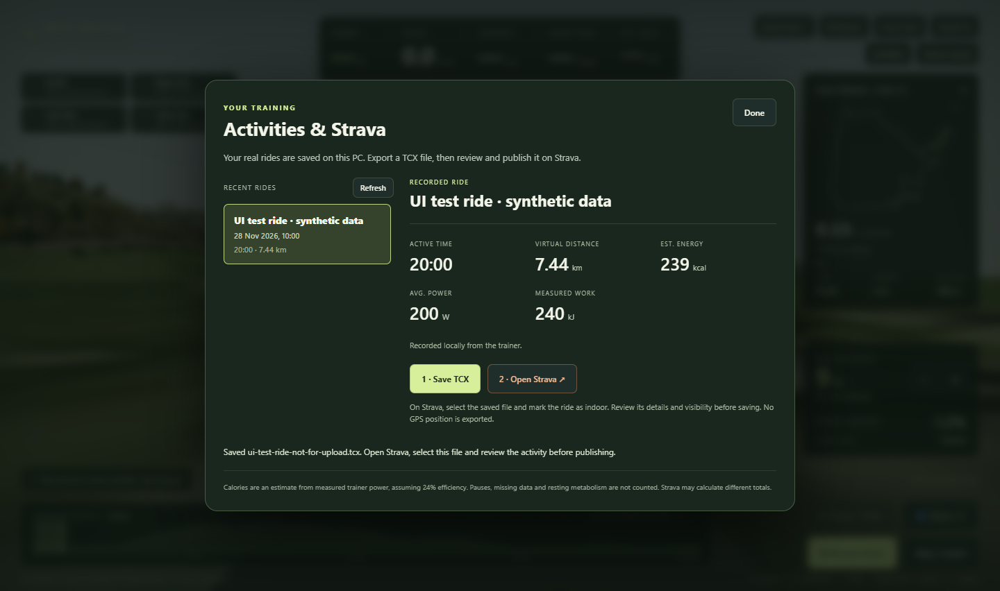
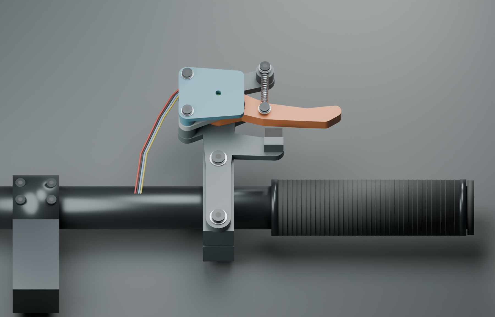
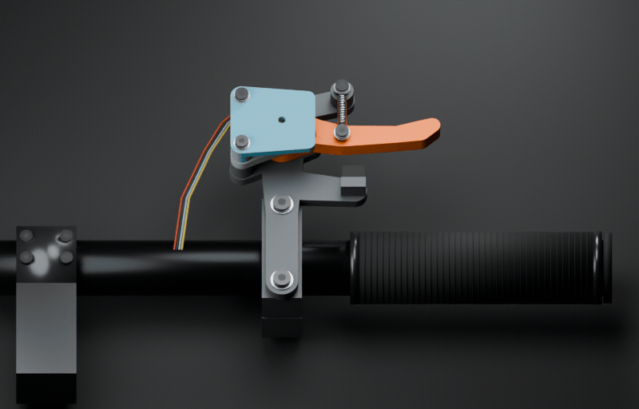

# MTB Indoor - Bern

**Ride Swiss trails indoors. Record the outdoors. Explore better controls.**

A Windows MTB simulator with real elevation data, aerial imagery, direct Bluetooth trainer control and configurable MTB gearing. Alongside the simulator, this repository contains **Track Lab** for trail data collection and a **Bluetooth brake research** section.

[Simulator](docs/simulator.md) · [Data acquisition](docs/data-acquisition.md) · [Bluetooth brakes](docs/bluetooth-brakes.md) · [Development log](DEVELOPMENT_LOG.md) · [Documentation index](docs/README.md)


*El Tony on Gurtentrail: the previous renderer and the new woodland pilot at matching positions. Real map and elevation data, recreated vegetation and approximate jump geometry. [45-second comparison with ride sound](docs/images/el-tony-pilot-comparison.mp4) · [Pilot details and performance](docs/el-tony-pilot.md).*

## Three parts of the project

| [01 · Simulator](docs/simulator.md) | [02 · Data acquisition](docs/data-acquisition.md) | [03 · Bluetooth brakes](docs/bluetooth-brakes.md) |
| --- | --- | --- |
| **The main application.** Ride local trails with a KICKR, MTB gears, heart rate and downhill braking. Explore without sensors in demo mode. | **Track Lab and import tools.** Align action-camera footage with FIT data, annotate trail surfaces and extract reference frames. | **Printable levers and a Bluetooth bench.** Assemble AS5600 controls, wire a TCA9548A and T-Beam Supreme, then inspect both sensors in a browser. Click button braking remains the implemented simulator input. |
| [Setup and controls →](docs/simulator.md#build-and-run) | [Workflow and hardware →](docs/data-acquisition.md) | [Current support and hardware →](docs/bluetooth-brakes.md) |

## Ride now

**Uetliberg, Gurten and Eiger Bike Challenge 20 km are included in the public repository.** Dentenberg / Al Dente is available in the local installation; its personal route and recording assets are not distributed.

| Course | Distance | Experience |
| --- | ---: | --- |
| [Gurten](docs/GURTEN.md) | 6.53 km | Climb from Kehrsatz, then descend the Gurtentrail to Wabern |
| [Uetliberg](docs/simulator.md#courses-and-data) | 25.75 km | Zurich, Triemli, Uto Kulm and Ringlikon |
| [Eiger Bike Challenge 20 km](docs/EIGER.md) | 19.48 km | Alpine summer around Grindelwald, race scenery and three selectable starting sectors |
| [Dentenberg / Al Dente](docs/dentenberg-visuals.md) | 12.24 km | Autumn woodland, leaf-covered singletrack and quieter ride sound |

[](docs/dentenberg-visuals.md)

*Dentenberg: a more open autumn canopy, young conifers and a worn leaf-covered trail. Continuous chain/freehub noise remains removed; the current app restores short confirmed gear-change clicks. [Comparison, sources and measured performance](docs/dentenberg-visuals.md).*

On Windows with the [.NET 10 SDK](https://dotnet.microsoft.com/download/dotnet/10.0) and [WebView2 Runtime](https://developer.microsoft.com/microsoft-edge/webview2/) installed:

```powershell
.\build.ps1 -SelfTest
.\artifacts\publish\win-x64\MTBIndoorBern.exe
```

Select a course and choose **Explore in demo**. Pause, click the elevation profile to seek, resume, or accelerate up to ×8. On Gurten, **El Tony ↗** jumps directly to the featured section. Demo does not control the trainer.

**Focus view** keeps the key riding numbers visible while folding away the map and profile. **View & sound** saves volume, stable-camera and frame-rate preferences independently of bike calibration. Ride audio includes the ground under your tyres, wind, braking and brief host-confirmed gear-change clicks. There is no continuous chain/freehub buzz. [Visual and audio pilot](docs/el-tony-pilot.md).

On **Eiger Bike Challenge 20 km**, choose the whole course or start from any of its three sectors before riding or exploring in demo. [Eiger route and sector guide](docs/EIGER.md).

Left and right Zwift Clicks have separate pairing and status indicators. A lost Click no longer pauses the ride: click the 3D trail with the **left mouse button to shift up** or the **right mouse button to shift down**. Keyboard and on-screen braking remain available. Heart-rate status distinguishes a connected sensor from one that is actually sending pulse readings. [Connection and controls guide](docs/simulator.md#first-connection).

**EST. KCAL** shows a power-based exercise-energy estimate during real trainer rides. **Activities** keeps local recordings: choose **1 · Save TCX**, then **2 · Open Strava ↗** and select the file on Strava. Review it as an indoor ride before saving. This is manual file upload, without automatic account linking or OAuth. Demo and practice do not create workouts. [Calories, activity storage and Strava guide](docs/activities-strava.md).

[](docs/activities-strava.md)

*UI preview with invented test data, not a real workout or a completed Strava upload.*

[Full setup and controls](docs/simulator.md) · [Bike profile and calibration](docs/bike-calibration.md) · [Downhill braking and records](docs/downhill.md)

## From trail recording to new controls

| Track Lab · working tool | Bluetooth brake prototype · Maneta v01 |
| --- | --- |
| [](docs/data-acquisition.md) | [](docs/bluetooth-brakes.md#maneta-v01) |
| [Camera/FIT alignment, annotations and hardware links](docs/data-acquisition.md) | [Prototype assembly, wiring, firmware and hardware references](docs/bluetooth-brakes.md#maneta-v01) |

The brake view above uses the printable Maneta v01 meshes. It illustrates the prototype geometry. Both built levers have now sent live Bluetooth readings to the bench; magnetic quality and full mechanical validation remain pending.

[](docs/bluetooth-brakes.md#maneta-v01)

**Maneta v01: the actual mechanical design in motion.** A looping Blender render of the lever pulling and returning, based on the supplied STL files and assembly drawings. [Animation, original still and CAD reference](docs/brake-v01-render.md). This render is separate from the first live electronics observation; proportional simulator integration is still pending.

**[Read the Maneta v01 assembly guide →](docs/bluetooth-brakes.md#maneta-v01)**

The illustrated guide is part of the Bluetooth brakes document, directly below **Maneta v01**. It covers assembly, wiring, firmware installation and Bluetooth diagnostics in GitHub Markdown. Download the [printable parts](hardware/maneta-v01/), build the [T-Beam Supreme firmware](firmware/brake-bench/), and open the **[Bluetooth bench tester](https://mfarre.github.io/mtb-indoor-bern/workshop/tester/)** in desktop Chrome or Edge.

[](https://mfarre.github.io/mtb-indoor-bern/workshop/tester/)

*Updated interface in demo mode. Each lever has stable endpoint capture, optional manual raw values and automatic local saving for the selected Bluetooth device. Weak/strong-field warnings allow provisional setup without being labelled healthy. The combined plot and CSV session section have been removed.*

**First live BLE observation:** both prototype levers are communicating, but both sensors reported a weak field at maximum AGC. That confirms acquisition and transport, not magnetic accuracy or repeatability. [Original live capture](docs/images/brake-bench-first-live.jpg) · [Calibration and magnetic checks](docs/workshop/tester/README.md) · [Verification record](docs/verification-brake-bench-2026-11-28.json). Custom proportional braking is not yet integrated into the simulator.

The simulator, Track Lab, documentation and current screenshots are in English.

## Follow development

The **[development log](DEVELOPMENT_LOG.md)** contains the full milestone history, screenshots, before/after GIFs, verification results and known limitations. It is updated when a milestone is complete, with planning work identified separately.

Start with the [documentation index](docs/README.md) for guides, developer tools and verification reports. Geodata, images and third-party libraries are documented in [Third-party notices](THIRD_PARTY_NOTICES.md).

Previously tested with a **Wahoo KICKR CORE**, **right Zwift Click 2** and **Garmin HRM-Dual**. Independent left/right Click support and connection recovery have software regression coverage; a physical two-Click and reconnect session is still pending. Other trainers have not been validated. This is an independent project; it is not an official Wahoo, Zwift or Garmin integration.
