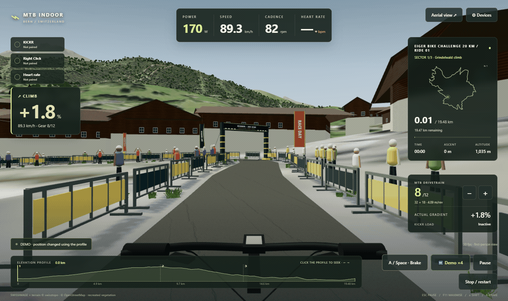
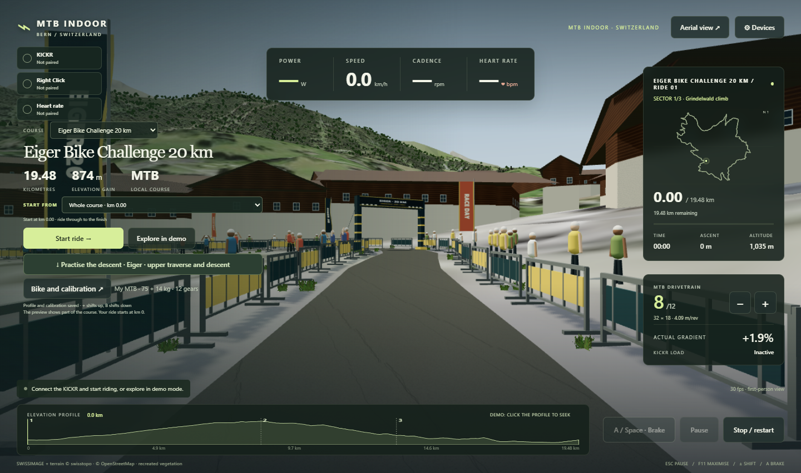
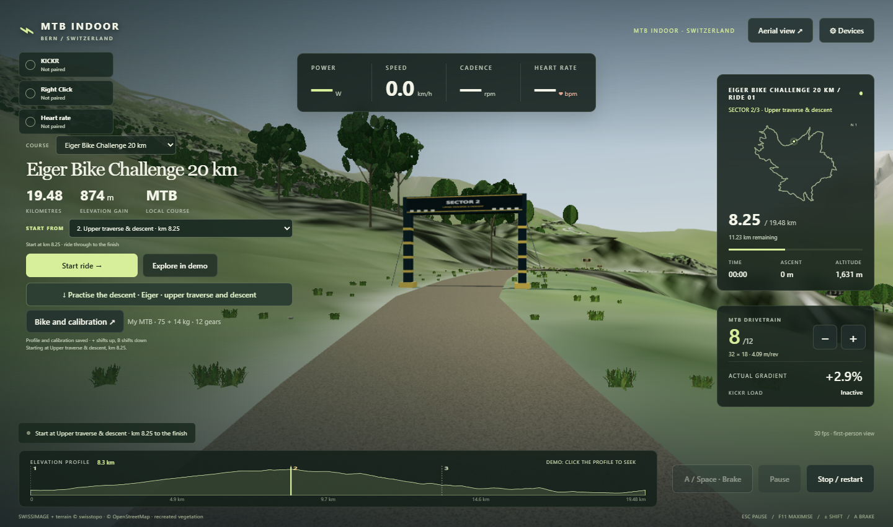
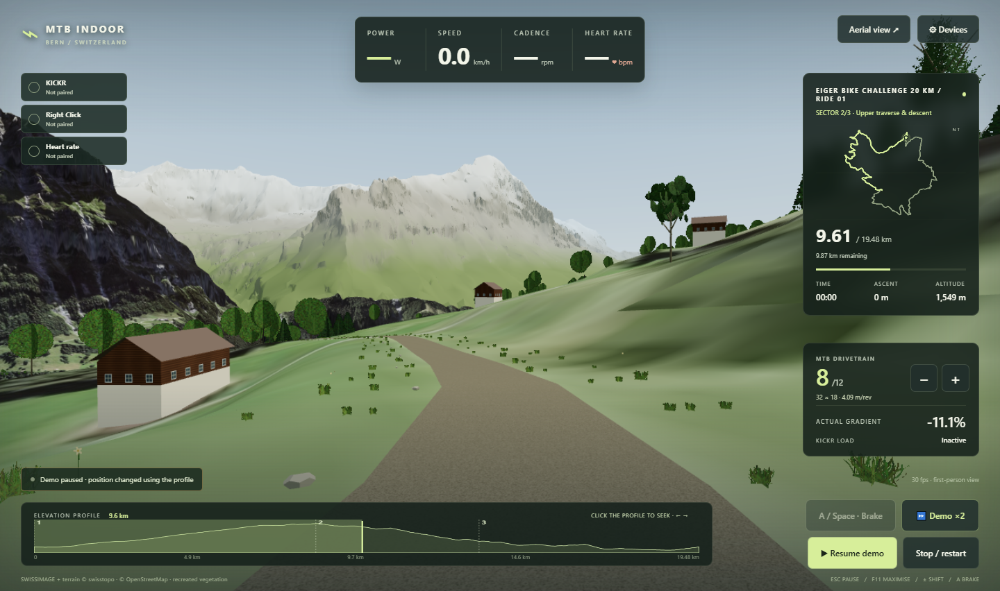
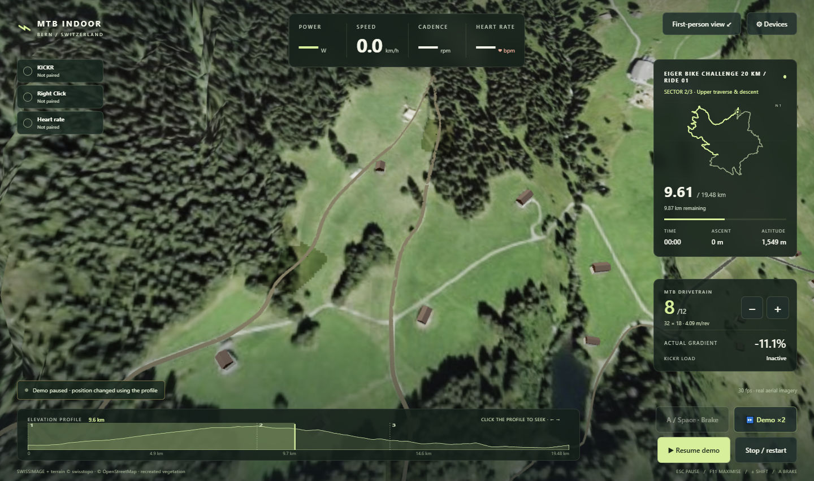
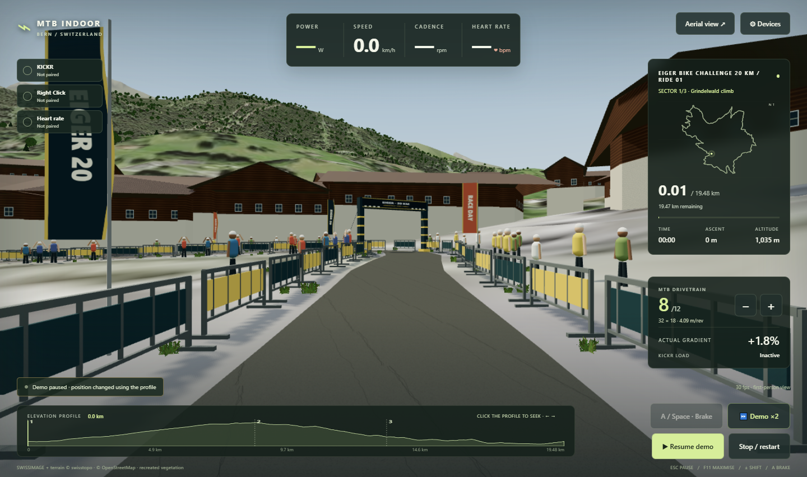
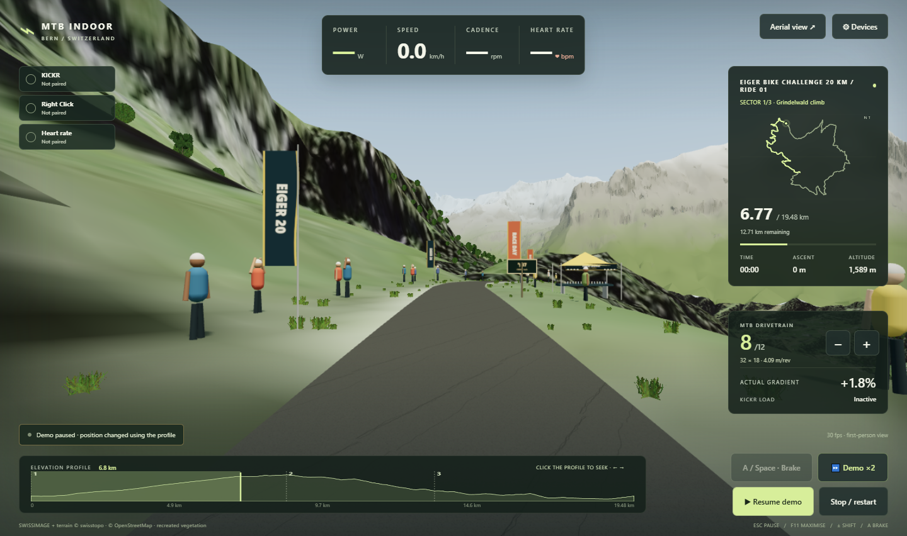

# Eiger Bike Challenge · 20 km

[Project overview](../README.md) · [Simulator](simulator.md) · [Development log](../DEVELOPMENT_LOG.md)

Ride the organisers' published **20 km GPX course around Grindelwald**, recreated with summer scenery, Swiss aerial imagery and real elevation data. The simulation uses the downloaded route's measured length rather than stretching it to exactly 20 km.

**Included route: 19.48 km, approximately 874 m of climbing.**

## Choose where to start

Select **Eiger Bike Challenge 20 km** on the welcome screen. Choose **Whole course** or one of the three sectors, then press **Start ride** with your equipment or **Explore in demo** without sensors. Each selection rides from that point through to the finish.

| Training sector | Start | End | Character |
| --- | ---: | ---: | --- |
| 1 · Grindelwald climb | 0.00 km | 8.25 km | The main climb out of the valley |
| 2 · Upper traverse & descent | 8.25 km | 13.03 km | Upper slopes and the descent towards Mühlebach |
| 3 · Mühlebach & finish | 13.03 km | 19.48 km | The lower loop and return to Grindelwald |

These are **training splits defined for this app**, not official race timing sectors. Sector markers appear on the elevation profile and the current sector is shown while riding. Elapsed time and climbing start at zero at your chosen entry point; the course kilometre position still refers to the full route.

**Stop / restart** returns to the chosen starting point. Change the selection before starting again. Changing courses returns to the whole-course selection. Mid-route starts do not create a personal descent record. Demo pausing, resuming, profile seeking and ×1–×8 speed controls remain available.

| Whole course from Grindelwald | Start directly in sector 2 |
| --- | --- |
|  |  |

Starting at or inside the timed descent starts a **partial descent timer without record eligibility**. Starting beyond it hides the already-passed descent panel.

## Geographic sources

The route comes from the **20 km GPX linked by the organisers**, downloaded on 22 November 2026:

- [Official course profiles and GPS downloads](https://www.eigerbike.ch/en/race/profiles/)
- [Official 20 km GPX](https://www.eigerbike.ch/wp-content/uploads/gpx/ebc20km.gpx)
- [Race information](https://www.eigerbike.ch/en/race/informations/)
- [Geographical provenance and import parameters](../src/MTBIndoorBern/Scene/courses/eiger-20/provenance.json)

The organiser describes the category as **20 km / 900 m of ascent**. The rendered road, displayed gradient, motion physics and KICKR load share the processed GPX elevation profile. Terrain from **swisstopo** and **SWISSIMAGE** aerial imagery place the route within the valley; mapped woodland and buildings come from **OpenStreetMap**.

The GPX and profile PDF were both updated by the organiser in June 2026. Their route shapes were cross-checked: the climb through Tuftbach and Weidli, upper Holewang/Bort area, Mühlebach, Marmorbruch and valley return. The original finish/start gap is retained instead of adding an invented connecting road.

The orthophoto is a **3072×3072** mosaic. Near-route terrain uses zoom-14 elevation meshes; a separate zoom-12 mesh supplies the real Eiger and surrounding Alpine silhouettes. Six original corner vertices are retained to prevent five-metre resampling from cutting across tight hairpins and creating false gradient spikes. The [elevation checks](../src/MTBIndoorBern/Scene/courses/eiger-20/elevation-verification.json) compare the original GPX with independent terrain samples and verify that graphical and simulation gradients agree.

| Actual Alpine terrain from the upper route | The route over SWISSIMAGE |
| --- | --- |
|  |  |

## Summer and race atmosphere

The summer interpretation uses green meadows, conifers, timber-style chalets, gravel and paved lanes. Race arches, course tape, flags, spectators and aid-station details are illustrative additions guided by event and local landscape references. They are not a survey of the exact event-day setup and do not imply organiser or sponsor affiliation.

| Village race atmosphere | Illustrative mountain feed zone |
| --- | --- |
|  |  |

Reference photographs guide the appearance; they are not redistributed as game textures. The renderer uses the course imagery and code-generated materials and geometry. The scenery does not introduce artificial bumps or resistance pulses into the geographical profile.

Visual references include the [official event photo page](https://www.eigerbike.ch/en/media-2/photos/), [Grindelwald Tourism's mountain-biking overview](https://grindelwald.swiss/en/sommeraktivitaten/mountain-biking.html), a [Bort summer photograph credited to Grindelwald/Switzerland Tourism](https://www.planetmountain.com/en/photos/65871), [race photography from the 2023 event](https://velomedia.ch/bmc-2023/04bericht_eigerbike_de.html), and [Bort's paved-lane setting](https://www.mibon.ch/de/inspirationen/ausflugstipps/bern/trottibike-bort). The long-course race photograph informs appearance only; the 20 km centreline always comes from its own GPX. Individual official gallery requests timed out during research, so exact sponsor layouts and installations are not claimed.

The [reusable Eiger importer](../tools/eiger-import/README.md) documents how to prepare the geography again. The source GPX, downloaded reference material and raw map caches stay outside the published repository.

## Scope

Public and personal builds, physics and sector-start self-tests, and **28 native UI checks** passed. Both normal and compact welcome layouts were checked. These native captures reported approximately **30 fps on the development PC**; performance depends on hardware and view. No new physical trainer test was performed. [Verification and media hashes](verification-eiger-2026-11-22.json).

This is an indoor-training reconstruction of the official downloadable route, not an outdoor navigation product. The organisers note that some sections are accessible only on race day and that the route can change. The included GPX is a dated source, not a guarantee of a future edition's routing.

Mapping **© OpenStreetMap contributors**, under [ODbL](https://www.openstreetmap.org/copyright). Orthophoto and terrain **© swisstopo**, under its [open geodata terms](https://www.swisstopo.admin.ch/en/terms-of-use-free-geodata-and-geoservices). The event name identifies the source course; this is an independent simulator.
