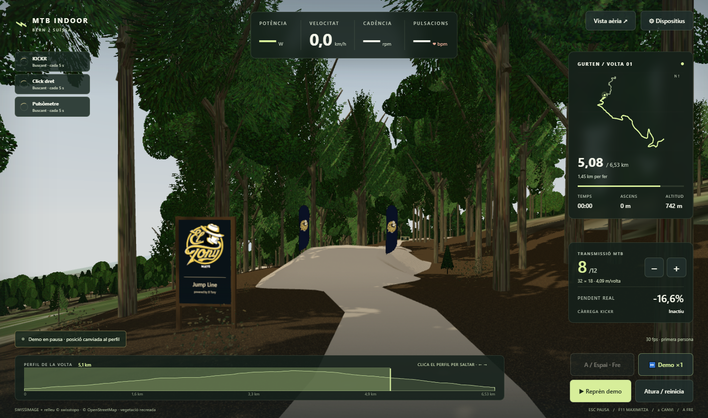

# Gurten · Il Brunello → Gurtentrail

[Project overview](../README.md) · [Simulator](simulator.md) · [Development log](../DEVELOPMENT_LOG.md)

A public course of **6.53 km with 289 m of climbing**, starting in Kehrsatz, climbing to the Gurtentrail entrance beside Gurten Kulm and descending to Wabern. Select **Gurten** on the welcome screen and press **Explore in demo**, or **Start ride** with your sensors. **El Tony ↗** opens a demo just before the sign; **Pause**, **Resume demo**, profile seeking and **⏩ Demo ×1** through ×8 work as on the other courses.

## Route and terrain

| Section | Course details |
| --- | --- |
| Start | Road beside Il Brunello, Bernstrasse 1, approximately 19 m from the official address point |
| Climb | Zimmerwaldstrasse → Talstrasse → Gurtenstrasse → Grünenbodenweg |
| Final access | Approximately 15.2 m of walking path before the trail gate; no cycling permission is asserted for this link |
| Descent starts | Km 4.154, beside Gurten Kulm |
| Mapped Gurtentrail | 2.373 km, downhill towards Wabern |
| Finish | Km 6.527, at the trail end; no return to Il Brunello is included |

This route was assembled from connected **OpenStreetMap** ways, rather than a recorded activity. The climb avoids sections with explicit cycling prohibitions and does not enter the pedestrian summit park. The descent uses [OSM way 94360847](https://www.openstreetmap.org/way/94360847), version 25, updated on 15 November 2026.

[Trail operator trailnet](https://www.trailnet.ch/de/trails/gurten-trail) and [Gurtenpark](https://www.gurtenpark.ch/de-ch/freizeit/downhill-trail) describe the 2025 renovation as approximately **2.4 km with 240 m of descent**. Their [schematic map](https://cdn.prod.website-files.com/678f9dfa489afaaef7e1f4de/695555f2e94e0dc5a770d007_gurtentrail-2-0_trailmap.jpg) helps cross-check corners, clearings, crossings and the finish; it was not treated as a georeferenced survey.

A **SWISSIMAGE © swisstopo** orthophoto of 4352×4096 pixels accompanies the swisstopo terrain. Elevations are sampled along the route and smoothed over a 40 m window. This profile gives approximately 840 m at the trail entrance and 593 m at the finish, compared with the rounded 840 m and 600 m on the official map.

## Jumps, berms and El Tony

Photographs of the renewed trail guided the pale compacted earth, dark edges, green vegetation and rounded jump shapes. The game includes **40 features—tables and rollers—and 14 berms**, modelled along the trail centreline. Earth and wood textures are generated in code; reference photographs are not distributed as textures.

The black timber-framed **El Tony Jump Line** sign is documented in [TRIEBHAUS installation photographs](https://www.triebhaus.ch/projekte/gurtentrail). Two navy flags carrying the logo appear beside a jump in the [official opening recap](https://www.trailnet.ch/de/aktuell/recap---opening-gurtentrail-2-0). The flags are documented in July 2025; they are not claimed to be permanent fixtures.

**Obstacle positions and dimensions are approximate.** The sources establish their design and appearance, but not the coordinates or measurements of each jump. The sign also has a representative position within the simulator. Its logo comes from the [official El Tony website](https://www.eltonymate.com/site/templates/images/El-Tony-Mate-Logo.png), with its proportions preserved; this depiction does not imply sponsorship of the app.

The road and camera use the same continuous profile to pass over each feature. **There is no airborne or flight physics.** These visual volumes do not change the gradient sent to the KICKR. Trainer load starts from the geographical terrain and averages elevation rise over the surrounding 40 m of the route. The elevation profile, displayed local gradient and movement physics keep their existing geometry. This avoids artificial load pulses at constructed jump lips.

## Trainer response

The 28 November update softens short load changes found in this map-and-terrain reconstruction. Averaging uses the horizontal length along the road, so bends and switchbacks do not become shortcuts in the slope calculation. Normal terrain-driven reductions also ease out at twice the saved torque-increase rate. Easier gears, low-cadence assistance and zero targets still reduce load promptly.

For adjacent 5 m samples on the Gurten climb, the 95th-percentile trainer-grade change falls from **2.00 to 1.25 percentage points** and the largest change from **4.21 to 1.86**. The peak trainer grade falls from **24.00% to 21.55%**; a separate constant-20% synthetic climb remains exactly 20%. These are numerical route/model checks, not measurements from a new ride. A physical KICKR comparison is pending. The averaging can anticipate or delay very short details by up to 20 m, and the source terrain has not been re-surveyed.

## Data and limitations

The public [`Scene/courses/gurten`](../src/MTBIndoorBern/Scene/courses/gurten/) folder includes `route.json`, `world.json`, `aerial.jpg`, `appearance.json`, `handling.json`, `features.json`, `provenance.json` and the logo. The [geographical provenance](../src/MTBIndoorBern/Scene/courses/gurten/provenance.json) and [visual-feature references](../src/MTBIndoorBern/Scene/courses/gurten/features.json) describe methods, sources and uncertainties. FIT files, videos, research photographs and sensor identifiers are not included.

This is a reconstruction for indoor training, not outdoor navigation or a guarantee of the real course's opening status, access or safety. Widths, trees, textures and obstacles are visual interpretations constrained by the available data.

Mapping **© OpenStreetMap contributors**, under [ODbL](https://www.openstreetmap.org/copyright). Orthophoto and terrain **© swisstopo**, under its [open geodata and geoservices terms](https://www.swisstopo.admin.ch/en/terms-of-use-free-geodata-and-geoservices). Other sources: [Il Brunello](https://ilbrunello.ch/), [SwitzerlandMobility](https://schweizmobil.ch/de/mountainbikeland/route-10714), [imagery service](https://docs.geo.admin.ch/visualize-data/xyz.html) and [terrain service](https://docs.geo.admin.ch/visualize-data/terrain-service.html).
