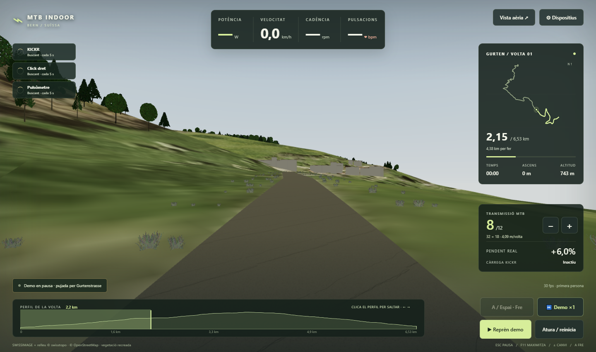
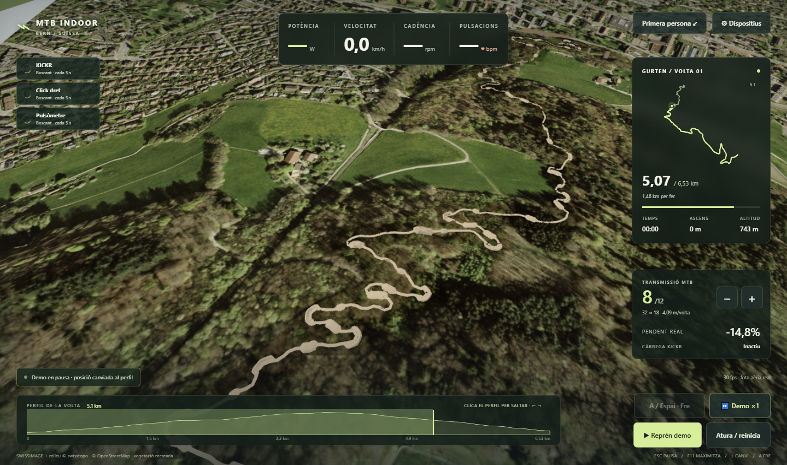
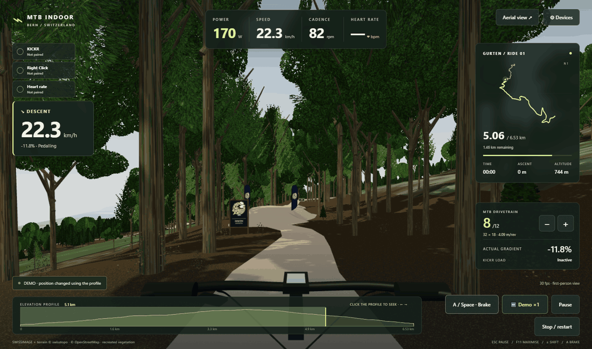

# Gurten · Il Brunello → Gurtentrail

Circuit públic de **6,53 km i 289 m d'ascens**, amb sortida a Kehrsatz, pujada fins a l'entrada del Gurtentrail al costat de Gurten Kulm i baixada fins a Wabern. Selecciona **Gurten** a la portada i prem **Explora en demo** o inicia la ruta amb els sensors. **El Tony ↗** obre una demo just abans del tram del rètol; la pausa, la represa, el perfil seleccionable i l'acceleració ×1–×8 funcionen com als altres circuits.

## Traçat i relleu

| Tram | Dades del circuit |
| --- | --- |
| Sortida | Carretera adjacent a Il Brunello, Bernstrasse 1, aproximadament a 19 m del punt oficial de l'adreça |
| Pujada | Zimmerwaldstrasse → Talstrasse → Gurtenstrasse → Grünenbodenweg |
| Accés final | Uns 15,2 m de camí a peu abans de la porta del trail; no se li atribueix permís per circular amb bici |
| Inici de la baixada | Km 4,154, al costat de Gurten Kulm |
| Gurtentrail cartografiat | 2,373 km, de baixada en sentit Wabern |
| Final | Km 6,527, final del trail; no inclou retorn a Il Brunello |

És una ruta construïda amb connexions d'**OpenStreetMap**, no una activitat gravada. La pujada evita els trams amb prohibició explícita per a bicicletes i no entra al parc de vianants del cim. La baixada utilitza la [via OSM 94360847](https://www.openstreetmap.org/way/94360847), versió 25, actualitzada el 15 de novembre de 2026.

El [gestor trailnet](https://www.trailnet.ch/de/trails/gurten-trail) i [Gurtenpark](https://www.gurtenpark.ch/de-ch/freizeit/downhill-trail) descriuen la renovació de 2025 amb uns **2,4 km i 240 m de descens**. El seu [mapa esquemàtic](https://cdn.prod.website-files.com/678f9dfa489afaaef7e1f4de/695555f2e94e0dc5a770d007_gurtentrail-2-0_trailmap.jpg) ajuda a contrastar revolts, clarianes, creuaments i final de ruta; no s'ha tractat com un aixecament georeferenciat.

L'ortofoto **SWISSIMAGE © swisstopo**, de 4352×4096 píxels, acompanya el terreny de swisstopo. Les elevacions es mostregen sobre el traçat i se suavitzen en una finestra de 40 m. Aquest perfil dona aproximadament 840 m a l'entrada del trail i 593 m al final, davant dels 840 i 600 m arrodonits del mapa oficial.

## Salts, peralts i El Tony

Les fotografies del nou trail han guiat la terra compactada clara, els marges foscos, la vegetació verda i les formes arrodonides dels salts. El joc inclou **40 ressalts —taules i rollers— i 14 peralts** modelats sobre la línia del camí. Les textures de terra i fusta es generen amb codi; les fotografies de referència no es distribueixen com a textures.

El rètol negre, emmarcat amb fusta i amb el text **El Tony Jump Line**, està documentat a les [fotografies d'instal·lació de TRIEBHAUS](https://www.triebhaus.ch/projekte/gurtentrail). Les dues banderes blau marí amb el logotip apareixen al costat d'un salt a la [crònica oficial de la inauguració](https://www.trailnet.ch/de/aktuell/recap---opening-gurtentrail-2-0). Les banderes es documenten el juliol de 2025; no s'afirma que siguin un element permanent.

**La posició i les dimensions dels obstacles són aproximades.** Les fonts confirmen el disseny i l'aspecte, però no les coordenades ni les mesures de cada salt. El rètol també té una posició representativa dins del simulador. El logotip s'ha obtingut de la [web oficial d'El Tony](https://www.eltonymate.com/site/templates/images/El-Tony-Mate-Logo.png), conservant-ne les proporcions; la representació no implica patrocini de l'app.

El camí i la càmera fan servir el mateix perfil continu per passar sobre cada ressalt. **No hi ha física de vol ni salts aeris.** Aquests volums visuals no alteren el pendent que rep el KICKR: el rodillo, el perfil d'altitud i la física de desplaçament continuen utilitzant el relleu geogràfic suavitzat. Això evita pulsacions artificials de càrrega als llavis dels salts.

## Dades i límits

La carpeta pública [`Scene/courses/gurten`](../src/MTBIndoorBern/Scene/courses/gurten/) inclou `route.json`, `world.json`, `aerial.jpg`, `appearance.json`, `handling.json`, `features.json`, `provenance.json` i el logotip. La [procedència geogràfica](../src/MTBIndoorBern/Scene/courses/gurten/provenance.json) i les [referències dels elements visuals](../src/MTBIndoorBern/Scene/courses/gurten/features.json) detallen mètodes, fonts i incerteses. No s'hi inclouen FIT, vídeos, fotos de recerca ni identificadors de sensors.

És una reconstrucció per entrenar a l'interior, no navegació exterior ni una garantia d'obertura, accés o seguretat del circuit real. Les amplades, els arbres, les textures i els obstacles són interpretacions visuals, limitades per les dades disponibles.

Cartografia **© OpenStreetMap contributors**, sota [ODbL](https://www.openstreetmap.org/copyright). Ortofoto i terreny **© swisstopo**, segons les seves [condicions de dades i geoserveis oberts](https://www.swisstopo.admin.ch/en/terms-of-use-free-geodata-and-geoservices). Altres fonts: [Il Brunello](https://ilbrunello.ch/), [SwitzerlandMobility](https://schweizmobil.ch/de/mountainbikeland/route-10714), [servei d'imatges](https://docs.geo.admin.ch/visualize-data/xyz.html) i [servei de terreny](https://docs.geo.admin.ch/visualize-data/terrain-service.html).
