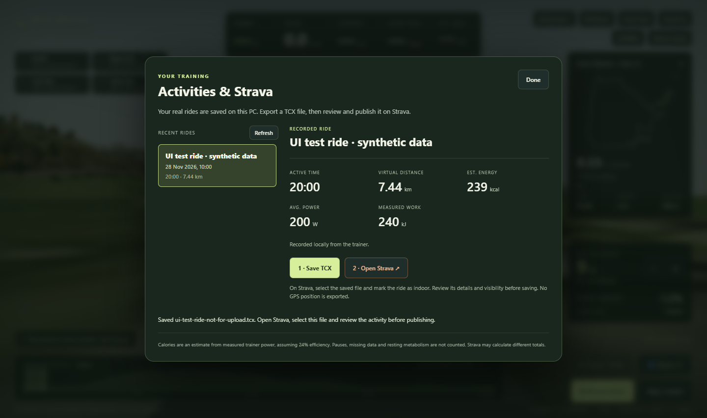

# Activities, estimated calories and Strava

[Simulator](simulator.md) · [Bike setup and calibration](bike-calibration.md) · [Development log](../DEVELOPMENT_LOG.md)

The simulator displays **EST. KCAL** during real trainer rides and keeps a local activity recording. Use **Activities** to review a ride, save a TCX file and open Strava's file uploader. Uploading remains a deliberate action on Strava; the simulator does not connect to your Strava account or publish automatically.



*The screenshot uses synthetic test data. It shows a local export, not a published Strava activity.*

## Estimated calories

The estimate uses accepted, fresh trainer-power intervals:

```text
mechanical work in joules = sum(measured watts × active seconds)
estimated kcal = mechanical work / (4184 × 0.24)
```

At 200 W for 30 minutes, this gives 360 kJ of measured work and approximately **359 kcal**. The 24% conversion is a fixed assumption, not a measured personal metabolic efficiency. Cycling efficiency varies between riders and workloads, as illustrated by [Hopker, Coleman and Wiles (2007)](https://pubmed.ncbi.nlm.nih.gov/18059575/).

The estimate excludes pauses, rejected/missing-power intervals and resting metabolism. Coasting at a measured zero watts adds no mechanical work, even though the rider still expends some energy. It is therefore an estimate of exercise energy from pedalling, not a measurement of all energy the body uses. The rider's saved weight remains part of the simulation's physics; it is not substituted for a measured power stream in this calculation.

Demo and practice do not produce workout calories or activity records. Their automatically generated watts must not be mistaken for exercise. Changing virtual gears only adds calories through the resulting measured rider power, not through the button press itself.

Strava may show a different calorie total because it supports third-party values as well as its own power/efficiency-based calculation. See [Strava's explanation of calories](https://support.strava.com/en-us/articles/15402159-how-does-strava-calculate-calories).

## Save a ride to Strava

1. Ride with the trainer connected. Open **Activities** when you want to review the recording.
2. Select the saved ride and choose **1 · Save TCX**. Save the file somewhere you can find it.
3. Choose **2 · Open Strava ↗**, or visit [Strava's file uploader](https://www.strava.com/upload/select).
4. Sign in to Strava if necessary, select the TCX file, mark the ride as indoor, and review its title, details and visibility before saving it there.

Strava documents manual uploads of TCX, FIT and GPX workout files up to 25 MB. The exporter checks that size limit before replacing a selected destination file. See [Strava's file-upload instructions](https://support.strava.com/en-us/articles/15402066-how-do-i-get-my-activities-to-strava).

The local **Save TCX** confirmation means the file was saved on this PC. Opening the Strava page does not mean the activity has been uploaded. This feature needs no Strava API client ID or secret. A separate automatic integration would require a registered application and OAuth authorization; Strava's current [developer getting-started guide](https://developers.strava.com/docs/getting-started/) also states that creating an API application requires a subscription.

Export the final version of a ride once. A resumed ride keeps its original identity and start time; uploading an earlier checkpoint and then its completed version can produce a duplicate warning in Strava. Re-exporting does not update an existing Strava activity automatically.

## What the file contains

The TCX is a cycling activity with UTC timestamps, active duration, estimated calories and cumulative **virtual distance**. Fresh measured power, cadence and heart rate are included when available. Missing sensor values are omitted, while genuinely measured zero power or zero cadence remain zero.

Pause/resume and rejected-data gaps create separate tracks. The exporter does not fill those gaps with invented samples. It omits GPS coordinates and outdoor altitude: the rider trained indoors, and the simulator's route is not a measured outdoor journey. Strava's displayed distance, moving time and other summaries may depend on how it processes the file.

The format follows Garmin's [Training Center Database v2 schema](https://www8.garmin.com/xmlschemas/TrainingCenterDatabasev2.xsd), with watts in [Activity Extension v2](https://www8.garmin.com/xmlschemas/ActivityExtensionv2.xsd). Strava explicitly documents TCX v2 and its power extension in the [upload format reference](https://developers.strava.com/docs/uploads/).

## Local storage and recovery

Real recordings are saved in the private `activities` directory beside the simulator executable. Checkpoints are written during the ride and at lifecycle boundaries, through the host's background save queue. Each recording retains its own ID; pausing and resuming continue the same activity. Resetting or starting a different ride preserves the previous recording separately.

Writes replace files atomically and keep the previous checkpoint as a `.bak` file. A damaged primary file can be read from that backup, with a warning. A damaged recording does not hide other readable activities, and corrupt files are kept for recovery rather than deleted. The panel shows recent recordings; older files are not automatically removed.

If a local write fails, its latest snapshot remains available in Activities for export, including after restarting the ride or changing courses. **Refresh** retries the save. The warning remains while any recording is unsaved; export those rides before closing the app, because this recovery copy is held in memory.

A recovered checkpoint can be exported if it contains sufficient real samples, but it may end before the actual ride ended. The UI distinguishes unfinished recordings. Sessions that reach the recorder's sample/segment limit retain their available local data and totals but cannot be exported as complete TCX streams. Export failure does not delete the recording or replace an existing selected file.

These files contain workout timestamps and may contain heart-rate measurements. They remain on the PC until the rider exports or uploads them. Local recordings, backups and exported workouts are excluded from the public repository.

## Verification and limits

The export/storage regression suite checks UTC conversion, pause gaps, measured zero values, omitted missing sensors, XML escaping, locale-independent numbers, indoor-only fields, malformed/demo/truncated rejection, checkpoint finalization, backup recovery, corrupt-file isolation and safe filenames. It also exports a snapshot produced by the actual recorder, including a partial-course start and pause/resume.

A synthetic TCX fixture was validated against both official Garmin schemas. No personal workout was uploaded to Strava during development, and no successful Strava import or new physical-sensor recording is claimed from those offline checks. Run `ActivityExportTests.Verify()` through the application's existing self-test command; the schema check additionally uses locally downloaded official XSD files.

The Windows app was also checked at 1440 px and 1132 px content widths. Demo calories stay unavailable; opening Activities pauses the ride, and closing it requires an explicit resume. Cancelling the native save dialog leaves the recording intact. A successful native export produced 1,201 synthetic points and passed both Garmin schemas with no GPS or altitude fields. Closing and reopening the panel requires a fresh export before enabling the Strava button again. See the [verification record](verification-activities-2026-11-28.json).
