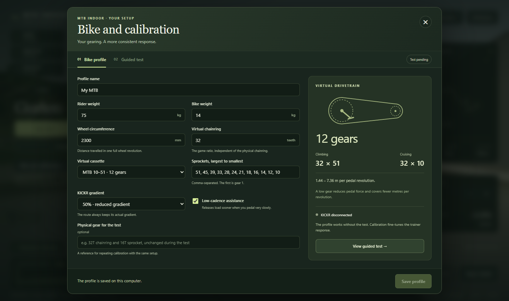
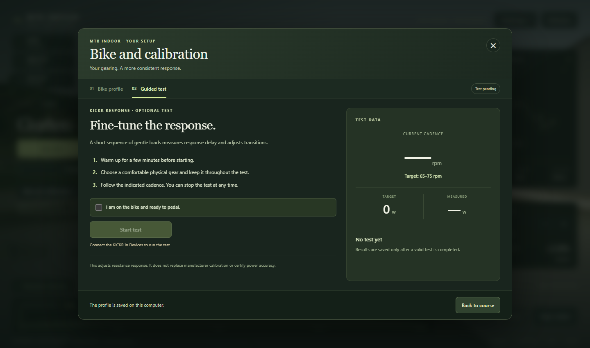

# Bike and calibration

[Project overview](../README.md) · [Simulator](simulator.md) · [Development log](../DEVELOPMENT_LOG.md)

Open **Bike and calibration** from the top bar or welcome screen. Opening this screen pauses the ride and releases trainer load. The profile works even if you skip the guided test. The app labels and screenshots are in English.

## Configure your bicycle

- **Rider weight** and **Bike weight:** their combined mass enters the gravity and rolling-resistance calculations. Previously saved rider weight and trainer gradient percentage are preserved.
- **Wheel circumference:** distance travelled in one full wheel revolution, entered in millimetres. The initial value is 2300 mm; replace it with your measured circumference if available.
- **Virtual chainring** and **Virtual cassette:** a 20–60-tooth chainring; MTB presets of 10–51, 10–52 or 11–46, or a custom list of 4–24 sprockets. Enter sprockets from largest to smallest: the first is gear 1, the easiest gear. The screen shows metres travelled per crank revolution at both ends of the range.
- **KICKR gradient:** 100% applies the full gradient to the load calculation. Lower percentages reduce its effect on the trainer; terrain and game speed always use the actual route gradient.
- **Low-cadence assistance:** when enabled, load decreases progressively between 45 and 30 rpm, reaching a 0 W target at 30 rpm. When disabled, these thresholds become 25 and 12 rpm; load release at very low cadence remains active.
- **Physical gear for the test:** an optional note recording the real chain position during the test. Shifting with the Click changes the virtual transmission; it does not move the physical chain.

Press **Save profile**. The settings apply to the game and persist when the app reopens. Changing weights, wheel circumference, gearing, assistance, gradient percentage or the physical-gear note makes the previous calibration result inapplicable. Changing only the profile name or course does not invalidate it.



## Guided response test

1. Connect the KICKR, warm up for a few minutes and choose a comfortable physical gear. Keep that gear throughout the test.
2. Open **Guided test**, tick **I am on the bike and ready to pedal** and press **Start test**.
3. Pedal at **65–75 rpm**. No load commands are sent until at least five stable seconds and five fresh samples have been observed.
4. Follow the instructions: **70 → 110 → 70 W** at approximately 70 rpm, transition to **80–90 rpm**, then **110 → 70 W** at approximately 85 rpm. The sequence takes about two minutes, plus the initial wait.
5. If every stage has enough stable data and the KICKR confirms the final load release, the result is saved automatically. The screen shows **Calibration current** when the same profile and trainer are connected.

The test measures settling time and tracking of the 70–110 W targets. It adjusts the torque increase rate between **3 and 6 Nm/s**, with commands at least one second apart. Without a valid result, the game uses **5 Nm/s**. Load reductions do not wait for this ramp.

**Stop and release load**, Esc, closing the screen or losing focus cancels the test. It also stops if fresh telemetry is missing, the trainer disconnects or cadence drops too low. A cancelled test or poor target tracking does not create a new result. Any previously valid result is retained. **Delete this calibration** explicitly restores the standard response.



## What the game calculates

Rollout is `wheel circumference × chainring teeth / sprocket teeth`. The load calculation combines rollout with cadence. Resistance includes gravity, rolling resistance and aerodynamic drag:

```text
θ = atan(gradient / 100)
F = total_mass × g × (sin θ + Crr × cos θ) + ½ × ρ × CdA × speed²
crank torque = max(0, F) × rollout / (2π × efficiency)
target power = torque × crank angular velocity
```

Avatar speed evolves from **measured power** and the resistive force from the same model, including bicycle mass and surface type. Gravity allows descending at 0 W; game speed is not forced to equal cadence multiplied by rollout.

The coefficients are simulator assumptions: efficiency 0.96; air density 1.225 kg/m³; CdA 0.51 m²; Crr 0.005 on asphalt, 0.009 on gravel and 0.012 on earth/leaves. They are not measurements of individual route sections. The game retains its limits of 600 W target load and 45 km/h virtual speed.

**Calibration limitation:** the KICKR supplies both the load and the observed power. Without an independent reference power meter, this test cannot certify absolute power accuracy and does not apply a multiplier to measured watts. It does not replace the manufacturer's procedure. Resistance remains an approximation using dynamic FTMS target-power commands: it does not reproduce real-wheel inertia exactly or use Zwift's proprietary virtual-shifting protocol.

The rolling-resistance model change starts a new version of downhill records. Old records remain in the local file but are not compared with times set using this physics model.

## Data and verification

The profile and result are saved only in `settings.json`, which is excluded from the repository. The result is associated with a profile signature and an identity derived from the trainer. No telemetry is sent to GitHub.

`--self-test <file>` runs physics, profile-migration, custom-gearing and calibration tests with a simulated trainer. Cases include fast/slow response, cancellation during a pending command, duplicate or stale samples, incorrect cadence, disconnection, rejected commands and failure to release load. These tests do not send commands to a real KICKR.

The current English screenshots show the profile and the test awaiting a connection. Physical validation of the guided test still requires a physical pedalling session.

References: [Wahoo trainer control modes](https://support.wahoofitness.com/hc/en-us/articles/28408412793490-Trainer-control-modes-for-KICKR-CORE-SNAP-or-BIKE-in-the-Wahoo-app), [ERG mode behaviour](https://support.wahoofitness.com/hc/en-us/articles/4402565516946-A-Guide-to-using-ERG-mode) and [Martin et al.'s cycling power model](https://pubmed.ncbi.nlm.nih.gov/28121252/).
