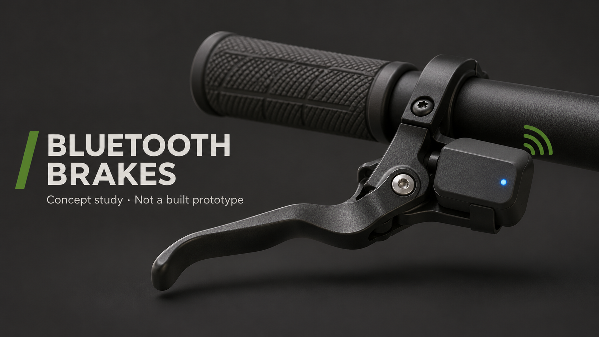
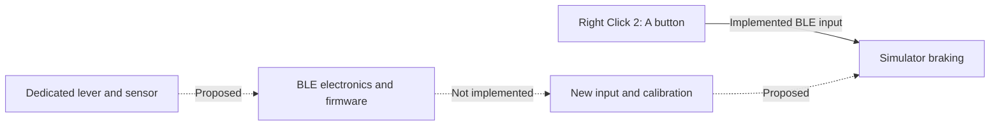

# Bluetooth brakes

[Project overview](../README.md) · [Simulator](simulator.md) · [Data acquisition](data-acquisition.md) · [Development log](../DEVELOPMENT_LOG.md)

This section brings together the working Bluetooth brake input and the early design work on a dedicated brake-lever accessory. The simulator already responds to the **A button on the right Zwift Click 2**. A separate physical lever, its electronics and its firmware are still research work; this repository does not yet contain a tested custom brake device.

*AI-generated concept study, not a built prototype, a CAD model or a wiring specification. The enclosure, clamp and lever arrangement are illustrative. [Render provenance and prompt](brake-concept-render.md).*

## Working today

- Hold **A** on the right Click 2 to brake; release it to coast. Keyboard **A / Space** and the on-screen brake are also supported.
- **+** and **B** retain their MTB gear functions in this application.
- Braking changes virtual speed. It does not actuate the bicycle's physical brake or add braking load to the KICKR.
- Corner warnings, grip loss and runout penalties make braking useful on descents. [Downhill guide](downhill.md).
- A live ride pauses when the connected Click is lost, so the rider can recover brake input before continuing.

The recorded hardware check detected **six presses and six releases**, with no unintended shifts. This is evidence for the right Click 2 integration, not for a custom lever or proportional sensor. See the [19 November verification report](verification-downhill-2026-11-19.json).

## Dedicated brake accessory: design work

The project's initial discussion is available in the [shared Bluetooth brake planning conversation](https://chatgpt.com/share/6b02a20d-5db8-83eb-93a7-cbb479549aaa). It is linked as a planning reference, not as evidence of a completed implementation.

The direction being explored is a physical lever that sends its input over Bluetooth to the simulator. The existing controller path is **pressed/released**: the `brakePressure` value shown by the game is a simulated response, not a measured hydraulic pressure. Continuous lever travel, force or pressure would need a new input path and calibration before being described as supported.

## Hardware and manufacturer references

### Existing, tested input

| Hardware | Role in this project | Links and status |
| --- | --- | --- |
| Zwift Click 2, right controller | Wireless A-button braking and MTB shifting | [Official installation guide](https://support.zwift.com/de/installing-your-zwift-click-H1pXM6Zp) · [Official controller guide](https://support.zwift.com/de/using-your-zwift-click-S1by2SXWp). Tested in this app. The manufacturer's pages describe Zwift's own button assignments; this app uses the mapping above. |

### Prototype component research

The exact components from the ongoing design discussion have **not yet been recorded in this repository**. The links below are technical reference options, **not a selected bill of materials, purchasing list or compatibility claim**. Replace them with the selected part number, revision and supplier link when the design is captured here.

| Function | Manufacturer reference | Project status |
| --- | --- | --- |
| Compact Bluetooth LE development board | [Seeed Studio XIAO nRF52840](https://www.seeedstudio.com/Seeed-XIAO-BLE-nRF52840-p-5201.html) · [Hardware documentation](https://wiki.seeedstudio.com/XIAO_BLE/) | Research reference only; not selected or tested for the brake accessory |
| Contactless lever-position sensing | [Texas Instruments DRV5055](https://www.ti.com/product/DRV5055) · [Datasheet](https://www.ti.com/lit/ds/symlink/drv5055.pdf) | Example of a linear Hall sensor for position sensing. It measures magnetic field, not hydraulic pressure; mounting, magnet and electrical compatibility need design work |
| Lever, mounting, power supply and enclosure | Specific models and supplier links pending | Not specified or validated by the concept render |

This documentation does not change or provide instructions for modifying a bicycle's real braking system. The proposed accessory is an **indoor simulator input**.

## What needs to be recorded next

1. Selected lever, sensing method, board, power source and exact hardware links.
2. Mechanical arrangement, circuit and firmware revision.
3. Input format: button state or continuous travel/force/pressure, with units and calibration method.
4. Measurements for release detection, repeatability, latency, disconnect handling and battery behavior.
5. Simulator integration and a dated test report before marking the custom device as supported.

## Source code for the existing integration

- [Bluetooth discovery, notifications and brake state](../src/MTBIndoorBern/BluetoothDevices.cs)
- [Input handling and ride state](../src/MTBIndoorBern/RideSession.cs)
- [Virtual braking, grip and recovery](../src/MTBIndoorBern/TrailHandling.cs)
- [Interface and disconnect handling](../src/MTBIndoorBern/RidePanel.cs)

Related: [downhill behavior](downhill.md), [bike calibration](bike-calibration.md), and [future recorded sensor streams](data-acquisition.md).
