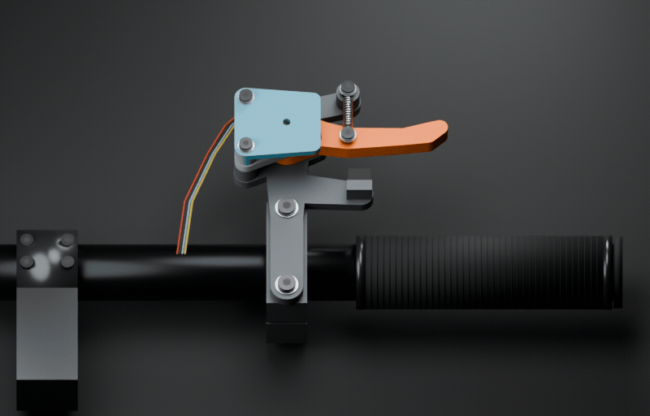
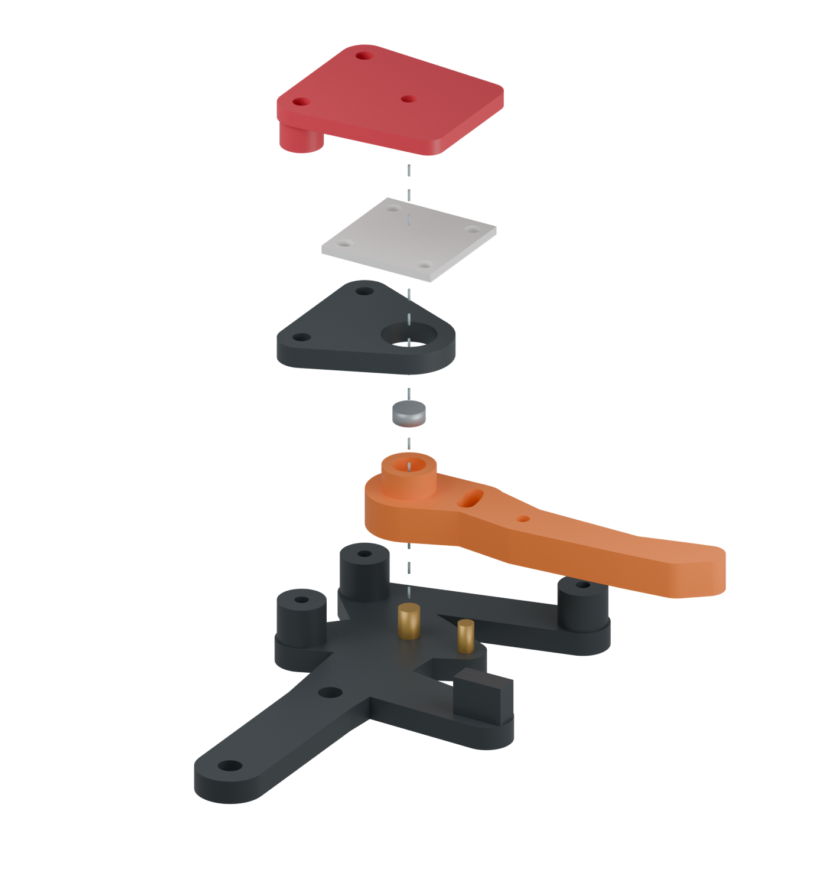
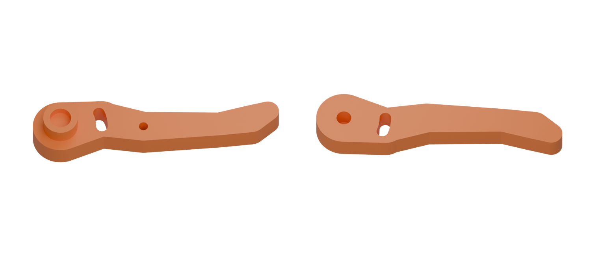
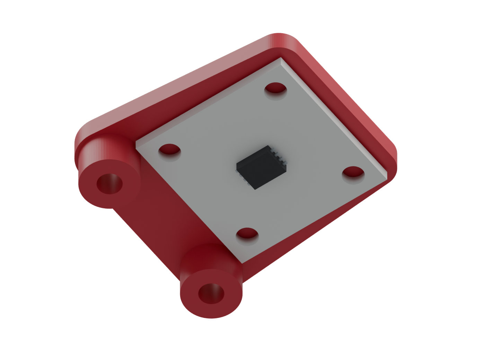
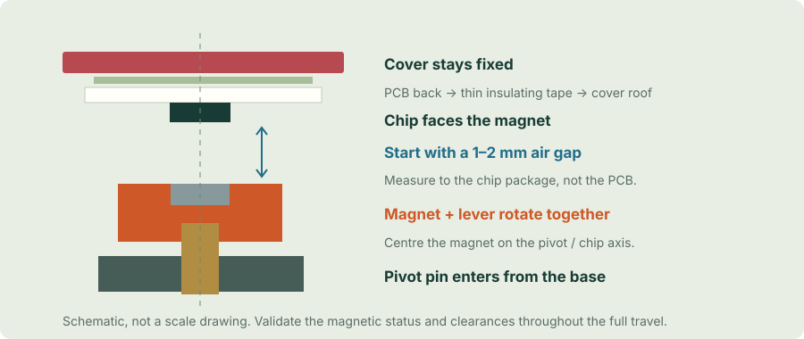
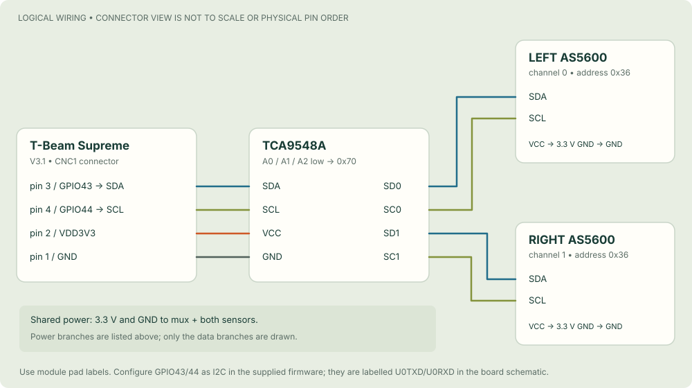

# Bluetooth brakes

[Project overview](../README.md) · [Simulator](simulator.md) · [Data acquisition](data-acquisition.md) · [Development log](../DEVELOPMENT_LOG.md)

This document covers the **Maneta v01 magnetic brake-lever prototype**, its assembly, electronics and Bluetooth bench test. The simulator's existing right Zwift Click 2 A-button input is described under [Working today](#working-today).

**Status:** printable geometry, build-checked T-Beam Supreme firmware and a browser tester are available. Both assembled levers were observed sending live BLE readings on **28 November 2026**. The sensors still reported weak magnetic fields; magnetic quality, repeatability and complete assembly acceptance need validation. The custom lever's proportional BLE signal is not yet integrated into the riding simulator.

- [Parts and tools](#parts-and-tools)
- [Mechanical assembly](#mechanical-assembly) and [sensor mounting](#sensor-mounting)
- [Wiring: encoders, multiplexer and controller](#wiring)
- [Firmware and startup](#firmware-and-startup)
- [Bluetooth bench test](#bluetooth-bench-test)
- [Troubleshooting](#troubleshooting) and [bench acceptance](#bench-acceptance)
- [Hardware and manufacturer references](#hardware-and-manufacturer-references)

## Maneta v01



*Animation rendered in Blender from the v01 STL assembly. Materials, fastener details, spring and cable routing are illustrative. This is not footage of a built prototype or mechanical validation. [Animation provenance and CAD references](brake-v01-render.md).*

Each lever uses **six printed PETG parts**: a base, lever, upper guide, sensor cover and two identical clamp halves. An extension spring returns the lever; a rubber stop adds resistance near the end of travel. The nominal design uses a **22.2 mm handlebar tube, a 55 mm pivot-to-finger radius and 22° of travel**. Viewed from the rider's side, the lever points **outward towards the grip and bar end**, with its pivot inboard, as on a conventional bicycle brake.

An **AS5600 measures the angle of a magnet fixed to the lever**, not finger force or hydraulic pressure. The PCB stays fixed to the cover. Four wires connect each sensor to external electronics: a TCA9548A selects the two encoders in turn, and one LilyGO T-Beam Supreme streams their readings and diagnostics over Bluetooth LE. Begin on USB power for the bench test.

Downloads and source:

- [Printable left/right STL files and editable CAD — ZIP](workshop/downloads/maneta-v01-print-files.zip)
- [Mechanical source and printing notes](../hardware/maneta-v01/README.md)
- [Firmware source — ZIP](workshop/downloads/brake-bench-source.zip)
- [Firmware source and detailed build notes](../firmware/brake-bench/README.md)
- [BLE telemetry protocol](brake-protocol.md)

### Parts and tools

Quantities below make **two levers**. Dimensions are v01 nominal values; measure the printed parts, tube, pins, magnet and PCB before committing to adhesive. Spring rate, rubber feel and clamp tightening torque need validation on the built assembly.

| Part | Quantity | Specification and source |
| --- | --- | --- |
| PETG printed parts | 12 | Per hand: base, lever, guide, cover and two identical clamp halves. [Print files](workshop/downloads/maneta-v01-print-files.zip). |
| AS5600 modules and magnets | 2 sets | 3.3 V modules with diametrically magnetized discs; nominal magnet Ø6 × 2.5 mm. [Bastelgarage module](https://www.bastelgarage.ch/arduino/as5600-magnetischer-12bit-encoder-3-3v). |
| TCA9548A multiplexer | 1 | Breakout with upstream SDA/SCL and SD0/SC0, SD1/SC1 channel pads. [Bastelgarage module](https://www.bastelgarage.ch/arduino/modul-breakout-fur-arduino/8-kanal-i2c-multiplexer-tca9548a). |
| LilyGO T-Beam Supreme | 1 | ESP32-S3 board; this guide targets V3.1 CNC1 wiring. Include a USB data cable. [Official board documentation](https://wiki.lilygo.cc/products/t-beam-series/t-beam-supreme/). |
| Smooth brass pins | 4 | Two Ø4 × 10 mm pivots and two Ø3 × 10 mm travel limiters. |
| Cover/guide screws | 4 | M3 × 20; check thread engagement and bottoming in the actual print. |
| Spring anchor hardware | 4 sets | Each: M3 × 8 screw, washer and approximately 2 mm tubular spacer. |
| Return springs and rubber stops | 2 each | Spring starting point: 18–20 mm relaxed eye spacing, working around 21–30 mm. Rubber starting size: 9 × 6 × 5–6 mm. Supplier part numbers are not yet fixed. |
| Handlebar clamp hardware | 4 sets | M4 × 40 bolts, low-profile locking nuts and thin washers; check the 22.2 mm clamp fit and actual bolt length. |
| Wiring and mounting supplies | As needed | Flexible four-core leads, suitable CNC1 connector lead, insulating double-sided tape, heat-shrink, strain relief and suitable epoxy. [Qwiic/STEMMA QT connector-to-loose-wire cable example](https://www.galaxus.ch/de/s1/product/hutopi-jst-sh-cable-for-qwiic-and-stemma-qt-elektronikkabel-stecker-59730842). Verify connector fit and pin continuity; cable colours do not establish polarity. |

Useful tools: calipers, a small file/deburring tool, hex keys, soldering iron, multimeter and a computer with USB and Bluetooth. A charging-only USB cable cannot upload firmware.

### Mechanical assembly

Use matching left- or right-hand parts. Work unpowered and dry-fit the moving mechanism before adding electronics or permanent adhesive.



*Unmodified v01 printed meshes, separated vertically for clarity. The electronic component shapes are illustrative; the magnet belongs inside its seat. Spring, clamp and fasteners are omitted from this exploded view.*



*Raised collar: nominal Ø6.18 × 2.5 mm magnet recess. Flat underside: nominal Ø4.30 mm blind pivot bore. These are separate cavities on opposite faces.*

1. **Clean and dry-fit the pins.** Remove printing burrs. The Ø4 mm pivot enters the main axis of the base; the Ø3 mm limiter sits 12 mm away and enters the curved lever slot. In v01, both 10 mm pins sit flush underneath the base. Secure the pins in the base only, keeping adhesive away from moving surfaces.
2. **Fit the lever.** Place it on both pins with the raised collar facing up. Check that the limiter follows the slot and that the pivot turns freely.
3. **Fit the upper guide.** Lower it around the collar and align its two fixing holes with the base pillars. It holds the lever vertically without gripping the rotating collar.
4. **Install the return spring.** Join the fixed post to the lever's spring anchor. Fit a short spacer, spring eye and washer under each M3 × 8 screw so the eye can pivot. Check that the spring covers the intended travel without permanent deformation.
5. **Add the rubber stop.** Attach it to the vertical backstop facing the lever. Thickness sets when contact begins; stiffness changes the finger feel. Check gentle, medium and firm pulls, then verify that the lever returns every time.
6. **Trial-fit the empty cover.** Pass the two M3 × 20 screws through the cover and guide into the base pillars. Check thread engagement and that the screws do not bottom out. Tighten gently, verify free return, then remove the cover to fit the sensor.

Use the mechanism's intended travel limits; the sensor must never become a mechanical stop. After the complete bench fit, mount the clamp halves on a compatible tube and check finger, grip and control clearance. Keep cables away from the moving lever. Do not force the fit by overtightening the printed parts.

### Sensor mounting



*The PCB's back attaches to the inner cover roof. The chip faces away from the cover and towards the magnet. The cover's two mounting holes attach to the guide/base; v01 has no separate posts for the PCB's four holes.*



*Spacing in the diagram is illustrative. Set the actual gap from the chosen magnet, mechanical clearance and live magnetic diagnostics.*

1. **Retain a centred diametric magnet.** Measure the recess and disc. v01 expects a Ø6 × 2.5 mm magnet, with its face level with the collar top. If the chosen magnet needs an insert or shim, make it nonmagnetic and measured so the magnet remains centred on the pivot axis. Keep the separate underside pivot bore free for its pin.
2. **Fix the PCB to the cover.** Start with thin insulating double-sided tape on the PCB's back. Centre the **AS5600 chip**, rather than the board outline, on the pivot axis. The small cover hole is an alignment reference, not a screw fixing through the sensor. Use a reversible, insulated mount while checking fit.
3. **Adjust the air gap using the signal.** Measure between the magnet face and the facing **chip-package surface**, not the PCB surface. Maintain clearance throughout the stroke, then adjust spacing while monitoring MD/ML/MH and AGC. A weak field calls for checking centring and cautiously reducing the gap; an excessive field calls for more separation. There is no universal spacer thickness. Verify healthy status throughout travel before fixing the final spacing.
4. **Adjust spacing without tilt.** Equal spacers under both cover feet raise the cover; a stable insulating PCB pad can lower the sensor. Recheck parallelism, screw engagement and clearance from every solder joint and moving part.
5. **Route and secure the wires.** Solder the four leads or fit a low-profile connection that clears the cover. Provide strain relief on the stationary structure. No wire, connector or solder joint may touch the lever, spring or magnet.
6. **Test before permanent adhesive.** Temporarily retain the magnet and board without allowing either to slip. Run the electrical test below, then secure the magnet, allow the adhesive to cure and repeat the test with the cover tightened.

Do not drill through the blind magnet/pivot cavities or put a screw through the sensor axis. The magnet rotates with the lever; the PCB and cover stay fixed.

### Wiring

The electrical target is the **LilyGO T-Beam Supreme V3.1 with ESP32-S3**. Check the revision and [official V3.1 schematic](https://github.com/Xinyuan-LilyGO/LilyGo-LoRa-Series/blob/master/schematic/T-Beam-S3-Supreme/T-Beam-S3-Supreme-V3.1.pdf) before wiring; other T-Beam models can have different pins.



*Logical connections, not a physical connector view. Use board markings and continuity checks. Do not infer pin order from wire colours or the orientation of this drawing.*

#### Controller to multiplexer

The supplied firmware uses the four-pin **CNC1 connector**. The schematic labels its data pins U0TXD/U0RXD; firmware reconfigures them as I2C. The serial console uses native USB CDC.

| CNC1 pin / signal | Firmware role | Connect to |
| --- | --- | --- |
| 1 · GND | Ground | Mux GND and both sensor GND pads |
| 2 · VDD3V3 | Regulated 3.3 V supply | Mux VCC and both sensor VCC pads |
| 3 · U0TXD / GPIO43 | SDA | Mux upstream SDA |
| 4 · U0RXD / GPIO44 | SCL | Mux upstream SCL |

CNC1 VDD3V3 uses the same DC1 rail as the ESP32, so this connection needs no auxiliary PMU rail switching. The firmware leaves the internal GPIO17/18 sensor bus and GPIO42/41 PMU bus untouched. The BLDO2 expansion output is not interchangeable without its power configuration. **VBAT, VSYS and VBUS are not the 3.3 V sensor supply.**

#### Multiplexer to encoders

Both AS5600 encoders have address **`0x36`**. Connect the left sensor to channel 0 and the right sensor to channel 1, so each can be selected separately.

| AS5600 pad | Left lever | Right lever |
| --- | --- | --- |
| VCC | Shared 3.3 V | Shared 3.3 V |
| GND | Common GND | Common GND |
| SDA | Mux SD0 | Mux SD1 |
| SCL | Mux SC0 | Mux SC1 |
| DIR | GND if the module does not already strap it | GND if the module does not already strap it |
| OUT / programming pad | Unused | Unused |

- Keep mux **A0, A1 and A2 low** for address `0x70`.
- **RESET must be pulled high** for normal operation. Check whether the breakout already includes the required resistor and address straps.
- SDA/SCL need suitable **pull-ups to 3.3 V** upstream and on both used branches. Inspect fitted resistors before adding more.
- Start with short bench leads and the supplied firmware's **100 kHz** bus speed.
- Firmware writes `0x01` to select channel 0, then `0x02` for channel 1. Each selection ends with STOP before reading `0x36`. It never enables both identical-address branches together.
- Leave sensor OUT and programming pads unused. Do not burn permanent AS5600 settings.

Before powering up, check connector orientation, common ground, 3.3 V rather than 5 V, and absence of a VCC-to-GND short. Disconnect USB and any battery before changing wiring. The multiplexer selects branches; the T-Beam runs the software that reads them and sends Bluetooth data.

### Firmware and startup

The ESP32-S3 application advertises as **MTB Brake Bench** and sends raw angles plus diagnostics at a nominal **20 Hz**. Bus faults can reduce the sampling rate. Calibration stays in the browser; the firmware does not store endpoints or write permanent sensor settings.

[Download firmware source ZIP](workshop/downloads/brake-bench-source.zip) · [Firmware README](../firmware/brake-bench/README.md) · [BLE protocol](brake-protocol.md)

#### Build

Install [Python](https://www.python.org/downloads/) and [PlatformIO Core](https://docs.platformio.org/en/latest/core/installation/index.html), or use [PlatformIO IDE for Visual Studio Code](https://platformio.org/install/ide?install=vscode). Extract the firmware ZIP or clone this repository. Run these commands from the directory containing `firmware/`:

```sh
python -m pip install platformio==6.1.18
python -m platformio run -d firmware/brake-bench -e tbeam-supreme
python -m platformio device list
```

The project pins Espressif32 **6.10.0** and Arduino-ESP32 **2.0.17**. The first build downloads the toolchain and project dependencies. In PlatformIO IDE, open `firmware/brake-bench` and use its **Build** task instead.

#### Upload

Connect the Supreme's **USB-C data/flash port** to the computer using a data-capable cable. A battery is not needed for this initial test. The separate core-module micro-USB port is not the port used here.

Find the serial port with `device list`, close any other terminal using it, then upload. This replaces the application currently installed on the board:

```sh
python -m platformio run -d firmware/brake-bench -e tbeam-supreme -t upload --upload-port COM7
```

Replace **COM7** with the actual port, such as `/dev/ttyACM0` on Linux. If automatic upload cannot enter the bootloader, hold **BOOT**, press and release **RST**, then release **BOOT**. Check the newly enumerated port and retry. Press **RST** after upload to start the application; the application port may differ from the bootloader port. PlatformIO IDE's **Upload** task performs the same operation.

#### Boot and serial diagnostics

After flashing, the application starts automatically on power-up or reset and advertises over Bluetooth. No button press, serial command, Wi-Fi credentials or cloud account is needed. It runs without a serial monitor open.

To inspect startup and once-per-second status, use the actual application port at **115200 baud**:

```sh
python -m platformio device monitor --port COM7 --baud 115200
```

Example output:

```text
MTB Brake Bench v1 - T-Beam Supreme ESP32-S3
External CNC1: SDA=GPIO43 SCL=GPIO44, 3.3V, 100kHz; mux=0x70 channels=0/1
seq=... mux=1 left=1 raw=... status=0x20 agc=... right=1 raw=... status=0x20 agc=... ble=0
```

These are example messages, not a recorded hardware test. `left=1` and `right=1` mean register reads succeeded; magnetic health must also be checked. `raw=65535`, `status=0xFF` and `agc=255` mark invalid reads. USB enumeration can make the monitor miss the first boot messages; the periodic status lines continue.

Keep USB power connected for the Bluetooth bench test. The board resumes advertising after a client disconnects. The application does not change charging/PMU settings, transmit over LoRa, actuate a brake or send braking commands to the simulator. [Detailed firmware behavior and host tests](../firmware/brake-bench/README.md#firmware-behavior).

### Bluetooth bench test

**[Open the Bluetooth bench tester](https://mfarre.github.io/mtb-indoor-bern/workshop/tester/)** in desktop Chrome or Edge on a computer with Bluetooth enabled. Open it directly, rather than inside an embedded preview. Web Bluetooth requires HTTPS or a localhost server; a `file://` page or ordinary LAN HTTP URL is unsuitable.

1. **Connect from the miniapp.** Power the controller, press **Connect Bluetooth**, select **MTB Brake Bench** in the browser chooser and allow access. Use this page's chooser rather than pairing it as an operating-system game controller. Keep only one BLE client connected.
2. **Check magnetic health.** A healthy channel has fresh readings and **MD = 1, ML = 0, MH = 0** throughout travel. These are the magnet-detected, field-too-low and field-too-high flags in AS5600 STATUS register `0x0B`. With MD=1 and a weak/strong-field warning, the bench still shows the angle and permits provisional calibration; it keeps the amber warning. Missing magnets, failed reads and stale data remain faults. Successful I2C reads or visible motion alone do not prove magnetic accuracy.
3. **Inspect the raw angle.** The 12-bit raw reading spans 0–4095. A 22° stroke corresponds to roughly 250 counts; the usable assembled stroke can be smaller. Crossing 4095/0 is normal, and the tester accounts for the wrap and direction when calibrating.
4. **Capture release.** Release one lever, hold it still for at least **0.5 seconds**, then press **Set released** for that channel.
5. **Capture full pull.** Hold a comfortable full pull steadily for at least 0.5 seconds and press **Set full pull**. Repeat both captures for the second lever. The percentage means calibrated lever travel, not force or hydraulic pressure.
6. **Keep the endpoints.** Each completed pair is saved automatically for this selected Bluetooth device and protocol in the browser; check the save message on its card. Alternatively, enter already measured released/full-pull raw counts and choose **Save endpoints**. **Clear** removes that lever's saved calibration. This does not write settings into the controller, and a saved mapping does not fix a weak field.
7. **Repeat and inspect.** Pull and release each lever ten times. Watch its percentage and raw angle for smooth movement, repeatable release and independent channels. The tester now uses just the two lever cards: the shared history plot and CSV session recorder have been removed. Record your hardware revision, endpoints and observations in a bench note or screenshot.
8. **Repeat after final assembly.** Cure the magnet adhesive, secure the PCB, tighten the cover and check again. Test disconnection and reconnection: invalid or stale readings must not look like a live lever position.

[Try the tester in demo mode](https://mfarre.github.io/mtb-indoor-bern/workshop/tester/?demo=1) to explore the interface without hardware. Demo signals do not validate sensors, wiring or Bluetooth. Demo calibration stays in memory and never loads or overwrites a physical device's saved endpoints.

**Why an angle can move while the field is weak:** MD indicates detection, while ML reports that automatic gain has reached its upper limit. In this 3.3 V setup, AGC ranges from 0 to 128; **128 is maximum gain**. The [AS5600 datasheet](https://cdn-learn.adafruit.com/assets/assets/000/138/130/original/Magnetic_Rotary_Position_Sensor_AS5600_Datasheet.pdf) recommends adjusting the magnet-to-chip gap towards the middle of the gain range. Centre the diametric magnet over the chip and check the whole stroke. The displayed angle can be useful for provisional setup while its accuracy remains unvalidated.

### Troubleshooting

| Symptom | What to check |
| --- | --- |
| Board missing from Bluetooth chooser | Check USB power and serial startup. Use a supported browser with Bluetooth permission; close another BLE app/tab connected to the board. Confirm the correct firmware is advertising as **MTB Brake Bench**, then reset and retry. Cancelling the chooser is not a sensor fault. |
| Mux or encoder missing | Power down and inspect VCC/GND/SDA/SCL, address straps, RESET pull-up, solder joints and fitted bus pull-ups. Confirm separate channels and that SD/SDA is not swapped with SC/SCL. Serial diagnostics identify the affected channel. |
| Weak, strong or missing magnetic field | Confirm a centred diametric magnet, air gap and alignment. Move it closer for weak field or farther away for excessive field, then check the whole stroke. Endpoint calibration cannot repair bad magnetic alignment. |
| Angle moves but calibration used to be blocked | Update/reload the tester. A detected, readable magnet with a weak/strong-field warning can now be calibrated provisionally; the warning stays visible. Use stable captures or enter measured raw endpoints. Missing magnets, invalid reads and stale data still block live capture. |
| Endpoints do not survive reconnecting | Check the per-lever save message. Browser storage must be available, and the same browser profile, site and Bluetooth device must be used. A different device or demo cannot reuse the saved profile. |
| Angle stays fixed, jumps or changes when pressing the cover | The magnet must rotate with the lever while the PCB stays fixed. Check for a sliding magnet, loose PCB, moving cable or contact with the chip. A single 4095/0 raw-angle wrap is normal. |
| Lever does not return consistently | Check pivot/guide binding, trapped spring eyes, rubber-stop stiffness and wires in the mechanism. Do not tighten the cover to force misaligned parts together. |
| Stale or disconnected status | Readings no longer represent live position. Reconnect and confirm fresh, healthy values on both channels. The tester clears stale/invalid values instead of retaining them as a live reading. |
| Tester works but the simulator does not brake | Custom proportional BLE input still needs a simulator adapter. The existing right Click A-button braking is a separate, supported input. |

### Bench acceptance

Use this checklist for the completed assembly and record the results with the actual hardware and firmware revisions:

- [ ] Both levers move freely, return consistently and do not catch wires or touch the sensor.
- [ ] Connector orientation, 3.3 V, common ground and all bus connections are checked.
- [ ] Both sensors remain magnetically healthy throughout the full stroke.
- [ ] Released and comfortable full-pull endpoints are captured for both channels.
- [ ] Ten pulls and releases show stable return and independent channels.
- [ ] Final assembly, disconnect/reconnect and saved endpoint restoration are checked.

**First live observation, 28 November 2026:** the hosted Chrome tester received both channels with **MD=1, ML=1, MH=0 and AGC=128**. The builder reported changing raw angles when pulling the levers, in opposite directions; endpoint mapping supports either direction. Measure each assembly's own released/full-pull values. Live transport and changing raw readings are established; healthy field, repeatability, latency and final mechanical acceptance are not yet established by that observation.

The firmware build and automated software tests do not validate physical fit or the magnetic gap. Complete and record the remaining bench checks before marking the assembly as verified. This accessory is an **indoor simulator input**; it does not modify the bicycle's real braking system.

## Working today

- Hold **A** on the right Click 2 to brake; release it to coast. Keyboard **A / Space** and the on-screen brake are also supported.
- **+** and **B** retain their MTB gear functions in this application. Left and right Clicks have independent connection slots; mouse clicks on the 3D trail provide backup shifting (left up, right down).
- Braking changes virtual speed. It does not actuate the bicycle's physical brake or add braking load to the KICKR.
- Corner warnings, grip loss and runout penalties make braking useful on descents. [Downhill guide](downhill.md).
- Losing a Click releases its held brake input and starts reconnection without pausing the ride. Keyboard and on-screen braking remain available; the other Click keeps its own connection and input state.

The recorded hardware check detected **six presses and six releases**, with no unintended shifts. This is evidence for the right Click 2 integration, not the custom lever. See the [19 November verification report](verification-downhill-2026-11-19.json).

The independent two-Click connection and recovery changes from 28 November have software checks; a physical two-controller and reconnect test remains pending.

The existing controller path remains **pressed/released**: the game's `brakePressure` is a simulated response. Continuous lever-angle input needs its own adapter and calibration before it can control a ride.

### Existing, tested input

| Hardware | Role in this project | Links and status |
| --- | --- | --- |
| Zwift Click 2, right controller | Wireless A-button braking and MTB shifting | [Official installation guide](https://support.zwift.com/de/installing-your-zwift-click-H1pXM6Zp) · [Official controller guide](https://support.zwift.com/de/using-your-zwift-click-S1by2SXWp). Tested in this app. The manufacturer's pages describe Zwift's own button assignments; this app uses the mapping above. |

## Hardware and manufacturer references

- [Maneta v01 mechanical source and printing notes](../hardware/maneta-v01/README.md), [firmware source](../firmware/brake-bench/README.md) and [BLE protocol](brake-protocol.md).
- [Initial design discussion](https://chatgpt.com/share/6b02a20d-5db8-83eb-93a7-cbb479549aaa) and [original attachment discussion](https://chatgpt.com/s/t_6b02aac7f4a8819189ca3bd0214c126f), retained as project provenance; the assembly instructions are fully included above.
- [LilyGO T-Beam Supreme official guide](https://wiki.lilygo.cc/products/t-beam-series/t-beam-supreme/), [hardware notes and pin map](https://github.com/Xinyuan-LilyGO/LilyGo-LoRa-Series/blob/master/docs/en/t_beam_supreme/t_beam_supreme_hw.md), [V3.1 schematic](https://github.com/Xinyuan-LilyGO/LilyGo-LoRa-Series/blob/master/schematic/T-Beam-S3-Supreme/T-Beam-S3-Supreme-V3.1.pdf) and [ESP32/PMU core schematic](https://github.com/Xinyuan-LilyGO/LilyGo-LoRa-Series/blob/master/schematic/T-Beam-S3-Supreme/T-Beam-S3-Core.pdf).
- [ams AS5600 datasheet](https://cdn-learn.adafruit.com/assets/assets/000/138/130/original/Magnetic_Rotary_Position_Sensor_AS5600_Datasheet.pdf), a manufacturer document hosted by Adafruit: magnet alignment, gap, pin roles and diagnostic registers.
- [Texas Instruments TCA9548A datasheet](https://www.ti.com/lit/ds/symlink/tca9548a.pdf): address selection, reset, pull-ups and channel switching.
- [Chrome Web Bluetooth documentation](https://developer.chrome.com/docs/capabilities/bluetooth): browser chooser, permissions and secure contexts.

## What needs to be recorded next

1. Physical fit, return behavior and exact spring, rubber, magnet, board and sensor-module revisions.
2. Actual wiring and firmware revision, released/full-travel endpoints, repeatability, latency and disconnect behavior.
3. Battery operation and power behavior, if the USB bench setup is extended to battery use.
4. Simulator integration and a dated hardware test report before marking custom proportional braking as supported.

## Source code for the existing integration

- [Bluetooth discovery, notifications and brake state](../src/MTBIndoorBern/BluetoothDevices.cs)
- [Input handling and ride state](../src/MTBIndoorBern/RideSession.cs)
- [Virtual braking, grip and recovery](../src/MTBIndoorBern/TrailHandling.cs)
- [Interface and disconnect handling](../src/MTBIndoorBern/RidePanel.cs)

Related: [downhill behavior](downhill.md), [bike calibration](bike-calibration.md), and [future recorded sensor streams](data-acquisition.md).
