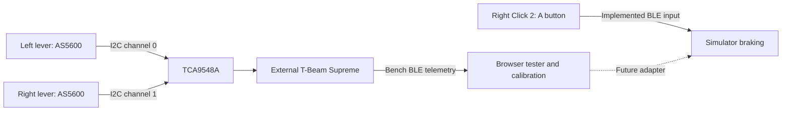

# Bluetooth brakes

[Project overview](../README.md) · [Simulator](simulator.md) · [Data acquisition](data-acquisition.md) · [Development log](../DEVELOPMENT_LOG.md)

This section brings together the working simulator input and a dedicated brake-lever prototype. The simulator already responds to the **A button on the right Zwift Click 2**. Printable lever files, T-Beam Supreme bench firmware and a browser Bluetooth tester are available for building and checking the custom controls. A physically verified custom device and proportional-brake integration with the simulator are still pending.

## Build and test the dedicated lever

**[Open the online workshop](https://mfarre.github.io/mtb-indoor-bern/workshop/)** for the illustrated assembly guide, bill of materials, complete encoder/multiplexer/controller wiring, firmware installation and startup steps.

- [Printable Maneta v01 files and editable CAD](../hardware/maneta-v01/README.md)
- [T-Beam Supreme firmware and build instructions](../firmware/brake-bench/README.md)
- [Open the Bluetooth bench tester](https://mfarre.github.io/mtb-indoor-bern/workshop/tester/) in desktop Chrome or Edge
- [Telemetry protocol](brake-protocol.md)

The bench tester reads both raw angles and magnetic health, supports local endpoint calibration and exports CSV. Its demo is labelled separately from live readings. The guide describes the original v01 geometry for general use; physical dimensions and sensor readings must be checked during assembly.

*AI-generated concept study, not a built prototype, a CAD model or a wiring specification. The enclosure, clamp and lever arrangement are illustrative. [Render provenance and prompt](brake-concept-render.md).*

### Maneta v01: render from the actual design

*Pull-and-release animation rendered directly in Blender from the supplied STL assembly. The lever rotates around its pivot and the spring follows its anchors. Materials, fastener details and cable routing are illustrative; this is not footage of a built prototype or a mechanical validation. [Animation details, original realistic still and CAD reference](brake-v01-render.md).*

Viewed from the rider's side: the trigger points **outward toward the right grip and bar end**, with the pivot inboard, as on a conventional bicycle brake lever.

## Working today

- Hold **A** on the right Click 2 to brake; release it to coast. Keyboard **A / Space** and the on-screen brake are also supported.
- **+** and **B** retain their MTB gear functions in this application.
- Braking changes virtual speed. It does not actuate the bicycle's physical brake or add braking load to the KICKR.
- Corner warnings, grip loss and runout penalties make braking useful on descents. [Downhill guide](downhill.md).
- A live ride pauses when the connected Click is lost, so the rider can recover brake input before continuing.

The recorded hardware check detected **six presses and six releases**, with no unintended shifts. This is evidence for the right Click 2 integration, not for a custom lever or proportional sensor. See the [19 November verification report](verification-downhill-2026-11-19.json).

## Dedicated brake accessory: design work

The project's initial discussion is available in the [shared Bluetooth brake planning conversation](https://chatgpt.com/share/6b02a20d-5db8-83eb-93a7-cbb479549aaa), with a [direct link to the design attachments and discussion](https://chatgpt.com/s/t_6b02aac7f4a8819189ca3bd0214c126f). The original design package supplies the v01 geometry. Its [OpenSCAD source and mirrored STL files](../hardware/maneta-v01/README.md) are now included here, with an English online assembly guide. These are prototype sources, not evidence of physical validation.

Each lever uses **six printed PETG parts**: a base, lever, upper guide, sensor cover, and two identical clamp halves. An exposed extension spring returns the lever; a rubber stop gives resistance near the end of travel. The nominal design uses a **22.2 mm handlebar tube, a 55 mm pivot-to-finger radius, and 22° of travel**. Those dimensions describe the CAD model and still need a physical fit check.

An **AS5600 measures the angle of a magnet on the pivot**, rather than finger force or hydraulic pressure. Four wires connect each lever to external electronics. The two-lever bench uses a TCA9548A and a single LilyGO T-Beam Supreme. The firmware sends both readings and diagnostic status over Bluetooth LE to the browser tester. Start on USB power for bench testing; battery operation and simulator integration require their own validation.

The existing controller path remains **pressed/released**: the game's `brakePressure` is a simulated response. Continuous lever-angle input will need its own adapter and calibration before it is supported.

## Hardware and manufacturer references

### Existing, tested input

| Hardware | Role in this project | Links and status |
| --- | --- | --- |
| Zwift Click 2, right controller | Wireless A-button braking and MTB shifting | [Official installation guide](https://support.zwift.com/de/installing-your-zwift-click-H1pXM6Zp) · [Official controller guide](https://support.zwift.com/de/using-your-zwift-click-S1by2SXWp). Tested in this app. The manufacturer's pages describe Zwift's own button assignments; this app uses the mapping above. |

### Maneta v01: bench hardware

Quantities are for **two levers**. The online workshop and source code provide assembly and bench-test instructions; physical operation still needs validation on the assembled hardware.

| Quantity and hardware | Role | Supplier and technical references |
| --- | --- | --- |
| 2 × AS5600 3.3 V modules with diametrically magnetized discs | Contactless lever-angle sensing; one sensor per pivot | [Bastelgarage module](https://www.bastelgarage.ch/arduino/as5600-magnetischer-12bit-encoder-3-3v) · [ams AS5600 datasheet, hosted by Adafruit](https://cdn-learn.adafruit.com/assets/assets/000/138/130/original/Magnetic_Rotary_Position_Sensor_AS5600_Datasheet.pdf). The CAD magnet seat is nominally Ø6 × 2.5 mm; check the supplied magnet before printing. |
| 1 × TCA9548A module | Separate I2C channels for the two angle sensors | [Bastelgarage module](https://www.bastelgarage.ch/arduino/modul-breakout-fur-arduino/8-kanal-i2c-multiplexer-tca9548a) · [Texas Instruments documentation](https://www.ti.com/product/TCA9548A) |
| 1 × LilyGO T-Beam Supreme and USB data cable | External controller and BLE connection to the bench tester | [LilyGO documentation, pin map and schematic](https://wiki.lilygo.cc/products/t-beam-series/t-beam-supreme/). The guide targets V3.1 CNC1 wiring and starts on USB power. Battery operation needs separate validation. |
| 1 × four-wire Qwiic cable, plus flexible wiring to both levers | Detachable connection between the central board and multiplexer | [HutoPi JST-SH Qwiic/STEMMA QT cable at Galaxus](https://www.galaxus.ch/de/s1/product/hutopi-jst-sh-cable-for-qwiic-and-stemma-qt-elektronikkabel-stecker-59730842), discussed as a connector-to-loose-wire option. Firmware must configure the selected connector pins for I2C; the connector alone does not establish the bus configuration. |
| 12 × printed PETG parts, 2 × springs, 2 × rubber stops, brass pins and fasteners | Mirrored mechanical controls and their handlebar clamps | Geometry and nominal hardware sizes come from `maneta.scad`, `planol.pdf` and `MUNTATGE.md` in the supplied package. Spring, rubber and fastener supplier part numbers are not yet fixed. |

This documentation does not change or provide instructions for modifying a bicycle's real braking system. The proposed accessory is an **indoor simulator input**.

## What needs to be recorded next

1. Physical fit and return behavior of the printed parts, spring and rubber stop.
2. Actual board, battery, magnet and sensor-module revisions; wiring and firmware revision.
3. Measured release/full-travel endpoints using the implemented bench calibration and telemetry format.
4. Measurements for release detection, repeatability, latency, disconnect handling and battery behavior.
5. Simulator integration and a dated test report before marking the custom device as supported.

## Source code for the existing integration

- [Bluetooth discovery, notifications and brake state](../src/MTBIndoorBern/BluetoothDevices.cs)
- [Input handling and ride state](../src/MTBIndoorBern/RideSession.cs)
- [Virtual braking, grip and recovery](../src/MTBIndoorBern/TrailHandling.cs)
- [Interface and disconnect handling](../src/MTBIndoorBern/RidePanel.cs)

Related: [downhill behavior](downhill.md), [bike calibration](bike-calibration.md), and [future recorded sensor streams](data-acquisition.md).
