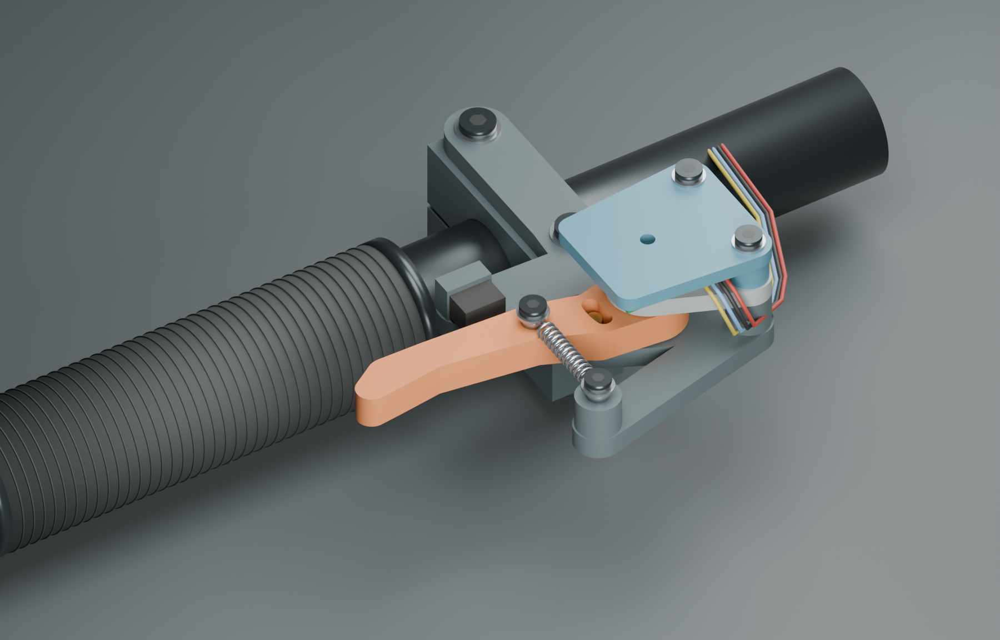

# Maneta v01 render provenance

[Bluetooth brakes](bluetooth-brakes.md) · [Development log](../DEVELOPMENT_LOG.md) · [Documentation index](README.md)

The realistic view beneath the earlier conceptual image is based on the owner's **Maneta-MTB-v01.zip** design package, supplied on 22 November 2026. Both pages of `planol.pdf`, `MUNTATGE.md`, the OpenSCAD assembly and the STL meshes were inspected before rendering.

## Published images

- [Realistic Maneta v01 render](images/bluetooth-brake-v01-realistic.png): built-in ImageGen surface and lighting treatment using the direct CAD render as its image reference.
- [Direct CAD reference](images/bluetooth-brake-v01-cad.png): Blender Cycles rendering of the supplied meshes, before the ImageGen treatment.



The original conceptual illustration remains above the realistic version in the brake guide and on the repository landing page. It records the earlier design exploration; it is not the geometry reference for this rendering.

## Source and assembly

The package contains the five printable shapes for each hand, `maneta.scad`, `planol.pdf` and `MUNTATGE.md`. Each assembled lever uses six printed PETG pieces because the clamp half is printed twice. The original archive and its files remain in the local working folder; they are not bundled with this documentation.

[Design-attachment conversation](https://chatgpt.com/s/t_6b02aac7f4a8819189ca3bd0214c126f) · [Initial planning discussion](https://chatgpt.com/share/6b02a20d-5db8-83eb-93a7-cbb479549aaa)

**Archive SHA-256:** `5e63dc93afddf633b9277a3e9b5ed62c21faf550c1b60a05819cefd13b896ba8`. The [source and asset manifest](brake-v01-sources.json) records individual file hashes, triangle counts and output dimensions.

The right-hand assembly follows the OpenSCAD transforms. Coordinates below are in millimetres; `(x,y,z)` is a point in the print-oriented STL.

| Part | Transform into the displayed assembly |
| --- | --- |
| Base | Unchanged |
| Lever | Rotate around Z by -8 degrees, then add 4.85 to Z |
| Upper guide | Add 12.15 to Z |
| Sensor cover | `(x, -y, 24.55-z)` |
| Upper clamp half | `(8-z, y-45, x-15.5)` |
| Lower clamp half | `(8-z, y-45, -x-15.5)` |

The contextual handlebar runs along X through Y=-45, Z=-15.5, with a 22.2 mm diameter. The CAD reference uses the original printed-part surfaces without smoothing modifiers, subdivision, bevels or remeshing. Duplicate triangle vertices are merged and normals recalculated. [Blender renderer and usage](../tools/brake-render/README.md).

## What is accurate, and what is illustrative

The reference fixes the six printed parts, their proportions and their assembled positions. The exposed spring anchors, rubber stop, magnet seat, cover hole and sensor arrangement follow the assembly notes and drawings. The realistic image was checked against this reference for meaningful changes in shape or missing components.

PETG colours and surface finish, the detailed spring coils, fastener recesses, sensor-board details, wire routing and the handlebar/grip appearance are visualization choices. ImageGen can interpret small details; use the original CAD and PDF for dimensions. The AS5600 PCB is under the cover. The four-wire lead goes to an external controller: the design does not specify a local Bluetooth pod or LED on the lever.

This is a rendering of a proposed mechanical prototype, not a photograph of a built device or evidence of fit, strength, sensor accuracy or working firmware. The package defines lever-angle sensing; it does not measure hydraulic pressure or finger force. The [hardware guide](bluetooth-brakes.md#maneta-v01-planned-hardware) records the proposed components and pending validation.

## Generation method and prompt

The direct reference was rendered in **Blender 4.5.16 LTS, Cycles, 48 samples**, with a right-hand lever angle of 8 degrees. The built-in **ImageGen** tool then processed that single local reference image with an opaque background. No API/CLI fallback was used. The generated file was copied into `docs/images/`; the original output was retained locally.

```text
Use case: precise-object-edit. Asset type: realistic product rendering for the open-source MTB Indoor - Bern brake hardware documentation. Edit the supplied CAD render into a polished photorealistic studio visualization. Input image 1 is the immutable geometry and camera reference, generated directly from the owner's Maneta-MTB-v01 STL meshes. Preserve the exact visible silhouette, proportions, part locations, 8-degree lever pose, camera angle, crop, two-piece rectangular handlebar clamp, orange slightly curved PETG lever, open frame, exposed steel extension spring between the two existing anchors, black rubber bumper, blue flat sensor cover with its small central hole and two mounting screws, and four thin coloured sensor wires. These parts must remain unmistakably the same design. Change only surface realism and lighting: subtle 0.2 mm FDM layer lines on all plastic parts including the orange lever and blue cover, natural matte PETG, plausible real steel washers and recessed hex socket screws, rubber grip texture, clean soft studio shadows and a restrained dark grey background. The grip is intentionally partly out of frame. Keep the four wires at the same path; they lead to external electronics, so no Bluetooth electronics box, LED, display, battery or hydraulic hose should be added to the lever. The coloured parts are printed plastic, not anodized metal. Do not redesign, move, duplicate, remove or smooth away any mechanical parts or holes. No person, no hands, no bicycle beyond this handlebar segment, no labels, text, logos, watermarks, arrows or graphic overlays. Opaque background. This is an engineering prototype visualization, not a manufactured commercial brake.
```
