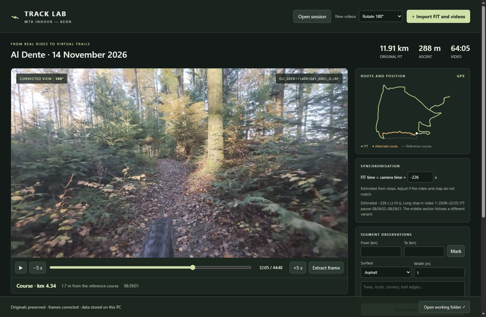
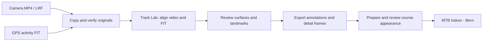

# Data acquisition

[Project overview](../README.md) · [Simulator](simulator.md) · [Bluetooth brakes](bluetooth-brakes.md) · [Development log](../DEVELOPMENT_LOG.md)

**Track Lab turns a ride recording into evidence for a course.** It brings camera footage and a GPS/FIT timeline together, lets you correct their clock offset, and saves observations about surfaces, widths and landmarks. The simulator consumes the resulting course assets after a separate review and preparation step.

The screenshot shows Track Lab in English. [Open the Track Lab guide](track-lab.md) for the controls, installation and build commands.

## Hardware and source files

These references document the equipment associated with the project, rather than a required shopping list. Manufacturer links were checked on 22 November 2026.

| Hardware | Role and evidence | Manufacturer documentation |
| --- | --- | --- |
| **DJI Osmo Action 5 Pro** | Camera used for the November trail survey. Both inspected recording metadata files identify the encoder as `DJI OsmoAction5 Pro`. Track Lab imports its MP4/LRF files and handles the 180° orientation correction needed by that recording. | [Product](https://www.dji.com/osmo-action-5-pro) · [Manuals and downloads](https://www.dji.com/osmo-action-5-pro/downloads) · [Support](https://www.dji.com/support/product/osmo-action-5-pro) |
| **Wahoo ELEMNT ROAM** | GPS bike computer used to record the supplied FIT activities. Its exact hardware generation has not been established, so no ROAM version is assumed. | [Identify the ELEMNT model](https://support.wahoofitness.com/hc/en-us/articles/21428327026578-Identify-an-ELEMNT-GPS-Computer) · [ELEMNT operating guide](https://support.wahoofitness.com/hc/en-us/articles/21001539547154-Use-an-ELEMNT-GPS-computer) |
| **Garmin HRM-Dual** | Heart-rate strap already used with the indoor simulator. It is a possible source for future aligned physiological data; the present Track Lab decoder does **not** import or display a heart-rate stream. | [Official manual](https://www8.garmin.com/manuals/webhelp/hrm-dual/EN-US/HRM-Dual_QSM_EN-US.pdf) · [Support and manuals](https://support.garmin.com/?productID=649059&tab=manuals) |
| **Windows PC and local storage** | Runs Track Lab and stores verified originals, previews and annotations. No specific storage device or camera mount model has been recorded. | [Software and build requirements](track-lab.md#build) |

The camera model is established from local file metadata. The raw metadata, personal route recordings and hardware identifiers are not included in this documentation.

## From a recording to a course

1. **Record and preserve.** Retain the original FIT and video files, including video timestamps. Import copies them to a new local session and verifies them with SHA-256.
2. **Align clocks.** Use a visible stop or recognisable location to estimate `FIT time = camera time + offset`. Inspect several points; a nearby GPS coordinate alone does not prove that the clocks match.
3. **Annotate the route.** Record surface, estimated width, segment limits and observations. Extract correctly oriented detail frames from the full-resolution MP4.
4. **Prepare course assets.** Export annotations for the course's appearance profile and inspect the result in the simulator. Track Lab does not rebuild the game automatically.

For routes without a recording, the [Swiss GPX import tools](../tools/course-import/README.md) combine a planned GPX with SWISSIMAGE, terrain and OpenStreetMap data. The [Gurten documentation](GURTEN.md) shows a map-based reconstruction supported by photographs. These sources complement field observations; they do not provide measured positions for every obstacle.

## Implemented and planned

| Capability | Current status |
| --- | --- |
| Verified local copying of FIT/ZIP and DJI video originals | Implemented |
| Video playback, rotation, thumbnails and full-resolution frame extraction | Implemented |
| FIT time, GPS, altitude, distance and speed timeline | Implemented |
| Manual clock offset and visual segment annotations | Implemented |
| Reference-course matching with variant and long-gap handling | Implemented |
| Independent GPX-to-course preparation tools | Implemented outside Track Lab |
| Aligned heart rate, power, cadence, IMU or brake-pressure streams | Planned; no Track Lab importer or visualisation yet |
| Live sensor capture or automatic sensor clock synchronisation | Planned; not part of the current viewer |

Additional sensors should join the same session timeline with their source, units, original timestamps, clock offset and confidence recorded explicitly. A useful next step is an adapter for time-stamped measurements plus alignment markers shared with the video. That is a design direction, not an existing data format or implemented API. The [Bluetooth brake work](bluetooth-brakes.md) can later provide another stream once its hardware and protocol have been validated.

## Data boundaries and source code

Source files live in [`src/TrackLab/`](../src/TrackLab/) and [`tools/track-lab/`](../tools/track-lab/). The viewer uses local files and does not connect to or control the KICKR or other sensors.

Full videos, FIT activities, working sessions, annotations and local configuration stay outside Git. Public examples contain selected screenshots and derived assets where documented. Surface and width observations are estimates; retain the uncertainty and avoid assigning observations from a route variant to a different line.

Next: [Track Lab usage and build](track-lab.md) · [GPX course preparation](../tools/course-import/README.md) · [Rendering asset provenance](render-assets.md).
