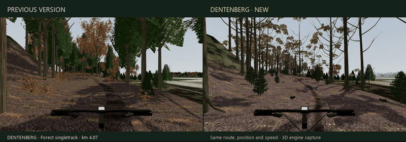
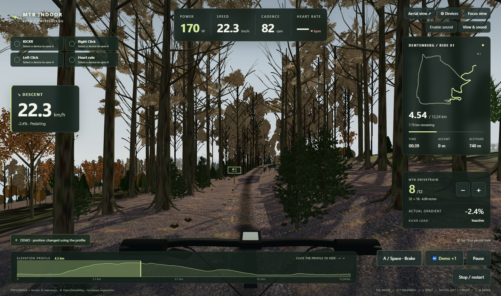

# Dentenberg · autumn woodland

[Simulator](simulator.md) · [Rendering assets](render-assets.md#dentenberg-autumn-textures) · [Track Lab](track-lab.md) · [Development log](../DEVELOPMENT_LOG.md)

The Dentenberg woodland update develops the autumn appearance of the course stored internally as `al-dente`. It uses the existing appearance annotations and the owner's previously imported DJI session as visual references. The aim is a more convincing leaf-covered singletrack, with tall trunks, a sparse autumn canopy and darker vegetation near the trail, while retaining the distinction between woodland, gravel approaches and open roads.

## Reference observations

The review used corrected frames and contact sheets already prepared by [Track Lab](track-lab.md). The original recordings were inverted in both axes; the existing previews and reference frames have the corresponding 180° correction. The recordings and extracted frames remain private.

Four representative views cover the open gravel approach and observed woodland around km 4.0–4.34. They show:

- Tall, fairly straight pale grey/brown trunks mixed with darker conifers, with visible spaces between them.
- An airy yellow/ochre canopy and branches, rather than uniformly dense orange foliage.
- Dark-green conifer saplings and low undergrowth beside the narrow trail, with some moss near trunk bases.
- Brown and tan fallen leaves over patches of darker earth. The shaded centre line is less bright and less uniformly covered than the margins.
- A pale gravel approach beside open green land, visually separate from the leaf-covered woodland.

These observations guide colour, silhouettes and density. They do not measure individual tree positions, identify every species or provide a photogrammetric reconstruction.

## Observed and inferred sections

The existing [`appearance.json`](../src/MTBIndoorBern/Scene/courses/al-dente/appearance.json) retains the route's surface, width and confidence information:

| Course section | Existing annotation |
| --- | --- |
| Km 1.80–2.36 | Observed road through woodland |
| Km 3.59–3.82 | Observed open gravel approach |
| Km 3.82–4.45 | Observed leaf-covered singletrack |
| Km 4.45–6.43 | Inferred woodland appearance: the recorded ride takes a different central variant |
| Km 6.43–6.48 | Observed leaf-covered exit |
| Km 6.48–6.90 | Observed road through woodland |

The inferred section borrows the general autumn setting. A stump, large tree, bend or obstacle seen on the different recorded variant is not transplanted as a surveyed landmark. The existing camera alignment has an estimated ±10-second uncertainty, so even the observed correspondence is not a precise survey.

## Rendering changes

The new treatment follows all existing `forest: true` sections, including the two woodland road sections. Open gravel and open asphalt keep their existing appearance. Leaf-covered singletrack gains a darker worn centre and softer transitions into the forest floor; it does not acquire a wider physical path.

Nearby woodland uses branching three-dimensional tree variants ranging from leafy to almost bare, together with darker evergreen saplings and bracken. The existing beech foliage asset is reused where available. It is generated artwork already included in the repository, not a private camera crop. Trees and undergrowth use repeatable placement and bounded nearby instance counts, rather than drawing detailed vegetation across the entire route. These are visual design choices, not surveyed vegetation locations or a frame-rate guarantee.

The implementation is separated into [woodland rendering and materials](../src/MTBIndoorBern/Scene/dentenberg-woodland.js) and [forest transitions, stable placement and spatial selection](../src/MTBIndoorBern/Scene/dentenberg-profile.js).

## Private references and public materials

The local video-derived `textures/forest-floor.jpg` and existing foliage asset remain separate from the new public material directory. The update does not overwrite the private crop or publish raw footage, extracted frames, FIT files or personal route coordinates.

When the local video texture is available, it takes precedence and supplies both colour and a subtle matching bump effect. The renderer does not place an unrelated stock normal map over that photograph. When it is absent, the public colour, normal and roughness maps provide a matching material set. The ground material tiles at approximately 2.1 m. If optional material files cannot load, the existing generated floor remains available; a missing stock texture must not prevent opening the course.

For a distributable ground material, the repository includes the **Forest Floor** diffuse, OpenGL normal and roughness maps from [eye-candy.xyz / Poly Haven](https://polyhaven.com/a/forest_floor), under [CC0 1.0](https://polyhaven.com/license). The original 1024×1024 files were restored from the local asset cache and verified against the publisher's file sizes and MD5 checksums; the manifest also records SHA-256 hashes. [Asset manifest](../src/MTBIndoorBern/Scene/assets/dentenberg/sources.json) · [Licence](../src/MTBIndoorBern/Scene/assets/dentenberg/LICENSE.md).

This generic material has sparser, brighter leaves than the observed woodland. Rendering choices such as muted colour, darker exposed earth and additional illustrative leaf detail adapt its appearance; they do not turn it into a photograph of the trail. Normal and roughness maps affect light response, not terrain elevation or grip.

## Ride behaviour and sound

The visual work preserves route coordinates, elevation, configured widths, slope, gearing, braking physics and trainer control. Scenery is illustrative and does not add measured obstacles or change the KICKR load.

Alongside this update, the requested drivetrain-noise removal deletes the freehub buzz and gear-shift clacks from the audio graph. Tyre rolling, wind, braking friction and corner scrub remain at their previous levels. The remaining seven synthesized buffers are unchanged; gear changes and coasting cannot create extra sound sources. Volume/mute controls, pause/hidden/stale-data fades and audio failure isolation remain available. See [audio behaviour and checks](../tools/ride-audio/README.md).

## Before and after

[Before still](images/dentenberg-woodland-before.png) · [After still](images/dentenberg-woodland-after.png) · [30-second comparison with the quieter soundtrack](images/dentenberg-woodland-comparison.mp4).

The comparison follows km 4.00–4.19 at the same speed, camera timing and resolution. Its 10 fps export is separate from the real-time measurement below. The silent GIF shows an eight-second excerpt; the video soundtrack uses the current application graph with drivetrain sounds removed.

## Validation and performance

The GTX 660 renderer-only benchmark used 1280×720, pixel ratio 1, a 30 fps target, five seconds of warm-up and 45 seconds from km 4.00 at 6.2 m/s. No frame captures or media encoding ran inside the measured loop.

| Measurement | Previous | Updated |
| --- | ---: | ---: |
| Delivered frame rate | 30.00 fps | 30.00 fps |
| Frame interval p95 | 33.4 ms | 33.4 ms |
| CPU submission p95 | 3.7 ms | 4.9 ms |
| Frames over 66.7 ms | 0 | 0 |

CPU submission time is not GPU execution time. These measurements do not establish connected-session or 60 fps performance. An isolated native demo at 1440×852 reported 30.0 fps after 45 seconds with no scene errors. An earlier short startup smoke overlapped the end of media export and contained a 1.78-second stalled frame; startup smoothness is not guaranteed by the steady renderer measurement.

Public and personal Windows Release builds and full self-tests passed. The [woodland suite](../tools/dentenberg/README.md) verified immutable road centreline/elevations, forest boundaries, fixed spatial pools, seeking, aerial view/fog, optional-asset failures and other-course isolation against both synthetic and private local data. The near-detail budgets are 96 trees, 110 saplings and 64 ferns. Audio, mouse shifting, brake keys, presentation and the existing El Tony geometry checks passed.

The installed application was checked in offline demo and retains all 15 protected settings/course files, including calibration, saved devices and private route imagery. Rollback copies are available locally. No new physical trainer, Click, heart-rate or prototype-brake test was performed. [Verification record](verification-dentenberg-2026-11-28.json) · [Reusable comparison tool](../tools/render-comparison/README.md).
