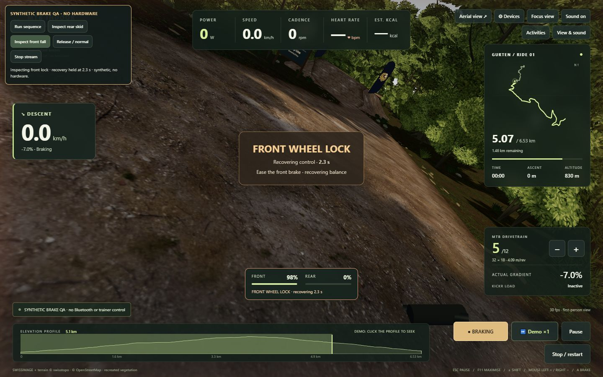

# Braking and the Dentenberg descent

[Project overview](../README.md) · [Simulator](simulator.md) · [Bluetooth brake project](bluetooth-brakes.md) · [Development log](../DEVELOPMENT_LOG.md)

Hold **A on the right Zwift Click 2** to brake; release it to coast again. You can also hold **Space**, the **A** key or the on-screen **A / Space · Brake** button. `+` shifts up and `B` shifts down, as before. Detection of A being pressed and released has been checked with the real controller.

The brake reduces virtual bicycle speed. **It does not apply a physical brake or increase KICKR load.** On descents, gravity moves the bicycle even at zero power. Small flat sections and rises may require pedalling during a real ride.

## Why braking helps

The central sign shows the direction of the next corner, distance to its entry and the game's target speed. The calculation uses route curvature, surface type and estimated width. Signs also appear within the scene. These values tune gameplay; they are not measurements of real grip or outdoor riding recommendations.

Entering slightly too fast causes a skid, visible lateral movement and loss of speed. Sustained excessive speed takes you off the riding line: the virtual bicycle stops for **3 seconds**, the timer continues and control then returns. Runouts are not random. Braking early lets you retain exit speed and avoid this penalty.

Climbs emphasise **gradient percentage**; descents show **speed**, gradient and whether you are braking or coasting. The grip indicator warns of a skid before control is lost.

## Two proportional levers

Pair and calibrate the board in **Brake setup**, after disconnecting the browser tester. Native and browser endpoint calibration are separate. The default mapping is left/front and right/rear, and can be swapped. The encoders measure lever travel, not finger force. Apply either lever gently for proportional slowing. Strong braking while moving produces wheel slip and a tyre-on-dirt skid sound. The rear brake gives less stopping power and can slide; a sustained near-full front pull at speed can cause a front-lock fall. [Pairing and calibration steps](bluetooth-brakes.md#simulator-setup).

The current rear-skid rule begins above **70% rear travel at 7.2 km/h or more**. Once braking has ramped in, at least **92% front travel for 0.25 seconds while moving at 14.4 km/h or more** can trigger a front-lock fall. These are game thresholds, not sensor force readings or measured tyre limits.

During a front-lock fall the camera tips and drops towards the ground, virtual progress stops for **three seconds**, and the ride/descent timers continue. Release the front lever before it can trigger another fall. Pausing, seeking or restarting clears the presentation effect. These thresholds are gameplay tuning, not a model of real bicycle stability or outdoor braking advice.

*Renderer/HUD check using synthetic host telemetry, not a physical lever test. [Rear-skid example](images/brake-simulator-rear-skid.jpg).*

The balanced Click/Space/on-screen brake stays available and cannot cause a front-lock fall by itself. Invalid Bluetooth lever input, or 750 ms without advancing telemetry, releases the affected brake; it never pauses the ride. Each channel needs at least 200 ms of fresh readings at or below 5% travel before re-arming. The chain/freehub buzz remains absent, and the short confirmed gear-change click remains enabled.

## Practice and personal records

**Practise the descent · Dentenberg · forest descent** on the welcome screen places you 55 m before the sector starts. It needs no sensors and does not control the KICKR. It uses the same braking and grip as a real ride, with automatic propulsion on flat sections and rises so you can complete it using only the controls. **Explore in demo** remains available at ×1, ×2, ×4 and ×8; this automatic tour does not score a time. Proportional brake skids and front-lock falls can be explored in demo, with risk based on normal riding speed rather than the accelerated tour multiplier.

The timed **Dentenberg · forest descent** sector covers **km 4.480–6.980 of the existing Al Dente course**. It is not a second imported track. `handling.json` defines the sector boundaries and can define sectors for other courses.

During a real ride, timing starts when you cross the start line and ends at the finish. It includes stops and recoveries. Your best time is saved to `records.json` beside the executable and reappears when the app reopens. Pausing within the sector invalidates the time; practice and demo sessions cannot set records either. Changes to the route or grip model separate older records from new ones.

If a Click disconnects during a real ride, the route keeps moving and that controller's held brake input is released. The other Click and keyboard/on-screen controls remain available while reconnection runs. For backup shifting, click the 3D trail with the left mouse button to shift up or the right button to shift down. Keyboard and on-screen braking release when focus is lost; input messages expire to prevent a stuck brake if the view is interrupted. Trainer telemetry loss and an interrupted 3D view still release load and pause the ride.

## Verification

The built-in tests cover A decoding, release, A+B, braking on a −20% slope, gravity starts at 0 W, time-step stability, excessive corner-entry speed, timing, pausing and record persistence. Run `build.ps1 -SelfTest` to repeat them with the local course data.

The automated descent test, including its approach, takes **384.3 s with 4 runouts** without braking, compared with **365.1 s and no runouts** with anticipatory braking. This compares simulations using practice propulsion; it is neither a pedalling test nor a personal record.

Ground geometry was also corrected at corners where the route revisits the same path with small GPS/barometric elevation differences. A continuous mesh prevents overlapping terrain strips, and the surface of the distant pass is hidden immediately around the rider. Route elevations and physics are preserved.

Click 2 protocol: `0x23` packets contain an active-low button mask; A corresponds to `0x10`. Community reference: [zwiftplay protocol discussion](https://github.com/ajchellew/zwiftplay/issues/5).
