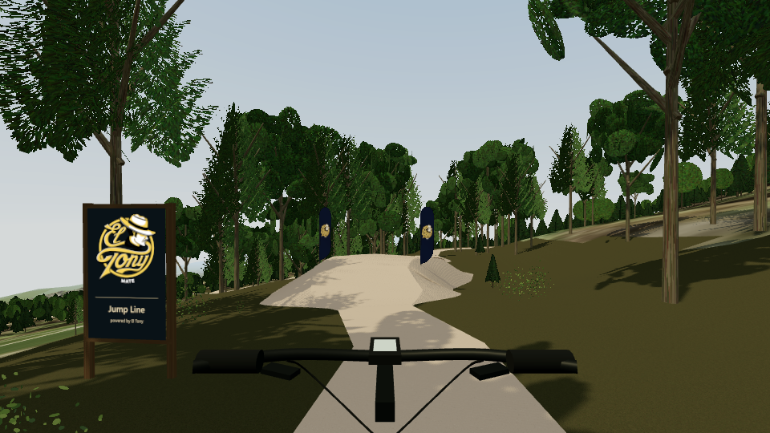
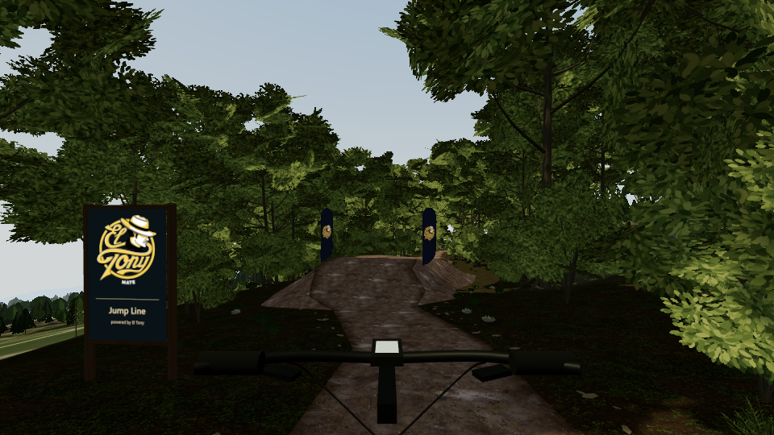
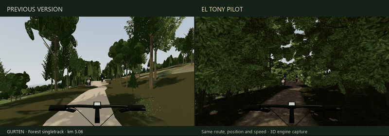
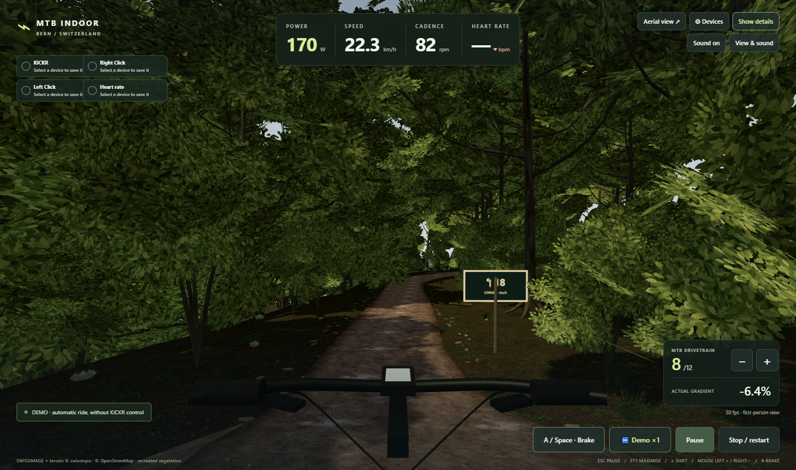
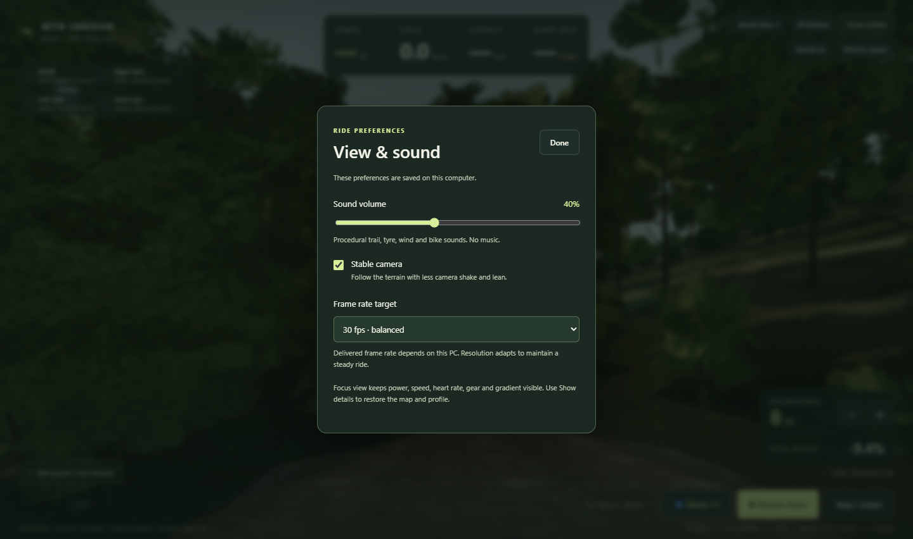

# El Tony · graphics and ride audio pilot

[Simulator](simulator.md) · [Gurten course](GURTEN.md) · [Asset sources](render-assets.md) · [Development log](../DEVELOPMENT_LOG.md)

This pilot improves the woodland around the El Tony section of Gurtentrail, from **km 4.97 to km 5.31** of the simulator's Gurten course. It tests a more detailed trail surface, irregular margins, nearby broadleaf trees, undergrowth and gentler transitions in light before applying the approach to longer routes.

Select **Gurten** and use **El Tony ↗** to preview the area. Demo mode supports pause, resume, profile seeking and accelerated travel. The pilot's scenery is local to this section; the new view and sound controls are available throughout the simulator.

## Before and after

[Watch the comparison video with synthesized ride audio](images/el-tony-pilot-comparison.mp4). The GIF is silent. Both versions follow the same route positions, camera timing, resolution and speed; the export is a deterministic rendering comparison, not evidence of real-time frame rate.

## Visual references and scope

The [trailnet opening recap](https://www.trailnet.ch/de/aktuell/recap---opening-gurtentrail-2-0) and [TRIEBHAUS Gurtentrail project photographs](https://www.triebhaus.ch/projekte/gurtentrail) inform the woodland, constructed earth features and El Tony branding. These photographs are reference material and are not bundled or projected onto the terrain. The pilot is a recreation, **not photogrammetry or a surveyed digital twin**.

Generic CC0 ground materials from Poly Haven provide colour, normal and roughness maps. They add small surface detail to the existing geometry. The trees, ferns, leaf litter, stones and branches are generated in code with repeatable placement. The [asset guide](render-assets.md#el-tony-pilot) records their sources and limits.

The El Tony sign and flags remain interpretations of the photographed trail signage. Their placement and dimensions are approximate. The logo retains its existing attribution and trademark status; its appearance here does not imply app sponsorship. See the [Gurten feature documentation](GURTEN.md#jumps-berms-and-el-tony).

The pilot does not change route coordinates, elevations, bike dynamics, gearing, trainer load, Bluetooth control or jump physics. The camera follows the same course and visual feature heights as before. There is still no airborne simulation. Rendering detail, surface shading and camera presentation cannot introduce extra KICKR resistance.

## View and sound

| Control | Behaviour |

| --- | --- |

| **Focus view** | Reduces the visible ride details while retaining essential telemetry and ride controls. **Show details** restores the full interface. |

| **View & sound** | Opens volume, stable camera and target frame rate settings. |

| **Sound on/off** | Enables or mutes the ride sound. A user gesture is required before audio can start. |

| **Volume** | Saved independently of the bike profile; the default is 35%. |

| **Stable camera** | Reduces cosmetic movement without flattening the route or changing its gradient. Enabled by default. |

| **Target frame rate** | Selects a 30 or 60 fps rendering target. The default is 30; this is a target, not a performance guarantee. |

These preferences persist across application restarts and do not invalidate bike calibration. The view interpolates between host positions for smoother motion and resets its interpolation on a seek or new session. It does not advance the simulation beyond the latest received position.

| Focus view in an offline demo | Saved view and sound preferences |

| --- | --- |

|  |  |

The demo's power and cadence are simulated. Heart rate remains blank without a sensor. The preferences screenshot shows a test value of 40%; a fresh profile defaults to 35%.

The sound combines earth, gravel, asphalt and leaf rolling textures, speed-dependent wind, a coasting freehub, confirmed gear changes, braking friction and restrained corner scrub. It is **original procedural synthesis, not a recording from the trail**. No music, third-party sound samples, invented landing impacts or wheel-lock measurements are included.

Live riding uses the host's power and cadence information for coasting. Demo and practice have explicit synthetic states, since their displayed cadence is not measured. Accelerated demo travel keeps a natural audio rate; practice follows its simulated speed. Pausing, stopping, hiding the view or losing fresh host updates fades the sound. Audio failure leaves the ride and trainer controls operational. See [audio behaviour and tests](../tools/ride-audio/README.md).

## Verification and performance

The comparison tool separates three tasks:

| Mode | What it establishes |

| --- | --- |

| `capture` | Repeatable pictures at fixed route positions. Screenshot export time is not a frame-rate measurement. |

| `benchmark` | Real-time renderer-only frame intervals and CPU submission timings after warm-up, without screenshot work in the measured loop. It excludes the full app UI, Bluetooth and live audio. |

| `audio` | The application's actual Web Audio graph rendered offline along the comparison's coasting trajectory, using the surface metadata under the bike. It is not microphone capture or a recorded training session. |

Measured on 28 November 2026 with an **NVIDIA GeForce GTX 660**, WebView2/D3D11, **1280×720**, pixel ratio **1** and a **30 fps target**. Each run has 5 seconds of stationary warm-up. The Gurten path covers 45 seconds from km 4.97 at 6.2 m/s; the Eiger control covers 30 seconds from km 8.80.

| Renderer-only run | Delivered fps | Frame interval p95 | CPU submission p95 | Intervals over 66.7 ms |
| --- | ---: | ---: | ---: | ---: |
| Gurten previous | 30.04 | 33.5 ms | 4.6 ms | 0 |
| Gurten pilot | 29.93 | 33.4 ms | 6.2 ms | 1 |
| Eiger previous | 30.00 | 33.4 ms | 6.2 ms | 0 |
| Eiger current | 30.00 | 33.4 ms | 6.1 ms | 0 |

The pilot maintains approximately 30 fps in this measured section, with more CPU submission work and one approximately 150 ms hitch. Optional shader prewarming completed during loading but did not remove that isolated hitch; its cause remains unconfirmed. The first pilot pass also had one hitch. This is not a claim of perfectly even rendering or a 60 fps capability. CPU submission duration is not GPU render time, and these results exclude the full HUD, Bluetooth and live audio. [Recorded verification](verification-el-tony-pilot-2026-11-28.json).

Automated checks cover presentation settings, snapshot ordering and seek resets, audio mode adapters, source reuse, stale-data fades and failure isolation. **No new physical KICKR, Zwift Click, heart-rate or prototype-brake validation is claimed by this pilot.** Existing control and physics behaviour remains the baseline.

The [comparison tool instructions](../tools/render-comparison/README.md) explain reproduction. The implementation is split between [pilot geometry and materials](../src/MTBIndoorBern/Scene/el-tony-pilot.js), [pilot bounds and repeatable placement](../src/MTBIndoorBern/Scene/el-tony-profile.js), [presentation](../src/MTBIndoorBern/Scene/ride-presentation.js) and [audio](../src/MTBIndoorBern/Scene/ride-audio.js).
