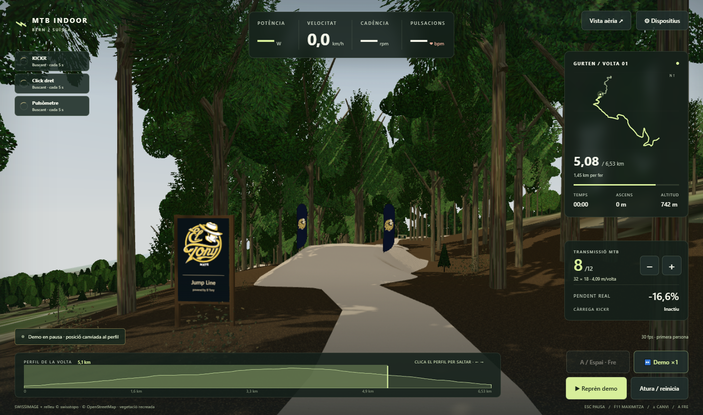
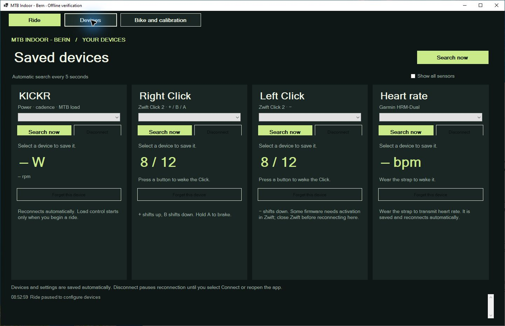

# Indoor MTB simulator

[Project overview](../README.md) · [Development log](../DEVELOPMENT_LOG.md) · [Data acquisition](data-acquisition.md) · [Bluetooth brakes](bluetooth-brakes.md)

**MTB Indoor - Bern** is a Windows simulator with Swiss 3D courses, Bluetooth connectivity to a Wahoo KICKR, virtual MTB gearing and heart-rate data. It has been tested with a **KICKR CORE, right Zwift Click 2 and Garmin HRM-Dual**. Uetliberg, Gurten and Eiger Bike Challenge 20 km are included in the public repository; the local installation also has Dentenberg (Al Dente).



The simulator interface and documentation are in English. Screenshots illustrate the English interface; dated captures may predate newer controls.

## Features

- 3D courses with SWISSIMAGE aerial imagery, elevation data, buildings, vegetation, shadows, textured roads and a handlebar view.
- Consistent geographical gradient: the road, motion physics and trainer control start from the same elevation profile. The trainer averages the surrounding 40 m and ramps terrain-driven load changes; the rendered road, gradient display and virtual motion retain the local slope. Gurten's visual jump shapes do not pulse the KICKR load.
- Live power, cadence, heart rate, speed, distance, altitude, elevation profile and estimated exercise calories from measured trainer power.
- Local recordings of real trainer rides, with pause-aware TCX export and a button opening Strava’s manual file uploader. Demo and practice are excluded. See [activities, calories and Strava](activities-strava.md).
- Saved volume/mute controls, seven continuous rolling/wind/braking sound layers and a brief click for a host-confirmed successful gear change. Chain/freehub buzz remains removed.
- Configurable MTB gearing: **10–51, 10–52 and 11–46** presets, a custom cassette, and 20–60-tooth chainrings.
- Independent left and right Click connections, without BikeControl, plus mouse and keyboard gear controls.
- Virtual braking with A / Space, corner warnings, grip and runout penalties; downhill practice, timing and persistent personal records.
- Remembered devices, separate connection indicators on the main screen and automatic searches every five seconds. Optional Click and heart-rate failures do not pause a ride.
- A saved bike profile and optional guided KICKR response test. Rider/bike weights, wheel, drivetrain, assistance, gradient scaling, course and calibration result are remembered.
- First-person and aerial views; demo speeds of ×1, ×2, ×4 and ×8 without controlling the trainer.
- Three selectable starting sectors on Eiger Bike Challenge 20 km, with summer Alpine scenery and race furniture.
- A separate course catalog, editable appearance profiles and support for additional routes. Gurten adds approximate jumps and berms based on official references, El Tony signage and a direct demo preview.
- Video-informed autumn surfaces and vegetation for Al Dente. [Track Lab](track-lab.md) imports, aligns, reviews and annotates local FIT/video sessions; see the separate [data acquisition section](data-acquisition.md).

## Courses and data

| Course | Length | Availability and source |
| --- | --- | --- |
| Dentenberg / Al Dente | 12.24 km | Local assets, prepared from a recorded FIT and video references |
| Uetliberg | 25.75 km | Included; planned GPX through Zurich, Triemli, Uto Kulm and Ringlikon |
| Gurten | 6.53 km | Included; mapped climb from Il Brunello in Kehrsatz and Gurtentrail descent to Wabern |
| Eiger Bike Challenge 20 km | 19.48 km | Included; organisers' published GPX around Grindelwald, with three training starts |

[`Scene/courses.json`](../src/MTBIndoorBern/Scene/courses.json) defines the catalog. Each course has a folder with `route.json`, `world.json` and `aerial.jpg`. The selector only shows courses with these essential assets installed. A whole-course ride starts at km 0. On courses with starting sectors, the **Start from** selector previews the selected entry point before **Start ride** or **Explore in demo**.

**Uetliberg:** [`Scene/courses/uetliberg/`](../src/MTBIndoorBern/Scene/courses/uetliberg/) includes the route, terrain, orthophoto, appearance profile and provenance. It can be built and explored directly. OpenStreetMap-derived data retains its ODbL license and swisstopo data retains its attribution.

**Gurten:** [`Scene/courses/gurten/`](../src/MTBIndoorBern/Scene/courses/gurten/) includes the route assembled from public map data, terrain, orthophoto, appearance, visual features and provenance. It is not based on a personal FIT or recording. The [Gurten guide](GURTEN.md) distinguishes the mapped route from the approximate obstacles. The route ends in Wabern; it does not loop back to the restaurant. A short walking connector at the trail entrance is documented explicitly. Jump shapes affect the rendered road and camera, with no airborne physics.

**Dentenberg:** `route.json`, `world.json`, `aerial.jpg` and the video-derived ground texture remain in the local installation. Supply those assets in `Scene/courses/al-dente/` to enable the course. Missing elevations were interpolated, noise was smoothed and nearby terrain was adapted to the same elevation profile used by the simulation. The original FIT is not included. Personal FIT files, complete videos, sessions and sensor identifiers are not published.

**Eiger Bike Challenge 20 km:** [`Scene/courses/eiger-20/`](../src/MTBIndoorBern/Scene/courses/eiger-20/) includes the official downloadable route, SWISSIMAGE orthophoto, near and distant Alpine terrain, mapped buildings and summer appearance. Choose the full route or any of three sectors and ride through to the finish. The [Eiger guide](EIGER.md) explains sources, splits and race scenery.

[GPX import tools](../tools/course-import/README.md) prepare Swiss courses from the command line. Adding a course to the catalog and reviewing its appearance remain manual steps.

## Requirements

- 64-bit Windows 10 version 2004 or later, or Windows 11.
- Bluetooth LE for sensors and a graphics card supporting WebGL 2.
- [Microsoft Edge WebView2 Runtime](https://developer.microsoft.com/microsoft-edge/webview2/), normally already installed on Windows.
- [.NET 10 SDK](https://dotnet.microsoft.com/download/dotnet/10.0) to build. Published output includes the .NET runtime.

The recorded graphics checks on an i5-6500 with a 2 GB GTX 660 maintained **30 FPS at 1440×852** in the inspected views. The renderer reduces resolution when performance drops; this is a measured result for those views, not a guarantee for every scene or PC.

## Build and run

From PowerShell at the repository root:

```powershell
.\build.ps1 -SelfTest
.\artifacts\publish\win-x64\MTBIndoorBern.exe
```

Or publish directly with the SDK:

```powershell
dotnet publish src/MTBIndoorBern/MTBIndoorBern.csproj -c Release -r win-x64 --self-contained true -p:PublishSingleFile=true -p:IncludeNativeLibrariesForSelfExtract=true -o artifacts/publish/win-x64
```

Keep the `Scene` folder beside the executable. Imagery, terrain and Three.js are local, so courses load without a map API or Google account. The initial build needs access to NuGet.

## First connection

1. Power on the KICKR, put on the heart-rate strap and press a button on each Click to wake it.
2. Open **Devices**, select each sensor and press **Connect**. **Right Click** and **Left Click** are separate slots; a previously saved right Click remains in the right slot.
3. Open **Bike and calibration**, set the weights, wheel and drivetrain, then press **Save profile**. The guided response test is optional.
4. Pedal for a few seconds until power and cadence arrive, then press **Start ride**.

The public repository starts with no paired sensors. Once connected, devices are remembered in `settings.json` beside the executable; this file is excluded from Git. **Disconnect** pauses reconnection until **Connect** is pressed or the app is reopened. **Forget this device** removes the saved pairing.

The main screen shows the KICKR, both Clicks, heart rate and optional Bluetooth brakes. **Waiting for data** means Bluetooth is connected but no usable button or pulse reading has arrived yet; press a Click button to confirm input. **No recent data** on the heart-rate sensor means its last pulse sample is stale. A battery or connection update alone does not count as a pulse reading. Missing or stale heart rate is shown as a dash with a waiting/no-recent-pulse label instead of retaining an old number.

Heart-rate readings become stale after eight seconds; a connection without fresh pulse data is retried after 20 seconds through the normal search loop. A Click stays confirmed during ordinary idle periods. If a Click reports **Zwift activation requested**, it has not yet confirmed usable input: activation through Zwift is not implemented by this app. Use the backup controls until it is activated and sending button events.

The Clicks, heart-rate strap and proportional brake board are optional for riding. Open **Brake setup** to pair the board, calibrate both levers and choose their front/rear mapping. See the [lever setup guide](bluetooth-brakes.md#simulator-setup). A Click disconnect releases that controller's held brake input and starts reconnection without pausing the route or changing the gear. The other controller, mouse, keyboard and on-screen controls remain usable. Loss of fresh trainer telemetry or an interrupted 3D view still pauses the ride and releases trainer load.



*Native offline verification capture. Both Click slots are visible; no hardware connection is claimed by this screenshot.*

## Controls

| Control or on-screen label | Action |
| --- | --- |
| Right Click `+` / keyboard `+` | Shift up |
| Right Click `B` / keyboard `B` or `−` | Shift down |
| Left Click `−` | Shift down |
| Left mouse click on the 3D trail | Shift up during a ride or moving demo |
| Right mouse click on the 3D trail | Shift down during a ride or moving demo |
| Right Click `A` / keyboard `A` or Space / brake button | Hold the balanced backup brake; release to coast |
| Calibrated Bluetooth levers | Independent proportional front/rear braking; strong pulls can skid, and sustained excessive front braking at speed can cause a fall |
| Brake setup | Pair the board, save endpoint calibration and choose left/right mapping |
| Practise the descent · … | Start before the selected course's downhill section, without trainer control or a record |
| Escape / Pause | Pause and release trainer control |
| Resume demo | Continue a paused demo from the same position |
| Click the elevation profile / arrow keys | Seek to a position in demo mode, including while paused |
| Stop / restart | Return to the selected starting point |
| Start from, on Eiger | Choose the whole route or one of three sectors before riding/demo |
| F11 | Toggle the maximized window |
| Aerial view | Change camera |
| Activities | Pause and review saved real rides |
| 1 · Save TCX, in Activities | Save the selected workout to a local file |
| 2 · Open Strava ↗, after export | Open Strava’s uploader; select the file and review it there |
| Explore in demo | Travel through the course without controlling the trainer |
| **⏩ Demo ×1** | Cycle demo speed through ×1 → ×2 → ×4 → ×8 |
| **El Tony ↗**, on Gurten | Open a demo before the jump with the El Tony sign |

When the elevation profile has focus, arrows seek 100 m, Shift + arrow seeks 1 km, and Home/End go to the endpoints. Pausing preserves demo speed and position. A seek preserves the paused/running state and does not create a record. See the [downhill guide](downhill.md) for grip, penalties and record eligibility.

Mouse shifting applies only to a click on the 3D scene. Buttons, menus, the map, elevation-profile seeking, brake input and bike/calibration dialogs keep their own behavior. Dragging, touch input and clicks with modifier keys do not shift gears.

The left stream ignores mirrored right-side `+`, `A` and `B` events, so a single physical press cannot shift twice through both connections. Right `B` remains available as a one-controller fallback.

## Calories and saved activities

**EST. KCAL** is an estimate from measured power, using a fixed 24% cycling-efficiency assumption. Pauses, rejected/missing data, resting metabolism, demo and practice do not add workout calories. It is separate from the rider/bike weights and trainer-response calibration.

Open **Activities** to review recent local workouts. **1 · Save TCX** writes a file; **2 · Open Strava ↗** opens the browser uploader. Select that file on Strava, mark it as an indoor ride, and review its details and visibility before saving. The simulator does not upload automatically or report that opening the page means publication succeeded.

Recordings contain timestamps, measured power and available cadence/heart rate, with virtual distance and estimated calories. They contain no GPS coordinates or outdoor elevation. Checkpoints and completed rides remain in the private `activities` directory beside the executable, including recovery backups; they are excluded from the public repository. Read the [activity and Strava guide](activities-strava.md) for the formula, recovery behaviour and format limitations.

## MTB gearing and trainer load

Gear 1 is the lowest: **32×51** with the initial profile. Cassette, chainring and wheel circumference are configurable. Load depends on gradient, total weight, surface, gear and cadence; virtual speed comes from measured power and the same force model.

Trainer gradient is averaged across 40 m of the route, using its actual horizontal path length through bends. Resistance increases use the saved torque ramp; ordinary terrain-driven reductions are limited to twice that rate. Shifting to an easier gear, low-cadence assistance and a zero target still reduce load promptly. The model retains a 600 W cap. Pausing or closing releases control, and reconnecting the trainer does not restart the effort. Gradient scaling affects KICKR load while the virtual route retains the full geographical gradient. The existing bike profile and calibration remain valid.

The optional guided test refines response transitions without changing measured watts or certifying their accuracy. Read the [bike and calibration guide](bike-calibration.md) for equations, thresholds and model limitations.

The Click button provides balanced backup braking alongside the two proportional Bluetooth levers. The [Bluetooth brake guide](bluetooth-brakes.md) documents assembly, native pairing and calibration, and the remaining physical validation.

## Repository structure

```text
src/MTBIndoorBern/
  BluetoothDevices.cs  Sensor discovery and data
  Equipment.cs         Pairing and reconnection
  Preferences.cs       Persistent local settings
  TrainerControl.cs    FTMS commands and acknowledgements
  RideSession.cs       Physics, gearing and ride state
  RideActivity.cs      Measured-work estimate and real-ride samples
  ActivityStore.cs     Private local recordings and recovery
  ActivityExport.cs    Indoor TCX export for manual upload
  RidePanel.cs         WinForms-to-3D-view bridge
  Scene/               Interface, Three.js renderer and courses
docs/images/           Application captures
src/TrackLab/          Video/FIT observation viewer and editor
tools/track-lab/       Verified import, decoding and frame extraction
build.ps1             Build and basic checks
```

## Verification and current limitations

Tests cover BLE/FTMS packets, gradients across installed courses, uphill starts, gear direction, low-cadence load reduction, load limits, pausing, persistence and sensor identity. A previous physical pedaling test confirmed reduced load when shifting from gear 3 to gear 1 and returning to flat terrain, with acknowledgements for every KICKR command.

Previous physical checks used **KICKR CORE**, **right Zwift Click 2** and **Garmin HRM-Dual**. Separate left/right connections and recovery are implemented; a physical session with both Clicks, repeated disconnect/reconnect and live heart-rate recovery is still pending. Other trainers have not been validated. The guided response-calibration milestone used a simulated trainer; a completed physical guided test is not claimed. The project is not a full photogrammetric reconstruction or an official Wahoo, Zwift or Garmin integration.

Run `node tools/ride-input/test.mjs` for the mouse-input regression checks. They cover gear direction, active versus paused modes, control/dialog isolation, modifiers, drag cancellation and loss of focus without connecting hardware.

Activity recording and TCX checks cover measured-work integration, pauses and sensor gaps, demo exclusion, UTC timestamps, missing sensor fields, partial-course starts, atomic storage and backup recovery. A synthetic export passed the official Garmin TCX v2 and ActivityExtension v2 schemas. Those offline tests do not establish successful Strava ingestion or a new physical recording session.

Historical build, physics, interface and rendering evidence is linked from the [development log](../DEVELOPMENT_LOG.md). Performance captures and hardware checks describe the conditions actually tested.

## Sources and credits

- Aerial imagery and elevation: **© swisstopo**, [SWISSIMAGE](https://www.swisstopo.admin.ch/en/orthoimage-swissimage-10) and [map services](https://docs.geo.admin.ch/visualize-data/xyz.html). Local Dentenberg uses a WMTS zoom-17 mosaic at 4864×3840; included Uetliberg uses zoom 16 at 4352×5120; included Gurten uses zoom 17 at 4352×4096. These mosaics do not retain the full native 10 cm resolution.
- Woodland and building map data: **© [OpenStreetMap contributors](https://www.openstreetmap.org/copyright)**.
- Gurtentrail references: [trailnet](https://www.trailnet.ch/de/trails/gurten-trail), [Gurtenpark](https://www.gurtenpark.ch/de-ch/freizeit/downhill-trail), [TRIEBHAUS signage](https://www.triebhaus.ch/projekte/gurtentrail) and [official opening photographs](https://www.trailnet.ch/de/aktuell/recap---opening-gurtentrail-2-0). The [El Tony logo](https://www.eltonymate.com/site/templates/images/El-Tony-Mate-Logo.png) depicts real trail signage and does not imply sponsorship of this app.
- Three.js: MIT license included at [`Scene/vendor/LICENSE`](../src/MTBIndoorBern/Scene/vendor/LICENSE).
- Microsoft WebView2: NuGet dependency under Microsoft's terms.
- Model references: [Shimano 12-speed drivetrain compatibility](https://productinfo.shimano.com/pdfs/product/archive/2020-2021_Compatibility_v035_en.pdf) and [Wahoo power-control behavior](https://support.wahoofitness.com/hc/en-us/articles/4402565516946-A-Guide-to-using-ERG-mode).

See [third-party notices](../THIRD_PARTY_NOTICES.md) for included resources and their terms.
